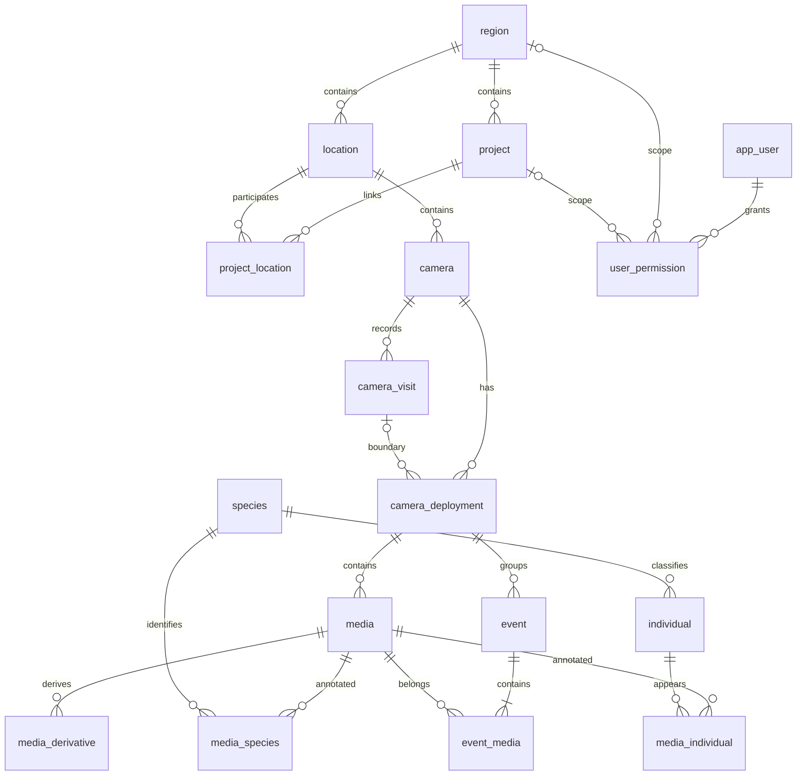

# 红外相机数据管理平台数据库设计文档

V1.5 · 2026-11-05 · PostgreSQL + PostGIS

依据《database_design_guide.md》修订的一期设计。本文完整描述本版模型，可独立用于评审及后续开发。设计文档更新不表示程序、数据库迁移或生产数据已经更新。

## 1. 版本依据与范围

### 1.1 依据及冲突处理

本版直接依据用户提供的[数据库设计指南](https://github.com/xuneree/WildlifeDATA/blob/main/docs/database/database_design_guide.md)，以前版[数据库设计 V1.4](https://github.com/xuneree/WildlifeDATA/blob/main/docs/database/wildlife_database_design_v1_4.md)为修订基线，并参考[总体需求 V1.3](https://github.com/xuneree/WildlifeDATA/blob/main/docs/requirements/platform-requirements-v1_3.md)。读取的仓库快照为 `3bb1c71d5bd0cf7b09c23fc32a5631ae6d4f1abc`，指南文件 blob 为 `306672e3e06ea0f2709b90b2dc3760c0c467eaf3`。

发生冲突时，以此次指南为准。因此，旧版“一级区域—二级区域—位点”改为“区域下分别管理项目与位点”；旧版一期亲缘关系取消；账号三角色改为账号类型与分范围权限。旧文档仅作历史参考，不能把两套规则同时用于新实现。

文中“指南要求”表示此次明确提出的业务原则；“本版实现建议”表示为完成可落地模型所采用的方案；“待明确”表示尚无业务结论。本版给出可继续设计的暂定方案，不把未决问题写成已确认需求。

### 1.2 一期与后续边界

一期包括：区域和项目、共享位点、机位、操作记录、布设周期、媒体及派生文件、XMP 物种标签导入、Excel 个体标签导入、个体档案与多角度代表图、历史编号、媒体标签底表、账号授权、审计和查询统计支撑。标签底表不等于完整素材库的选编、裁剪、发布功能已经纳入一期。

一期不增加实体相机库存管理，不增加个体关系表。已有个体关系数据须归档保留。人工个体标注工具、繁殖记录、家域可视化和模板报告沿用后续规划；物种 AI 的交付阶段仍另定。RAI 仍保留一期设计支撑，但正式计算口径须先确定。

### 1.3 相对 V1.4 的主要变化

| 主题 | V1.4 | V1.5 |
| --- | --- | --- |
| 数据组织 | 两级区域、位点 | 固定区域；区域下项目与位点并列，通过 project_location 多对多关联 |
| 相机含义 | 周期内 device_code 字符串 | camera 独立表示位点内机位，非实体设备 |
| 现场记录 | 工作、维护、回收混在周期内 | camera_visit 保存现场操作，camera_deployment 保存操作之间的周期 |
| 周期状态 | 主要为已结束周期 | 支持开放周期、已闭合周期及未补齐边界的历史周期 |
| 时间校准 | 媒体单独校准 | 周期统一秒偏移；历史媒体单独校准保留为优先覆盖值 |
| 当前标签 | species_annotation、individual_occurrence | media_species、media_individual，保留导入来源及覆盖历史 |
| 个体档案 | 主要为豹；代表图无结构化角度 | 支持豹、兔狲等物种；代表图有角度、部位，支持拼合图 |
| 个体关系 | 一期 | 一期不纳入，历史数据归档 |
| 账号权限 | admin/operator/viewer 与区域范围 | admin/normal 账号类型；区域、项目分别授权，取较高有效权限 |
| 素材标签 | 主要支撑未知个体标签 | 保留系统标签并补齐素材标签、标记人和素材描述字段 |

## 2. 业务对象与关系

### 2.1 名词与基数

| 对象 | 定义及归属 | 例子 |
| --- | --- | --- |
| region | 独立管理数据的固定区域；名称不在自由录入时创建 | 山西、西北、河北&北京；完整名单以业务配置为准 |
| project | 有明确目标的监测项目，只属于一个 region | 和顺常规监测、和顺 X337 |
| location | 地理监测位置，只属于一个 region；可关联零个或多个同区域 project | 701 |
| camera | location 内稳定机位；更换实体相机不更换机位 ID | 701A、701B |
| camera_visit | 对一个 camera 的一次现场操作 | 安装、回收、停用 |
| retrieval | 一次数据回收事实，在 camera_visit 中表达，不另建重复事实表 | 701A 在 2026-10-01 回收 |
| camera_deployment | 同一 camera 两个边界操作之间的布设周期，首次从安装起算 | 2026-08-01 至 2026-09-30 |
| media | 一个原始视频或图片，只属于一个 deployment | IMG00001.MP4 |
| event | 按明确规则由连续媒体生成的独立事件，只属于一个 deployment | 某周期内某物种的一次独立拍摄 |
| annotation | 媒体与物种或个体的当前有效关联 | media_species、media_individual |
| species | 全系统物种字典 | leopard |
| individual | 稳定身份的个体档案，可改当前编号 | LEO_HS1905F |

一个位点关联多个项目时，共用该位点的机位、周期、媒体和标签；不为每个项目复制事实。不在 location 再放单个 project_id，也不以旧“二级区域”直接代替新 project。

### 2.2 核心实体关系图

下图省略字典、导入历史、审计及代表图等支撑表；箭头代表外键关系，不代表数据必须按箭头顺序录入。



camera_visit 作为周期边界具有两种具体外键：start_visit_id 和 end_visit_id。同一次回收可同时是上一周期结束与下一周期开始；新周期并不复制该操作记录。user_permission 每行只选择 region 或 project 其中一个范围。

### 2.3 项目归属的本版实现建议

指南只要求 project_location 关联，未定义项目的起止归属时间。本版采用“当前关联决定该位点全部历史数据的项目访问范围”：项目用户可读取关联位点的历史周期与媒体。项目负责人不是自动授权角色，填负责人不会自动获得权限。

项目关联变更会立即改变项目用户能看到的历史数据，须由区域管理权限执行并审计。关联可停用以保留历史，不物理抹除操作轨迹。查询跨多个项目时按事实主键去重，同一媒体不得重复计数。

这是待验证的访问范围建议。若业务只允许查看项目参与期间的数据，必须先增加 project_location 的有效区间并明确媒体、周期的边界规则，再开放项目账号；不能把“加入项目”隐含解释为按时间自动切分。

## 3. 命名、类型与通用约定

表名用单数 snake_case。主键采用 UUID，不随业务编号变化。代码字段保持文本，保留前导零。相机机位统一使用 camera_code，实体设备型号使用 camera_model；不把型号当机位编号。

`DATE` 保存现场操作、布设和有效工作日期，不伪造午夜；`TIMESTAMPTZ` 保存媒体拍摄与审计时间点。媒体来源时区通过来源记录明确，未知时区不按服务器默认值猜测。界面按明确选择的时区展示。

除复合关联表和固定选项表外，业务表默认有 `id UUID PRIMARY KEY`、`created_at TIMESTAMPTZ NOT NULL DEFAULT now()`、`updated_at TIMESTAMPTZ NOT NULL DEFAULT now()`；下方不重复列出。可变事实表另有 `row_version BIGINT NOT NULL DEFAULT 1`，用于导入预览后提交及人工更正的并发检查。导入历史、审计和已完成统计快照只追加，不原位修改内容。表中“必填”含数据库 NOT NULL；“可空”表示 NULL，不用空字符串、0 或虚构关联替代未知值。

指南以 * 标明非必填。本版字段表进一步区分正常必填、条件必填和历史/未知可空：开放周期不要求结束信息，未复核不要求复核人，未知出生信息、坐标和工作量允许 NULL。这些可空处理沿用真实资料不完整时不造值的原则，属于实现建议；新在线录入是否强制坐标、生境等资料齐全，应在表单验收时确认，不能以虚构值满足约束。

外键默认 RESTRICT/NO ACTION；业务实体不级联删除。每个外键须有适合访问路径的索引。坐标采用 WGS84；空间查询可使用 `ST_SetSRID(ST_MakePoint(longitude,latitude),4326)` 的 GiST 表达式索引。

## 4. 表清单

本版一期模型共 30 张表，含固定选项、导入和统计支撑；统计三表为建议派生结构。可选的位点历史编号及多段工作区间不计入本版 30 张表。表数不是运行库已实现表数。

| 分组 | 表 | 职责 |
| --- | --- | --- |
| 组织 | region | 固定区域 |
| 组织 | project | 项目 |
| 组织 | project_location | 项目—位点关联 |
| 监测 | location | 地理位点 |
| 监测 | camera | 位点内机位 |
| 监测 | camera_visit | 安装、回收、停用操作 |
| 监测 | camera_deployment | 布设周期及周期统一校准 |
| 媒体 | media | 原始文件索引 |
| 媒体 | media_derivative | 代理视频、缩略图、抽帧 |
| 物种 | species | 全局物种字典 |
| 物种 | annotation_import | XMP 导入批次 |
| 物种 | annotation_import_item | 逐媒体导入结果与快照 |
| 物种 | media_species | 当前物种标签 |
| 个体 | individual | 个体档案 |
| 个体 | individual_profile | 按角度、部位保存的代表图 |
| 个体 | individual_alias | 个体历史编号 |
| 个体 | individual_import | Excel 个体导入批次 |
| 个体 | individual_import_item | 逐媒体导入结果与快照 |
| 个体 | media_individual | 当前已确认个体关联 |
| 标签 | tag | 系统与素材标签字典 |
| 标签 | media_tag | 媒体标签、标记人和素材描述 |
| 账号 | app_user | 账号类型、身份及状态 |
| 账号 | user_permission | 区域或项目授权 |
| 审计 | audit_log | 操作和前后快照 |
| 固定选项 | terrain_option | 地形 |
| 固定选项 | habitat_option | 生境类型，承接原植被词表的映射候选 |
| 固定选项 | environment_option | 保留旧环境属性，避免无依据丢字段 |
| 统计 | statistics_run | 规则、输入、结果快照 |
| 统计 | event | 按周期派生的物种独立事件 |
| 统计 | event_media | 事件—媒体成员 |

## 5. 组织与监测数据字典

### 5.1 region｜区域

| 字段 | SQL 类型 | 要求 / 默认 | 说明 |
| --- | --- | --- | --- |
| region_code | VARCHAR(30) | 必填 | 稳定配置代码，唯一 |
| region_name | VARCHAR(100) | 必填 | 区域名称，唯一 |
| is_active | BOOLEAN | 必填 / true | 停用后保留全部历史 |
| notes | TEXT | 可空 | 区域说明 |

指南中的“写死”落实为部署时初始化的固定区域记录和稳定 ID，普通导入不允许新增区域。不使用自由文本作为外键。只有全局管理员可维护固定区域配置；已引用记录不删除。

### 5.2 project｜项目

| 字段 | SQL 类型 | 要求 / 默认 | 说明 |
| --- | --- | --- | --- |
| region_id | UUID | 必填 | FK → region.id |
| project_code | VARCHAR(50) | 必填 | 区域内唯一项目编号 |
| project_name | VARCHAR(200) | 必填 | 项目名称 |
| project_type | VARCHAR(50) | 必填 | 项目类型，取值待提供 |
| responsible_person | TEXT | 必填 | 负责人姓名文本，兼容无平台账号人员 |
| responsible_user_id | UUID | 可空 | FK → app_user.id；有关联账号时填写 |
| project_status | VARCHAR(20) | 必填 / active | active / inactive |
| notes | TEXT | 可空 | 备注 |

约束：UNIQUE(region_id,project_code)，并设 UNIQUE(region_id,id) 支持同区域复合外键。负责人和授权独立；停用项目仍可查询有权限的历史，停止普通新增。跨区域迁移项目影响全部权限及关联，不开放直接改 region_id。

### 5.3 location｜位点

| 字段 | SQL 类型 | 要求 / 默认 | 说明 |
| --- | --- | --- | --- |
| region_id | UUID | 必填 | FK → region.id |
| location_code | VARCHAR(20) | 必填 | 区域内唯一，包含停用位点 |
| deployment_type | VARCHAR(20) | 必填 / single | single / paired |
| location_status | VARCHAR(20) | 必填 / active | active / inactive |
| longitude | DOUBLE PRECISION | 可空 | -180 至 180 |
| latitude | DOUBLE PRECISION | 可空 | -90 至 90，与经度同时填写或同时为空 |
| elevation_m | NUMERIC(8,2) | 可空 | 海拔米，可为合法负值 |
| habitat_type | VARCHAR(20) | 可空 | FK → habitat_option.option_code |
| terrain_type | VARCHAR(20) | 可空 | FK → terrain_option.option_code |
| environment_type | VARCHAR(20) | 可空 | FK → environment_option.option_code；兼容旧字段 |
| first_deployed_date | DATE | 可空 | 首次布设日期；已有可靠历史保留 |
| track_storage_path | TEXT | 可空 | 轨迹文件受控存储键，不内嵌文件内容 |
| notes | TEXT | 可空 | 说明 |

约束：UNIQUE(region_id,location_code)、UNIQUE(region_id,id)，坐标成对及范围 CHECK。位点表不保存单值“项目”列，由 project_location 查询项目列表。`paired` 是位点布设设计，不强制任意时刻都恰好有两条开放周期。

历史编号需求待明确，本版不预建 location_alias。已有旧位点编号在迁移映射与审计中保留，不能丢弃或当作新编号覆盖。若确认需要，按“稳定 location_id + 可追溯历史编号表”扩展，避免逗号拼接字段。

### 5.4 project_location｜项目—位点关联

| 字段 | SQL 类型 | 要求 / 默认 | 说明 |
| --- | --- | --- | --- |
| region_id | UUID | 必填 | 用于强制两端同区域 |
| project_id | UUID | 必填 | FK → project.id |
| location_id | UUID | 必填 | FK → location.id |
| is_active | BOOLEAN | 必填 / true | 是否作为当前项目关联参与授权与筛选 |
| linked_by_id | UUID | 必填 | FK → app_user.id |
| linked_at | TIMESTAMPTZ | 必填 / now() | 建立关联时间，非项目参与起始日期 |
| notes | TEXT | 可空 | 关联说明 |

以 (project_id,location_id) 为复合主键，无单独 id；通用 created_at/updated_at 保留。复合外键 (region_id,project_id) → project(region_id,id)、(region_id,location_id) → location(region_id,id) 防止跨区域关联。变更 is_active 记录审计；重新关联复用该行。关联时间不是媒体访问起点。

### 5.5 camera｜机位

| 字段 | SQL 类型 | 要求 / 默认 | 说明 |
| --- | --- | --- | --- |
| location_id | UUID | 必填 | FK → location.id |
| camera_code | VARCHAR(20) | 必填 | 位点内机位编号，如 701A |
| camera_status | VARCHAR(20) | 必填 / active | active / inactive，机位是否启用 |
| notes | TEXT | 可空 | 机位说明 |

约束：UNIQUE(location_id,camera_code)。机位非设备，无库存数量、采购、资产流转字段。型号记录在操作和周期；同机位换新实体相机沿用 camera.id。机位挪到新的地理位点须新建 ID，历史媒体不改挂。若未来加入实体资产模块，另建 camera_device 并关联周期，不改变 camera 的含义。

### 5.6 camera_visit｜相机操作记录

| 字段 | SQL 类型 | 要求 / 默认 | 说明 |
| --- | --- | --- | --- |
| camera_id | UUID | 必填 | FK → camera.id；位点经 camera 推导 |
| operation_date | DATE | 必填 | 现场操作日期 |
| operation_sequence | INTEGER | 必填 / 1 | 同机位同日操作顺序，正整数 |
| operation_type | VARCHAR(20) | 必填 | install / retrieval / deactivate |
| data_retrieval_batch | VARCHAR(20) | 条件可空 | 本次回收批次；安装无回收时为空 |
| data_retrieval_status | VARCHAR(20) | 条件可空 | retrieved / not_retrieved；未发生回收动作时为空 |
| camera_model_after | VARCHAR(20) | 可空 | 操作后留在机位的相机型号；撤机可空 |
| working_status_after | VARCHAR(20) | 必填 / unknown | normal / faulty / stopped / unknown |
| is_deployed_after | BOOLEAN | 必填 | 操作后机位是否仍布有相机，不设猜测默认值 |
| operated_by | TEXT | 可空 | 现场工作人员姓名 |
| recorded_by_id | UUID | 必填 | FK → app_user.id；录入账号，区别于现场人员 |
| issue_type | VARCHAR(50) | 可空 | 异常类型；正常为空 |
| issue_notes | TEXT | 可空 | 异常问题 |
| maintenance_notes | TEXT | 可空 | 维护内容 |
| notes | TEXT | 可空 | 其他说明 |

约束：UNIQUE(camera_id,operation_date,operation_sequence)，另设 UNIQUE(camera_id,id) 供周期复合外键。install 要求 is_deployed_after=true，deactivate 要求 false；retrieval 必须填写回收状态和批次，retrieved 必须有批次。deactivate 可同时记录回收；install 本版不同时表达回收，应先记录回收再安装。回收批次是分组代码，不是唯一回收操作 ID，同机位同批次多次回收通过不同 visit.id 区分。

retrieved 表示确实取回数据介质/数据，空卡或损坏仍为 retrieved，异常写说明。not_retrieved 表示回收尝试失败或未取回；不能据此假造已完成回收。问题类型沿用既有候选 sd_card_lost / camera_lost / camera_damaged / battery_depleted / other，词表最终以业务配置为准。

指南列出的位点编号和相机编号在视图中通过 camera.location_id 输出，不在本表重复保存易冲突的编号。批次只保存于操作表，媒体通过所属回收操作获得批次。

### 5.7 camera_deployment｜布设周期

| 字段 | SQL 类型 | 要求 / 默认 | 说明 |
| --- | --- | --- | --- |
| camera_id | UUID | 必填 | FK → camera.id |
| start_visit_id | UUID | 条件可空 | 起始操作；新建正常周期必填 |
| end_visit_id | UUID | 条件可空 | 结束操作；开放周期为空 |
| deployment_status | VARCHAR(20) | 必填 | open / closed / legacy_unknown |
| camera_model | VARCHAR(20) | 可空 | 周期内型号快照，来自起始操作后的型号 |
| deployment_start_date | DATE | 条件可空 | 布设开始日期，新周期必填 |
| deployment_end_date | DATE | 条件可空 | 布设结束日期，closed 必填 |
| effective_work_start_date | DATE | 可空 | 有依据的有效工作起始日期 |
| effective_work_end_date | DATE | 可空 | 有依据的有效工作结束日期 |
| work_interval_verified | BOOLEAN | 必填 / false | 是否已核实为连续有效工作区间 |
| time_offset_seconds | INTEGER | 可空 | 校准秒偏移，NULL=未校准，0=已确认无需偏移 |
| time_offset_note | TEXT | 可空 | 校准依据与说明 |
| time_offset_updated_by_id | UUID | 可空 | FK → app_user.id |
| time_offset_updated_at | TIMESTAMPTZ | 可空 | 最后一次校准时间 |
| notes | TEXT | 可空 | 周期说明 |

外键：用 (camera_id,start_visit_id) 与 (camera_id,end_visit_id) → camera_visit(camera_id,id) 保证同机位。start_visit_id 非空唯一，end_visit_id 非空唯一，允许同一个 visit.id 出现在上一周期 end 与下一周期 start。创建部分唯一索引 UNIQUE(camera_id) WHERE deployment_status='open'。

状态约束：open 要求 start_visit_id 和开始日期非空，end_visit_id 和结束日期为空；closed 要求两端操作及日期非空；legacy_unknown 只用于不能可靠重建边界的历史记录，新在线录入禁止使用。日期均在已知时检查先后，有效工作区间不得超出已知布设边界；verified=true 要求有效起止均非空且确认为连续工作。校准偏移非空时，校准人、时间必填。

开始、结束日期是边界操作日期的受控冗余，用约束触发器或同一事务服务核对，不能允许独立随意编辑。边界先后按“操作日期、同日顺序”比较；同一天允许上一周期结束和下一周期开始，因此不能用日期相等直接判为重叠。

媒体只保存 deployment_id。结束操作与回收操作通常相同，但停用后另行取卡时可能不同，故媒体另有 retrieval_visit_id；二者不能混为一个概念。

### 5.8 固定选项表

terrain_option、habitat_option、environment_option 使用相同结构：`option_code VARCHAR(20) PRIMARY KEY`、`option_name VARCHAR(100) NOT NULL`、`is_active BOOLEAN NOT NULL DEFAULT true`、`notes TEXT NULL`。三表不使用通用 UUID 与时间字段。

选项由明确词表配置，录入和 Excel 使用同一词表，未知值报错，不自动新建。原 vegetation_option 与新“生境类型”的语义是否相同需人工映射，不直接改表名后把全部历史值当作生境。原环境属性保留为兼容可选项；后续若确认删除须先归档。

## 6. 媒体、物种与标签数据字典

### 6.1 media｜原始媒体文件

| 字段 | SQL 类型 | 要求 / 默认 | 说明 |
| --- | --- | --- | --- |
| deployment_id | UUID | 必填 | FK → camera_deployment.id |
| retrieval_visit_id | UUID | 可空 | FK → camera_visit.id；实际取得本文件的回收操作，历史不明可空 |
| filename | TEXT | 必填 | 原始文件名 |
| media_type | VARCHAR(10) | 必填 | video / image |
| storage_path | TEXT | 必填 | 受控 NAS 路径或存储键，唯一 |
| file_size_bytes | BIGINT | 可空 | 非负文件字节数 |
| file_hash | VARCHAR(64) | 可空 | SHA-256，不作为跨目录自动删除依据 |
| captured_at | TIMESTAMPTZ | 可空 | 首次导入的原始拍摄时间，保留原值 |
| captured_time_source | VARCHAR(30) | 必填 | file_mtime / metadata / legacy / unknown |
| source_timezone | VARCHAR(100) | 可空 | 解释原始本地时间的 IANA 时区或来源说明 |
| time_corrected_at | TIMESTAMPTZ | 可空 | 历史或特例媒体单独校准值；优先于周期偏移 |
| time_correction_note | TEXT | 可空 | 单文件校准依据，写入审计记录操作者 |
| duration_seconds | NUMERIC(12,3) | 可空 | 视频时长，非负；图片为空 |
| width | INTEGER | 可空 | 像素宽，非空须大于 0 |
| height | INTEGER | 可空 | 像素高，非空须大于 0 |
| codec | VARCHAR(50) | 可空 | 编码 |
| individual_annotation_status | VARCHAR(20) | 必填 / unannotated | unannotated / annotated |
| notes | TEXT | 可空 | 文件说明 |

retrieval_visit_id 非空时必须为同机位且状态 retrieved 的操作；回收操作日期不早于文件所属已知周期的结束边界。停用关闭后才取卡，允许引用后来的成功回收操作。同一个回收可取回多个历史周期的文件，但每个媒体仍须明确一个拍摄周期。不能只按文件名或批次猜归属。

回收批次由 retrieval_visit_id → camera_visit.data_retrieval_batch 推导，视图输出该字段，不在 media 再独立存一份。原文件拍摄时间沿用首次读取文件 mtime 的已有约定，新导入优先规则变化须单独确认；captured_time_source 的 metadata 值仅为明确采用元数据时的扩展，不静默改变默认来源。未知时间不排除媒体入库，但不能参与依赖精确时间的事件统计。

有效拍摄时间为视图计算列 `effective_captured_at`，公式见第 11 节。不把跨表计算写成 PostgreSQL generated column，也不批量覆盖原始 captured_at。

### 6.2 media_derivative｜代理与预览

| 字段 | SQL 类型 | 要求 / 默认 | 说明 |
| --- | --- | --- | --- |
| media_id | UUID | 必填 | FK → media.id |
| derivative_type | VARCHAR(30) | 必填 | proxy_video / thumbnail / frame_capture |
| filename | TEXT | 必填 | 派生文件名 |
| storage_path | TEXT | 必填 | 唯一存储键 |
| generation_status | VARCHAR(20) | 必填 / pending | pending / ready / failed |
| notes | TEXT | 可空 | 生成说明或错误 |

索引 (media_id,derivative_type)。允许同一原始文件多张抽帧，不用 UNIQUE(media_id,derivative_type) 误限制。派生文件可重建；查看和播放继承原始 media 的权限，路径不能作为公开访问凭证。

### 6.3 species｜全局物种字典

| 字段 | SQL 类型 | 要求 / 默认 | 说明 |
| --- | --- | --- | --- |
| species_code | VARCHAR(50) | 必填 | 全局唯一代码 |
| common_name | VARCHAR(100) | 必填 | 物种名称 |
| scientific_name | VARCHAR(200) | 可空 | 拉丁学名 |
| is_active | BOOLEAN | 必填 / true | 停用不删除已有关联 |
| notes | TEXT | 可空 | 分类说明 |

物种由全局管理员维护，所有账号的引用使用稳定 species.id；普通标签导入不能自动创建未知物种。

### 6.4 annotation_import｜XMP 导入批次

| 字段 | SQL 类型 | 要求 / 默认 | 说明 |
| --- | --- | --- | --- |
| imported_by_id | UUID | 必填 | FK → app_user.id，实际上传账号 |
| imported_at | TIMESTAMPTZ | 必填 / now() | 执行时间 |
| source_filename | TEXT | 可空 | 单文件或压缩包名 |
| source_hash | VARCHAR(64) | 可空 | SHA-256 |
| import_status | VARCHAR(20) | 必填 | validated / completed / failed |
| replacement_policy | VARCHAR(30) | 必填 | skip_identical / replace_confirmed |
| annotated_by | VARCHAR(100) | 可空 | 批次默认原标注人，非上传账号 |
| review_status | VARCHAR(20) | 必填 / unreviewed | unreviewed / reviewed |
| reviewed_by | VARCHAR(100) | 可空 | 批次默认复核人 |
| total_file_count | INTEGER | 必填 / 0 | 处理项总数 |
| success_file_count | INTEGER | 必填 / 0 | 成功数 |
| failed_file_count | INTEGER | 必填 / 0 | 失败数 |
| skipped_file_count | INTEGER | 必填 / 0 | 跳过数 |
| notes | TEXT | 可空 | 说明 |

计数非负，success+failed+skipped ≤ total；completed 时相等且 failed=0。本版采用整批业务提交，失败不能留下部分标签更新。可在失败业务事务之外单独记录 failed 批次及错误项。

### 6.5 annotation_import_item｜逐媒体 XMP 结果

| 字段 | SQL 类型 | 要求 / 默认 | 说明 |
| --- | --- | --- | --- |
| annotation_import_id | UUID | 必填 | FK → annotation_import.id |
| source_filename | TEXT | 必填 | 来源 XMP 文件名 |
| source_media_key | JSONB | 必填 | 周期、目录、相对路径等匹配上下文 |
| media_id | UUID | 可空 | FK → media.id；未匹配时为空 |
| import_status | VARCHAR(20) | 必填 | success / failed / skipped |
| before_data | JSONB | 可空 | 替换前完整物种关联及人员、复核、来源快照 |
| after_data | JSONB | 可空 | 完整目标标签及元信息，使用稳定 species.id |
| error_message | TEXT | 可空 | 失败、跳过说明 |

success/skipped 必须有 media_id；每批非空 media_id 唯一。success 的 after_data 保存实际提交值；失败项的候选内容须明确为未生效，不作为当前标签。快照结构按接口契约校验，不能只有代码列表而丢失复核及来源信息。

### 6.6 media_species｜当前物种标注

| 字段 | SQL 类型 | 要求 / 默认 | 说明 |
| --- | --- | --- | --- |
| media_id | UUID | 必填 | FK → media.id |
| species_id | UUID | 必填 | FK → species.id |
| annotated_by | VARCHAR(100) | 可空 | 原标注人 |
| review_status | VARCHAR(20) | 必填 / unreviewed | unreviewed / reviewed |
| reviewed_by | VARCHAR(100) | 可空 | reviewed 时须有复核人 |
| reviewed_at | TIMESTAMPTZ | 可空 | 有可靠时间时保存，不以导入时间冒充复核时间 |
| annotation_import_item_id | UUID | 条件可空 | FK → annotation_import_item.id |
| source_type | VARCHAR(20) | 必填 | xmp_import / legacy；manual 留待后续工具启用 |
| imported_at | TIMESTAMPTZ | 可空 | 可靠导入时间 |

UNIQUE(media_id,species_id)。导入批次 ID 通过 item 推导，不重复保存两个可能冲突的来源外键。source_type=xmp_import 必须引用同媒体的成功导入项；legacy 不伪造来源。一个媒体可多物种，本版不增加数量、框或帧时段。

### 6.7 tag｜标签字典

| 字段 | SQL 类型 | 要求 / 默认 | 说明 |
| --- | --- | --- | --- |
| tag_code | VARCHAR(50) | 必填 | 全局唯一 |
| tag_name | VARCHAR(100) | 必填 | 标签名称 |
| tag_type | VARCHAR(20) | 必填 | system / material |
| description | TEXT | 可空 | 定义 |
| is_active | BOOLEAN | 必填 / true | 是否供新标记使用 |

预置 system 标签 unknown_individual。全局字典由全局管理员维护；一期保存素材标签关联，不预设完整素材库分类和发布流程。

### 6.8 media_tag｜媒体标签与素材描述

| 字段 | SQL 类型 | 要求 / 默认 | 说明 |
| --- | --- | --- | --- |
| media_id | UUID | 必填 | FK → media.id |
| tag_id | UUID | 必填 | FK → tag.id |
| tagged_by | VARCHAR(100) | 可空 | 标记人姓名 |
| tagged_by_id | UUID | 可空 | FK → app_user.id，平台执行账号 |
| tagged_at | TIMESTAMPTZ | 必填 / now() | 标记时间 |
| material_description | TEXT | 可空 | 该素材标签下的素材描述 |
| individual_import_item_id | UUID | 条件可空 | FK → individual_import_item.id，仅未知个体导入来源使用 |
| notes | TEXT | 可空 | 其他说明 |

UNIQUE(media_id,tag_id)。已知个体与 unknown_individual 可同一媒体并存。未知标签不代表一个固定个体，不代表未知个体数量。个体导入只更新 unknown_individual 标签，不覆盖 material 类型标签或其描述。来源项非空时须同媒体、已成功且标签为 unknown_individual。

## 7. 个体档案与个体导入数据字典

### 7.1 individual｜个体档案

| 字段 | SQL 类型 | 要求 / 默认 | 说明 |
| --- | --- | --- | --- |
| individual_code | VARCHAR(50) | 必填 | 当前编号，全局唯一 |
| species_id | UUID | 必填 | FK → species.id，支持豹、兔狲等 |
| management_region_id | UUID | 条件可空 | FK → region.id；本版建议的档案维护责任区域，新建必填，历史不明可空 |
| profile_id | UUID | 可空 | FK → individual_profile.id，当前主代表图 |
| sex | VARCHAR(20) | 必填 / unknown | male / female / unknown |
| birth_year | INTEGER | 可空 | 1–9999，未知不猜测 |
| birth_date_from | DATE | 可空 | 推测出生日期下界 |
| birth_date_to | DATE | 可空 | 推测出生日期上界 |
| life_status | VARCHAR(30) | 必填 / unknown | alive / confirmed_dead / unknown |
| notes | TEXT | 可空 | 档案说明，按档案维护范围控制 |

建档时间使用通用 created_at。指南重复出现的两个“出生日期上界”按“下界、上界”修正。两端已知时 from ≤ to；出生年份与日期区间有一致性检查，只知年份不补 1 月 1 日。未再观测到不表示确认死亡。

management_region_id 仅为档案维护责任，不限定个体活动区域，也不自动给出其他区域出现记录权限。其用途是避免全局个体档案在项目之间无维护责任；具体跨区域共享策略见第 9.6 节。这是实现建议，非指南新增的个体生物属性。

当前编号与所有历史编号共用一个全局编号空间，禁止 unknown_individual 作为正式编号。首末拍时间、出现位点由权限范围内 media_individual → media 汇总，不保存在此表。跨区域全局汇总只供有全部相应范围权限的账号。

### 7.2 individual_profile｜个体代表图

| 字段 | SQL 类型 | 要求 / 默认 | 说明 |
| --- | --- | --- | --- |
| individual_id | UUID | 必填 | FK → individual.id |
| view_angle | VARCHAR(20) | 必填 / multi | multi / left / right / front / back |
| body_part | VARCHAR(30) | 必填 / whole_body | whole_body / face / tail / left_forelimb / right_forelimb / left_hindlimb / right_hindlimb |
| filename | TEXT | 必填 | 图片名称 |
| storage_path | TEXT | 必填 | 唯一受控存储键 |
| uploaded_by_id | UUID | 可空 | FK → app_user.id；历史不明可空 |
| notes | TEXT | 可空 | 制作说明 |

默认“多角度 + 全身”用于人工拼合图，非从文件名猜测角度。一个个体同角度同部位可以多张图，不加该组合唯一约束。代表图不是原始 media；若有原始依据，可在说明中记录受控引用，不强制关联一个原始文件。

设置 UNIQUE(individual_id,id)，用复合 FK individual(id,profile_id) → individual_profile(individual_id,id) 保证主图属于同一个体。先建 individual，建 profile 后再加该循环外键，或在事务中延期检查。主图切换与档案更新同事务。

### 7.3 individual_alias｜历史编号

| 字段 | SQL 类型 | 要求 / 默认 | 说明 |
| --- | --- | --- | --- |
| individual_id | UUID | 必填 | FK → individual.id |
| alias_code | VARCHAR(50) | 必填 | 历史编号，全局唯一 |
| retired_at | TIMESTAMPTZ | 可空 | 该编号停用时间；历史未知可空 |
| notes | TEXT | 可空 | 改号说明 |

改号事务：校验新编号未被任何当前号或历史号占用 → 旧号写 alias → 更新 individual_code → 写审计。跨两表的编号冲突须用并发锁和约束触发器保证，不能仅靠各表单独 UNIQUE；不能把另一只个体旧号重新分配。回用本个体曾用号若有业务需要，须专门迁移流程，本版常规改号不允许。

### 7.4 individual_import｜Excel 个体标签导入批次

| 字段 | SQL 类型 | 要求 / 默认 | 说明 |
| --- | --- | --- | --- |
| source_filename | TEXT | 必填 | Excel 文件名 |
| source_hash | VARCHAR(64) | 可空 | SHA-256 |
| imported_by_id | UUID | 必填 | FK → app_user.id |
| imported_at | TIMESTAMPTZ | 必填 / now() | 导入执行时间 |
| import_status | VARCHAR(20) | 必填 | validated / completed / failed |
| replacement_policy | VARCHAR(30) | 必填 | skip_identical / replace_confirmed |
| total_media_count | INTEGER | 必填 / 0 | 归并后的媒体项数 |
| success_media_count | INTEGER | 必填 / 0 | 成功数 |
| failed_media_count | INTEGER | 必填 / 0 | 失败数 |
| skipped_media_count | INTEGER | 必填 / 0 | 跳过数 |
| notes | TEXT | 可空 | 批次说明 |

计数、状态与整批提交约束同 annotation_import。同一个媒体的多行先归并为完整个体集合，不能逐行覆盖。

### 7.5 individual_import_item｜逐媒体个体导入项

| 字段 | SQL 类型 | 要求 / 默认 | 说明 |
| --- | --- | --- | --- |
| individual_import_id | UUID | 必填 | FK → individual_import.id |
| source_row_numbers | JSONB | 必填 | 原始行号数组 |
| source_media_key | JSONB | 必填 | 周期、目录、文件名及可选哈希 |
| media_id | UUID | 可空 | FK → media.id |
| import_status | VARCHAR(20) | 必填 | success / failed / skipped |
| before_data | JSONB | 可空 | 完整个体集合、未知标签、完成状态、人员复核和来源 |
| after_data | JSONB | 可空 | 完整目标集合、稳定 ID 及编号快照等 |
| error_message | TEXT | 可空 | 错误或跳过原因 |

success/skipped 必须匹配一个媒体；每批非空 media_id 唯一。快照包含即使没有任何已知个体时的“已标注、未知个体、原标注人和复核人”信息，避免空关联集合丢失来源。成功项与所有被更新记录同事务落库。

### 7.6 media_individual｜已确认个体关联

| 字段 | SQL 类型 | 要求 / 默认 | 说明 |
| --- | --- | --- | --- |
| media_id | UUID | 必填 | FK → media.id |
| individual_id | UUID | 必填 | FK → individual.id |
| annotated_by | VARCHAR(100) | 可空 | 原标注人 |
| annotated_at | TIMESTAMPTZ | 可空 | 有可靠原时间时保存，不伪造 |
| review_status | VARCHAR(20) | 必填 / unreviewed | unreviewed / reviewed |
| reviewed_by | VARCHAR(100) | 可空 | reviewed 时须有复核人 |
| reviewed_at | TIMESTAMPTZ | 可空 | 可靠复核时间 |
| individual_import_item_id | UUID | 条件可空 | FK → individual_import_item.id |
| source_type | VARCHAR(20) | 必填 | excel_import / legacy；manual 为后续工具保留 |
| notes | TEXT | 可空 | 说明 |

UNIQUE(media_id,individual_id)。excel_import 必须指向同媒体的成功 item；legacy 不伪造来源。个体所属物种须与该媒体物种集合一致；更正物种若导致冲突，阻断并要求先核对标签与个体，不静默删除关联。个体标签不能以缺失物种标签为由自动创造新物种标注；可提供明确预览后的联合补录流程，物种来源另行记录。

unknown_individual 仅在 media_tag 中，不建虚拟 individual。`individual_annotation_status=annotated` 表示流程已完成，不表示全部个体身份已知；允许“已知 A + 未知”及“完成审核但无需个体记录”。不得只凭存在关联自动推断完成状态。

## 8. 账号、授权与审计数据字典

### 8.1 app_user｜平台账号

指南中的 user 采用物理表名 app_user，避免与 PostgreSQL 内置标识混淆；不是增加另一套账号体系。

| 字段 | SQL 类型 | 要求 / 默认 | 说明 |
| --- | --- | --- | --- |
| username | VARCHAR(100) | 必填 | 唯一登录名，建立规范化后的唯一校验 |
| password_hash | TEXT | 必填 | Argon2id 或 bcrypt 安全哈希，不保存明文密码 |
| display_name | VARCHAR(100) | 可空 | 姓名 |
| account_type | VARCHAR(20) | 必填 / normal | admin / normal；admin 为全局管理员 |
| is_active | BOOLEAN | 必填 / true | 禁用后所有访问失效 |

账号表不放“区域工作人员／项目工作人员”角色，不保存权限 JSON，也不再保存 role=operator/viewer。区域管理员仍是 normal 账号，其区域 manage 授权保存在 user_permission。

### 8.2 user_permission｜单范围授权

| 字段 | SQL 类型 | 要求 / 默认 | 说明 |
| --- | --- | --- | --- |
| user_id | UUID | 必填 | FK → app_user.id，被授权账号 |
| region_id | UUID | 条件可空 | FK → region.id；区域授权时必填 |
| project_id | UUID | 条件可空 | FK → project.id；项目授权时必填 |
| permission_level | VARCHAR(10) | 必填 | none / read / work / manage |
| can_view_coordinates | BOOLEAN | 必填 / false | 只读时精确坐标独立授权，兼容旧业务规则 |
| granted_by_id | UUID | 必填 | FK → app_user.id，实际授权者 |
| granted_at | TIMESTAMPTZ | 必填 / now() | 最近授权时间 |
| notes | TEXT | 可空 | 授权说明 |

CHECK 恰有一个范围：`(region_id IS NOT NULL) <> (project_id IS NOT NULL)`。项目授权禁止 manage：`project_id IS NULL OR permission_level IN ('none','read','work')`。建立部分唯一索引 (user_id,region_id) WHERE region_id IS NOT NULL，以及 (user_id,project_id) WHERE project_id IS NOT NULL。

没有授权行等价 none；显式 none 用于记录撤销结果，不是拒绝优先规则。坐标授权不能单独授予业务访问，permission_level=none 时该位坐标标志无效。admin 无需逐范围授权，normal 必须按当前授权计算。撤权更新或删除当前行，但历史由不可修改 audit_log 保留。

### 8.3 audit_log｜审计

| 字段 | SQL 类型 | 要求 / 默认 | 说明 |
| --- | --- | --- | --- |
| actor_id | UUID | 可空 | FK → app_user.id；历史导入可空 |
| action | VARCHAR(100) | 必填 | 新增、修改、停用、关联、授权、校准、导入替换等 |
| entity_type | VARCHAR(100) | 必填 | 目标表或业务类型 |
| entity_id | UUID | 可空 | 目标对象；复合键保存在快照 |
| scope_snapshot | JSONB | 必填 | 操作时区域、项目、位点范围的稳定 ID，支持删除后鉴权 |
| before_data | JSONB | 可空 | 前值 |
| after_data | JSONB | 可空 | 后值 |
| created_at | TIMESTAMPTZ | 必填 / now() | 操作时间，不能原位修改 |

audit_log 只追加，不使用通用 updated_at/row_version。业务变更和成功审计同一事务。密码哈希、令牌不写日志；快照中的精确坐标、其他区域信息仍受访问控制。普通用户不因参与导入就自动能读整个混合区域批次或完整审计日志。

## 9. 权限计算与授权边界

### 9.1 有效权限算法

权限等级：none=0，read=1，work=2，manage=3。禁用账号无权限；启用 admin 全局 manage。对 normal 用户 u，在项目 p 上：

```text
R = 用户对 p.region_id 的区域权限，缺省 none
P = 用户对 p.id 的项目权限，缺省 none
项目有效权限 E(u,p) = max(R, P)
```

区域 work 覆盖该区域所有项目；区域 read/none 可被单个项目 work 提升。项目授权不能降级区域继承权限，项目 none 不会抵消区域 work。这是指南“区域权限覆盖项目权限，项目权限可高于区域权限”的统一解释。

对共享位点及其机位、周期、媒体：先取其区域权限，再取所有当前有效关联项目的有效权限，最大值为该事实的数据访问权限。无项目关联的位点只按区域权限。项目 work 不能反向提升整个区域、兄弟项目或无关联位点的权限。

### 9.2 权限示例

| 账号类型 | 区域权限 | 项目 A 单独授权 | 项目 B 单独授权 | A 有效权限 | B 有效权限 |
| --- | --- | --- | --- | --- | --- |
| admin | 无需配置 | 无需配置 | 无需配置 | 管理 | 管理 |
| normal | 管理 | 无 | 无 | 管理 | 管理 |
| normal | 工作 | 无 | 只读 | 工作 | 工作 |
| normal | 只读 | 工作 | 无 | 工作 | 只读 |
| normal | 无 | 工作 | 只读 | 工作 | 只读 |
| normal | 无 | 无 | 无 | 无 | 无 |

共享位点若同时属于 A、B，A 的工作权限可用于这份共享媒体的标注；不会使 B 的项目资料或 B 的其他位点可见。项目数据展示须过滤无权项目名称及项目负责人。

### 9.3 工作、管理与共享修改

以下是本版实现建议，将“工作”与会影响多个项目的数据治理区分清楚：

| 操作 | 区域管理或全局管理 | 区域工作 | 仅项目工作 | 只读 |
| --- | --- | --- | --- | --- |
| 查询范围内位点、媒体、标签和统计 | 允许 | 允许 | 关联位点范围内允许 | 授权范围内允许 |
| 导入媒体、XMP、Excel 个体标签，编辑素材标签 | 允许 | 允许 | 关联位点范围内允许 | 不允许 |
| 新建或维护位点、机位、现场操作和布设周期 | 允许 | 允许 | 不允许，提交区域工作人员维护 | 不允许 |
| 周期统一时间校准 | 允许 | 允许 | 不允许，影响共享周期 | 不允许 |
| 更改项目—位点关联、创建/停用项目 | 允许 | 不允许 | 不允许 | 不允许 |
| 删除未引用的误建位点 | 允许 | 区域范围内允许 | 不允许 | 不允许 |
| 删除未引用的误建周期或现场操作 | 允许 | 不允许 | 不允许 | 不允许 |
| 授予区域管理权限 | 仅全局管理员 | 不允许 | 不允许 | 不允许 |
| 授予区域或项目的工作、只读、无 | 区域管理员在本区域内允许 | 不允许 | 不允许 | 不允许 |
| 维护物种、系统标签及固定区域 | 仅全局管理员 | 不允许 | 不允许 | 不允许 |

项目工作写入的物种、个体和素材标签更新同一份共享事实，会被其他有权项目看到；不是项目私有副本。所有相关项目读取同一 row_version，并发更正必须检查冲突。若未来要求项目独立标注结果，需要另增标注方案/版本维度，不在本版暗中复制 media。

### 9.4 授权者规则

全局管理员任命和撤销区域管理员。区域管理员可以向普通用户授予本区域 read/work/none，以及本区域项目 read/work/none；不能授予区域 manage，不能把自己或他人升级为全局管理员，不能修改自己由全局管理员授予的 manage 记录。项目没有管理级权限，因此项目负责人或项目工作账号不能进行转授权。

授权接口每次验证当前授权者权限、目标区域归属和目标账号状态，并与审计同事务。不能根据客户端传入“我是区域管理员”字段放行。撤销后会话中的旧范围缓存必须失效，文件、下载和统计读取均重新检查有效权限。

### 9.5 精确坐标与文件

保留前版只读坐标独立授权原则，但改为在 user_permission 中按范围配置。manage/work 在授权范围内可查看精确坐标；read 仅在同区域或可访问项目存在有效的 can_view_coordinates=true 授权时可看；none 不会因坐标标志变为可访问。

该规则同时覆盖位点坐标、轨迹文件、导出、快照与日志。轨迹文件可能包含完整坐标，读取时使用同样判断；原视频、代理和代表图通过后端鉴权提供，不以 NAS 地址公开绕过权限。

### 9.6 个体跨区域与跨项目

物种是全局字典，个体使用全局稳定 ID，不能每区域复制同一只个体。跨区域共享细节不由指南完全确定，本版采用以下最小实现建议，待真实样例验证：

普通账号可查询其有权限媒体中已出现个体的必要身份字段与代表图，出现列表和首末拍汇总只返回其有权限媒体。不能借全局个体 ID 读取其他区域出现地点、导入批次、档案私有备注或全局首末拍时间。项目筛选结果不泄露无权项目名称。

档案新建、改号、出生及存活状态、代表图管理由 management_region_id 对应的区域工作/管理账号或全局管理员负责；仅项目工作可将有权使用的已有个体关联媒体，不能全局改号。管理责任区域不明的历史档案暂由全局管理员维护。选择另一地区已建档身份时，由区域管理员协作确认，不因模糊编号静默创建重复档案或泄露隐藏档案信息。

## 10. 操作记录与布设周期的事务规则

### 10.1 周期边界

正常周期从安装开始，到成功回收或停用结束。中途成功回收后继续布设时，该回收操作结束上一周期并开启下一周期。仅回收尝试但未取回数据且继续布设，不切断周期；若随后停用，则以停用结束。该规则是对指南“两次回收期间”的实现细化，避免把未成功回收当成数据已交接。

| 操作及结果 | 上一开放周期 | 新周期 | 说明 |
| --- | --- | --- | --- |
| install，操作后已布设 | 必须不存在，否则报冲突 | 开启 | 起点是安装操作 |
| retrieval，retrieved，继续布设 | 结束 | 开启 | 同 visit 同时作为前后边界 |
| retrieval，retrieved，撤机 | 结束 | 不开启 | 操作后 is_deployed_after=false |
| retrieval，not_retrieved，继续布设 | 保持 | 不开启 | 失败尝试仍有现场记录 |
| retrieval，not_retrieved，结束布设 | 结束 | 不开启 | 记录为何结束且未取回 |
| deactivate | 若存在则结束 | 不开启 | 可同时记录成功或失败回收 |
| 已停用后补做成功取卡 | 无需伪造开放周期 | 不开启 | 可供历史媒体引用实际 retrieval_visit_id |

同一机位最多一个 open 周期。操作后的相机型号用于新周期；上一周期保留其起始型号快照。正常周期中更换实体相机或改变校准基准，应以真实操作形成可追溯边界，不能用事后型号覆盖历史。若不是回收动作而是单纯维修，不能伪造 retrieval，见第 14 节待明确项。

### 10.2 日期示例

机位 701A：2026-08-01 安装 V1 → 2026-09-30 成功回收 V2 并继续布设 → 2026-10-31 停用 V3。

形成 D1(start=V1,end=V2)、D2(start=V2,end=V3)。V2 的 camera_model_after 若变更为另一型号，只影响 D2。D1 的有效工作结束日期可以是 2026-09-27，不自动等于 9 月 30 日。2026-09-30 的媒体需要目录和回收上下文确认属于 D1 或 D2，不能凭 DATE 自动假定操作发生在零点。

同日多操作通过 operation_sequence 明确先后；不能用虚构时间点解决未知时刻。安装、结束日期只是边界日期，统计工作量仍需单独确认日界和纳入方式。

### 10.3 写入与更正

创建操作时锁定 camera 及当前开放周期，在同一事务内写 camera_visit、闭合旧周期、开启新周期和 audit_log。通过机位锁与开放周期唯一索引防止并发产生两个 open。周期不得跨不同机位引用操作，不能重叠复用同一个起点或终点。

事后补录早期操作时，重新校验该机位时间线并预览受影响周期；已有媒体时不自动改挂或按日期自动拆分。确认后在同一更正事务更新引用和审计，标记受影响统计过期。结束操作被周期引用时禁止直接删除。

停用 location 或 camera 不删除历史，也不伪造现场停用操作；若存在 open 周期，状态变更流程需明确是否补录真实停用操作或只是行政停用。允许历史补录，普通新建默认隐藏停用对象。

## 11. 时间校准与有效工作区间

### 11.1 周期校准公式

指南要求对整个周期加减秒数，统一存为有符号 time_offset_seconds。正数表示相机时钟慢，需要加；负数表示相机时钟快，需要减。例如原时间 10:00:00、偏移 +120，则有效时间 10:02:00。

```sql
CASE
  WHEN m.time_corrected_at IS NOT NULL THEN m.time_corrected_at
  WHEN m.captured_at IS NULL THEN NULL
  ELSE m.captured_at
       + COALESCE(d.time_offset_seconds, 0) * INTERVAL '1 second'
END AS effective_captured_at
```

这是 media m JOIN camera_deployment d 的查询视图表达式。time_offset_seconds=NULL 时继续使用原始时间，但显示“未校准”；0 表示已经确认无需调整。单文件覆盖值是绝对时间，不再叠加周期偏移。新流程主要使用周期偏移；历史单文件覆盖值保留，并单独提示不受周期偏移变化影响。

更改偏移只更改周期字段并写审计，所有未单独覆盖的媒体立即生效。预览须显示媒体数、单独覆盖数、日期越界候选和受影响统计，不改原始文件及 captured_at。校准后时间超出已知周期的媒体须核查，不自动截断到边界。

事件及 RAI 使用有效时间。校准后旧统计保留原快照并标为过期，新查询重算，不能让旧结果静默代表新时间。

### 11.2 有效工作日期

布设日期、回收日期、有效工作日期各有含义。相机可能布设中断电、损坏，回收空卡不等于零工作日；有媒体也不证明整个布设期间始终有效工作。

本版用一段可空有效工作起止日期，并加 work_interval_verified 表示是否已核实为连续区间。缺少可靠起止、确认有中途停机又修复、同日边界不清等情况，不能把整个跨度当作有效工作量。work_interval_verified=false 不妨碍媒体入库和标签查询，但 RAI 必须报告工作量资料不足。

若确认周期内会多次故障与恢复，再增加 deployment_work_interval(deployment_id,start_date,end_date,证据、确认人)，并规定区间不重叠和日界计算。本版不提前把未确认的多段区间作为必填模型，也不使用“最早媒体—最晚媒体”推断工作天数。

## 12. 导入、更正与历史保留

### 12.1 位点、机位与现场操作导入

使用区域、项目、位点、机位的稳定代码与明确上下文匹配；项目关联另列处理，不在每次录入位点时覆盖项目列表。未知区域、项目和固定选项报错；可按明确流程先建项目或机位，不按模糊文本偷偷创建。

操作导入按机位和操作顺序排序，在预校验中模拟周期衔接。同键同内容跳过，同键不同内容报冲突；普通批量导入不作为历史覆盖接口。一次成功提交的位点/操作、周期联动与审计须同事务。确认提交时重新核对当前权限、row_version、唯一性和开放周期，失败整批回滚。

新版不再以 (位点,机位,回收批次) 唯一约束代替操作 ID：同批次多次回收允许保存，但旧系统中存在的唯一约束需在数据迁移完成后明确移除。UI 若需防止误重复，可提示同机位同日同批次已有操作，不能阻止真实多次操作。

### 12.2 原始媒体入库

先明确 deployment_id，再核对实际回收操作、目录、文件路径和可选哈希。文件名和回收批次均不足以唯一定位媒体。未知周期的文件先留在导入暂存区，不创建假周期后当作完整事实。历史周期边界不明可按 legacy_unknown 显式保留可靠归属。

同路径重复上传须幂等；不同路径相同哈希提示核查，不自动删除。首次拍摄时间及其来源冻结，后续 mtime 变化不静默覆盖。读取 NAS、媒体分析或代理生成失败要有可重试结果，数据库事务不能声称文件已可靠生成但存储文件不存在。

### 12.3 XMP 与 Excel 标签

统一流程为预校验 → 展示匹配和差异 → 明确替换意图 → 提交时重验。所有目标媒体逐个鉴权；跨区域批次不能因上传者对其中一个区域有权而整批放行。导入结果只展示调用者有权看到的内容。

同媒体多标签或多行先归并完整目标集合。相同集合及元信息跳过；如复核状态或标注人更正，仍是有效差异。空标签、空个体集合默认不清空旧记录；明确清空需显示差异并记录确认策略。未知物种、缺失个体、歧义匹配、权限不足不覆盖原结果。

成功提交时保存前快照 → 更新当前关联集合 → 更新未知个体标签与完成状态（个体导入）→ 保存后快照和来源项 → 写审计，全部同一事务。统计快照随后标记过期或按输入签名识别过期。批次外媒体和素材标签不变。

导入项 success 与当前标签间的同媒体来源约束，采用可延期约束触发器或统一提交服务验证；不能先永久提交 success 再异步更新一半关联。失败事务可单独保存 failed 批次与错误，但不能保存成已成功的业务更新。

## 13. 查询、独立事件与统计

### 13.1 查询事实链

物种记录：media_species → media → camera_deployment → camera → location → region。项目范围通过有效 project_location 筛选，优先使用 EXISTS，避免多项目关联展开后重复计数。

个体记录：media_individual → individual，以及 media → 周期 → 机位 → 位点。个体出现记录只包含已确认身份；豹分布位点从豹物种标注查，不局限于已有个体档案的媒体。未知个体不计入独立个体数。

回收统计改以 camera_visit 的实际回收尝试为单位，retrieved / (retrieved+not_retrieved) 表示“已记录回收尝试中的成功比例”，不能冒充计划回收完成率。安装和未涉及回收的停用不入分母。若要计划完成率，需另行定义计划清单，不能把开放周期数量当作计划数。跨项目共享操作按 visit.id 去重，无分母返回不可计算。

### 13.2 statistics_run｜可复现统计运行

| 字段 | SQL 类型 | 要求 / 默认 | 说明 |
| --- | --- | --- | --- |
| created_by_id | UUID | 必填 | FK → app_user.id |
| run_status | VARCHAR(30) | 必填 | completed / insufficient_data / failed |
| filter_snapshot | JSONB | 必填 | 区域、项目、位点、物种、时间等稳定 ID 条件 |
| rule_snapshot | JSONB | 必填 | 事件间隔、边界、分组、对拍、时区、日界和工作量规则 |
| input_snapshot | JSONB | 必填 | 不可变的完整输入值或对应不可变文件清单 |
| input_signature | VARCHAR(64) | 可空 | 输入版本或 SHA-256 签名，用于识别过期 |
| algorithm_version | VARCHAR(100) | 必填 | 算法版本 |
| result_snapshot | JSONB | 必填 | 各分组事件数、有效工作量、RAI 和不可计算原因 |
| is_stale | BOOLEAN | 必填 / false | 输入或规则更正后置 true |

使用通用 created_at 作为运行时间；完成后的 input/rule/result 不可改写，不使用通用 updated_at/row_version；仅允许维护 is_stale 状态并审计。input_snapshot 至少含媒体 ID 及有效时间、物种标签、周期和校准版本、有效工作日期与采信依据、项目关联版本、数据截止点。仅保留可能继续被修改的 ID 列表不足以复现。

统计运行、读取和导出都重新验证范围权限。跨区域混合快照不可整体提供给仅有部分权限的账号；应重新计算其可见子集。快照不是长期有效的授权凭证。

### 13.3 event｜周期内派生独立事件

| 字段 | SQL 类型 | 要求 / 默认 | 说明 |
| --- | --- | --- | --- |
| statistics_run_id | UUID | 必填 | FK → statistics_run.id |
| deployment_id | UUID | 必填 | FK → camera_deployment.id，满足指南“挂靠 deployment” |
| species_id | UUID | 必填 | FK → species.id |
| event_start_at | TIMESTAMPTZ | 必填 | 成员媒体最早有效拍摄时间 |
| event_end_at | TIMESTAMPTZ | 必填 | 成员媒体最晚有效拍摄时间 |

CHECK(end≥start)。event 是按规则派生的物种事件，不是人工原始标注，不代表视频中动物实际停留时段。每个事件必须至少一条成员媒体，成员均同 deployment 且有该物种标签。规则版本属于 run，不在同一 run 混用阈值。

本版默认不跨周期合并 event，保证归属唯一；具体阈值、相邻间隔还是距事件起点、跨日处理均待确认，不能擅定为已认可的 30 分钟。按位点统计对拍去重时，保留各机位周期内 event，再在该 run 的结果中保存位点合并组与源 event ID 快照，不把一条 event 同时挂两个 deployment。合并分子和工作量分母必须采用一致口径。

### 13.4 event_media｜事件成员

| 字段 | SQL 类型 | 要求 / 默认 | 说明 |
| --- | --- | --- | --- |
| event_id | UUID | 必填 | FK → event.id |
| media_id | UUID | 必填 | FK → media.id |

复合主键 (event_id,media_id)，不使用通用 id/时间字段。约束触发器或事件生成服务校验：同一 run、同一物种、同一媒体仅属于一个 event；媒体所属 deployment 与 event 一致。多物种媒体可属于多个不同物种事件。成员、事件与结果完成状态整体提交，不能先 completed 后补成员。

### 13.5 RAI 与工作量口径

RAI = 独立事件数 / 有效相机工作日 × 100。工作量必须可靠且 >0 才可计算；未知或不可信返回 NULL 并附原因，不能填 0。可靠工作量且没有探测时可为 0。

正式运行前至少明确：事件阈值和比较方式、跨周期与跨日边界、按机位还是位点、对拍合并方式、工作日期按首尾日如何计算、同日回收再布设如何去重、部分日期筛选时如何裁剪工作量、多项目重复位点去重方式。未确定或样例不足时 run_status=insufficient_data，而非输出默认公式得来的正式 RAI。

相机日与位点日不是同一量。按机位相加的工作量不能直接用于已按位点去重的分子。周期内存在未明确停机而不能核实连续有效区间时，不用日期跨度充当有效工作日。

## 14. 索引、删除及关键约束

### 14.1 推荐索引

| 表 | 索引 |
| --- | --- |
| project、location | 各自区域内业务代码唯一；(region_id,id) 唯一 |
| project_location | PK(project_id,location_id)；(location_id,project_id) WHERE is_active=true |
| camera | UNIQUE(location_id,camera_code) |
| camera_visit | UNIQUE(camera_id,operation_date,operation_sequence)；(data_retrieval_batch,operation_date) |
| camera_deployment | 起始/结束操作非空唯一；每机位最多一条 open；(camera_id,deployment_start_date) |
| media | UNIQUE(storage_path)；(deployment_id,captured_at)；(retrieval_visit_id)；(individual_annotation_status)；file_hash 非空检索索引 |
| media_derivative | (media_id,derivative_type) |
| media_species | UNIQUE(media_id,species_id)；(species_id,media_id)；来源 item 外键索引 |
| media_individual | UNIQUE(media_id,individual_id)；(individual_id,media_id)；来源 item 外键索引 |
| individual | UNIQUE(individual_code)；(management_region_id) |
| individual_profile、individual_alias | (individual_id)；代表图自身复合唯一；UNIQUE(alias_code) |
| media_tag | UNIQUE(media_id,tag_id)；(tag_id,media_id) |
| 两类导入 item | (批次_id,media_id) 非空唯一；(media_id) |
| user_permission | 区域、项目两种部分唯一索引；(region_id,user_id)、(project_id,user_id) |
| audit_log | (entity_type,entity_id,created_at)；(actor_id,created_at) |
| statistics_run、event、event_media | (created_by_id,created_at)；(statistics_run_id,deployment_id,species_id,event_start_at)；event_media(media_id) |
| location 空间 | 合法坐标的 PostGIS GiST 表达式索引 |

跨周期校准后的有效时间先由 JOIN 视图计算，普通 captured_at 索引不能直接当作已覆盖所有校准筛选。数据量增长后可维护有版本的投影或物化视图，但须在周期偏移变更时同步失效；不在第一版引入无必要缓存。

### 14.2 不能只靠普通外键的检查

以下由约束触发器或统一业务事务服务实现，并在后续迁移测试中覆盖：操作顺序与周期不重叠；周期日期与边界操作一致；媒体回收操作属于同机位且成功；来源 item 与当前标签同媒体且 success；代表图属于自身；个体物种与媒体物种一致；当前号与历史号跨表不冲突；event 至少一成员且归属、物种正确；授权者当下确有对应管理权限。

复合外键、唯一索引和 CHECK 能覆盖的规则优先交给数据库，权限检查与可解释反馈由后端负责；不让前端成为唯一校验位置。

### 14.3 删除与历史

位点、机位、操作、周期、媒体、个体、来源批次被引用时禁止直接删除。误建且未引用的事实按第 9.3 节权限删除并审计。停用不释放业务编号，不改变历史归属；真实地理迁移须新建 location/camera，不把历史影像移到新地点。

派生文件与统计事件可按明确清理策略重建，但不能借清理统计级联删除原始事实。当前标签替换不等于删除其历史；导入快照、编号变更与校准审计应保留。原始媒体删除涉及 NAS 文件和数据库引用，需单独有可恢复的业务流程，本设计不把 SQL 行删除等同于物理文件已清理。

## 15. V1.4／当前实现到 V1.5 的迁移设计

### 15.1 两种基线必须区分

V1.4 是设计文档，不是当前程序实际结构。仓库快照中的 backend/app/models.py 仍以初始 schema.json 动态建表，账号存在 role、regions、can_view_coordinates；docs/implementation.md 也明确后续设计尚未迁移。因此不能假定运行库已经有 region_level1/2、个体导入或统计表。

实施前应检查实际 Alembic revision、表和约束、数据量及文件存储，再按实际结构编写版本化迁移。本版只给出映射与步骤，不提供可直接在未知数据库上运行的破坏性 SQL，也不改写已执行初始迁移。

### 15.2 对象与字段映射

| 旧对象 / 字段 | V1.5 目标 | 迁移处理 |
| --- | --- | --- |
| region 自由文本或 region_level1 | region | 按人工确认映射固定区域，优先复用稳定 ID；未知不猜 |
| region_level2 | 无直接等价表 | 归档旧层级；逐项确认是否对应项目，不能直接把“和顺”等行政/业务层级当作项目 |
| camera_site | location | 保留 id；site_code → location_code；区域关系明确映射 |
| camera_site.vegetation_type | location.habitat_type 候选 | 经词表语义核对后映射；未核对值归档，不静默改义 |
| camera_site.environment_type | location.environment_type | 可选兼容字段保留 |
| 周期 site_id + device_code | camera(location_id,camera_code) | 按可靠组合去重创建机位并建立 ID 映射 |
| camera_deployment | camera_deployment | 保留原周期 id；改为 camera_id；不为漂亮边界重新生成全部周期 |
| work_start_date/end_date 或 work_start_at/end_at | effective_work_start_date/end_date | 只有证据充分时转换日期与 verified；不自动当作布设边界 |
| data_retrieval_*、maintenance_by、issue_type、notes | camera_visit 与周期说明 | 真实可确认操作才生成 visit；原字段快照完整归档 |
| media_asset | media | 保留媒体 id；camera_deployment_id → deployment_id |
| media.time_corrected_at | media.time_corrected_at | 保留为绝对覆盖值，不被周期偏移覆盖或二次叠加 |
| species_annotation | media_species | 保留 id 及当前标签，来源可靠时关联新 item，否则 legacy |
| individual_occurrence | media_individual | 保留 id 和已知身份；unknown 仍是标签 |
| individual_alias.changed_at | retired_at | 保留真实时间，未知可空 |
| individual_profile | individual_profile | 保留 id、路径；无法判断角度/部位时默认 multi/whole_body，标注迁移来源 |
| individual_relationship | 一期不启用 | 导出或只读归档，保留引用与备份，不直接 DROP 丢数据 |
| 繁殖三表 | 后续模型档案 | 已存在数据保留归档，不作为一期必验表，不随一期升级删除 |
| app_user.role、regions、旧授权表 | account_type、user_permission | 按实际角色和人工确认范围生成，不能自动扩大权限 |
| independent_detection_event / detection_event_media | event / event_media | 派生数据按新规则重算；旧统计作为历史保留 |

旧维护人员和维护内容只能映射到确有依据的操作。旧“未回收”周期未必存在一次真实回收尝试，不能据此批量制造 camera_visit(retrieval,not_retrieved)。无法恢复起始或结束操作的周期采用 legacy_unknown，保留旧日期和说明，待人工补齐后再升级到正常状态。

### 15.3 分步迁移

1. 盘点并备份：数据库、迁移版本、NAS 文件清单、旧字段及旧区域权限；记录可恢复检查点。输出重复编号、孤立外键、超长文本、未知时区、重叠周期、旧校准和词表冲突清单。
2. 新增结构与可空兼容列：初始化固定 region、project、project_location、camera、camera_visit、user_permission；已存在的旧结构先保留。项目和位点关联必须由确认的项目清单建立，不自动把所有位点挂到“默认项目”并开权限。
3. 保留 ID 回填事实：机位组合映射，周期改挂机位，可靠操作才生成边界；媒体与标签保留原 UUID。不能用旧有效工作起点猜首次安装日期，也不能为满足 NOT NULL 造记录。
4. 校准迁移：新增周期偏移默认 NULL，保留全部单文件校准。只有确认同周期所有校准差值确为同一秒数且来源可靠，才提出统一偏移候选；经检查后可清除被等价替代的覆盖值并保留迁移审计，否则原样保留。
5. 授权迁移：旧 admin → admin；operator/viewer → normal。旧区域范围只映射到确认的新 region；原二级范围若不能等价映射到 project，不扩大到整个区域。旧只读坐标标志仅投影到原已授权范围，不能生成全局可见。迁移前后按账号比较可见数据和可写动作。
6. 加约束与切换：清理冲突后验证复合 FK、唯一键、CHECK 和关键触发器；更新 API、导入模板、权限过滤、查询视图和文档引用后切换。单纯改数据库表名而不改 API 不构成完整升级。
7. 验证与归档：按第 16 节用真实样例验收，保留旧关系及旧繁殖数据只读归档和映射清单。观察完成后再另定旧字段清理，不在本轮文档修订中删除数据。

回滚应在切换前准备数据库和文件备份并演练。切换后已有新写入时，不能仅把表名改回就称为可逆；需停止写入并导出增量，采用经验证的恢复或前向修复方案，避免丢失 V1.5 新操作、项目授权和校准记录。

## 16. 评审、验收与待明确事项

### 16.1 关键验收场景

| 场景 | 预期结果 |
| --- | --- |
| 同区域两个项目共用位点 701 | 只有一个 location、同一套 camera/media；跨项目汇总不重复 |
| 把不同区域的项目和位点关联 | 复合外键和业务校验拒绝 |
| 区域 work、项目 none | 项目仍为 work |
| 区域 read、项目 A work | A 为 work，其他项目继承 read |
| normal 仅项目 work 调用授权或改周期接口 | 拒绝；不能反向取得区域管理权 |
| 区域管理员尝试授予他人 manage | 拒绝；只能由全局管理员任命区域管理员 |
| 8 月安装、9 月回收继续、10 月停用 | 两周期共享中间 visit；旧周期型号不被新型号覆盖 |
| 两个请求并发开启同机位周期 | 最多一个 open，另一个收到可解释冲突 |
| 同机位同批次真实两次回收 | 允许不同 visit，依操作日期和同日序号区分 |
| 回收空卡或文件损坏 | retrieved，有异常说明；不伪造零工作量 |
| 失败回收仍继续布设 | 保留原开放周期，不虚构成功回收 |
| 周期偏移 +120 秒 | 原始时间保留；未单独覆盖媒体统一 +120 秒；旧统计过期 |
| 已有绝对单文件校准 | 优先用该值，不再叠加周期偏移 |
| 同一媒体多个物种或多个已知个体加未知 | 当前集合完整、无重复，unknown 不建立虚拟个体 |
| 导入解析失败、空标签或权限变化 | 原结果不被清空，整批业务变更回滚并保留失败反馈 |
| 同一只个体改号 | id 不变，旧号进入 alias，新旧号不与其他个体冲突 |
| 导入无角度/部位的拼合图 | 默认 multi / whole_body；主图不能指向其他个体 |
| 只知出生年份或跨年估计区间 | 不伪造月日，边界与年份保持一致 |
| 周期内故障后修复但区间不明 | 可查询媒体；RAI 返回工作量资料不足 |
| 一期不使用个体关系 | 不出现一期新增关系流程，旧关系数据仍可追溯 |
| 已撤权账号读取旧导入、代理 URL 或统计快照 | 重新鉴权，不能复用旧范围绕过权限 |

以上是后续实施的验收要求，文档输出不代表已经运行这些业务测试。对本文件仅进行表清单、引用、示例和版本一致性校核。

### 16.2 指南中明确保留的三个未决问题

| 问题 | V1.5 暂定处理 | 明确后可能的变化 |
| --- | --- | --- |
| 相机是否需要库存管理？ | 一期不做；camera 仅表示机位 | 若需要，增加实体设备/库存流转模型，不把 camera 变成资产 |
| 位点是否需要历史编号？ | 不预建历史编号表；保留迁移映射和审计 | 若需要，增加 location_alias，定义区域内当前号与旧号冲突规则 |
| 一个周期内是否存在故障后修复？ | 单段有效工作区间；不确定时不认证工作量 | 若存在，增加多段有效工作区间，明确维修操作类型与周期切分规则 |

### 16.3 其他实现前待验证事项

项目—位点关联是否应按有效时间约束历史访问；项目工作是否需要直接维护共享监测基础数据；个体档案维护责任和跨区域代表图共享策略；区域完整名单和项目类型、地形、生境词表；XMP 与 Excel 真实样例、来源时区及 mtime 稳定性；失败回收后撤机和停用后取卡样例；独立事件阈值、对拍去重和有效工作日规则。以上均可用本版模型展开确认，不应在程序中隐藏未经确认的默认业务结论。

## 17. 交付与版本说明

本版完整替换 V1.4 中冲突的组织、现场记录、校准和授权模型，保留未冲突的原始文件管理、稳定身份、导入快照、审计及可复现统计原则。Markdown 与 Word 由同一正文生成，旧版 V1.3/V1.4 保留。

交付为数据库设计文档 V1.5，不包含已执行的迁移、API 改造或生产部署。后续代码实施须以真实运行库为基线，不能把设计文件中已描述的 30 张表当成已建库状态。

参考：[camtrapR](https://cran.r-project.org/web/packages/camtrapR/index.html) 用于后续事件与工作量口径讨论；本版没有把其默认参数视为本项目已确认规则。
