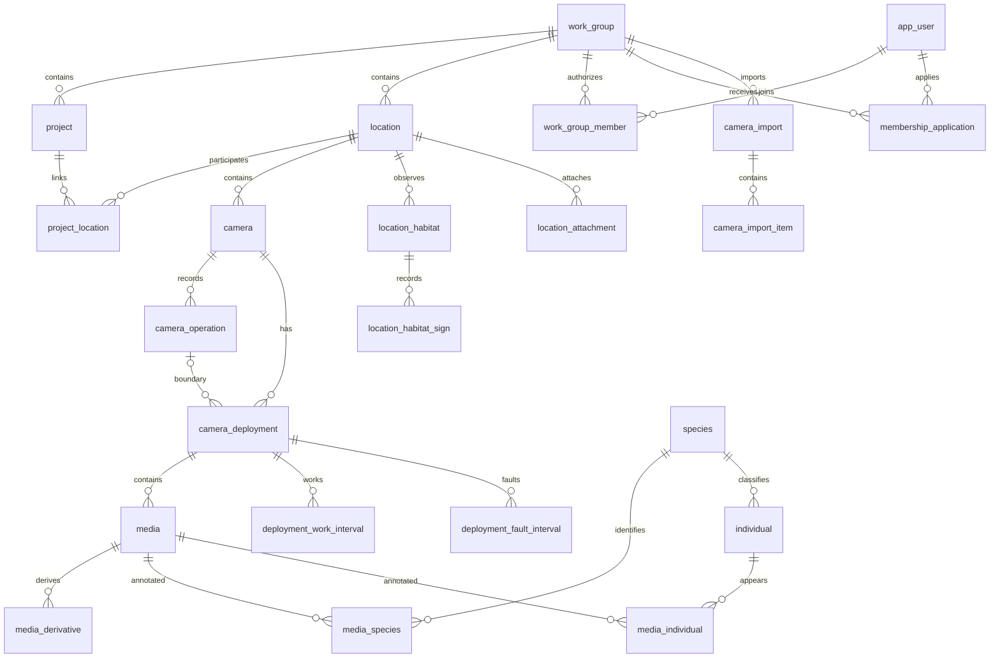

# 红外相机数据管理平台数据库设计文档

V1.5 · 相机管理结构对齐：2026-11-16 · PostgreSQL + PostGIS

依据[数据库设计指南](database_design_guide.md)命名，并按[模块1-相机管理 V2.0](../requirements/module01-camera-management-v2_0.md)更新位点、生境调查、相机操作及布设周期设计。基准提交为 `d724f77b0707201e6795460a879b404dd8d08032`。本文描述正式落库方案，不表示后端、迁移或生产库已实现。

相机管理已纳入稳定 ID、V4.2 字段、六位坐标、秒参数、自动周期、多段故障、校准、业务移除和位点/操作 Excel 事务约束。故障事实与有效工作量核实分开；正式有效工作量核实流程、媒体引用更正/重挂接口及生境/周期批量模板仍待设计。

物种 Excel、非动物标签/映射授权及空独立值映射 FALSE，个体源观察、日期级校正、个体独立标记及档案匹配不属于本次结构更新；下文 XMP 专用结构仍是待替换/扩展草案，不覆盖当前[总体需求](../requirements/platform-requirements-v1_4.md)及[各模块需求](../requirements/README.md)。

## 1. 版本依据与范围

### 1.1 依据及冲突处理

业务对象按 guide：group、project、location、camera、operation、deployment、media、annotation、species、individual。物理表沿用 work_group、camera_operation、camera_deployment 等 guide 表名。guide 由用户维护，本次不修改；其中操作类型、参数稀疏记录及周期字段的旧描述，按模块1 V2.0 已确认规则细化：安装/检查/撤回，操作后与周期起点保存完整配置快照，周期自动生成，故障与校准按需填写，不恢复人工确认字段。

工作组是数据归属和人员授权单位，项目继承工作组权限。管理申请及既有管理身份调整仅由系统管理员审批；工作/只读申请由工作组管理员或系统管理员审批，不得自审。

已确认业务与实现建议分开：本版字段名、支撑表、事务锁及索引是实现方案；未知历史不补造事实，未定工作量和媒体更正流程不写成已实现能力。

### 1.2 一期与后续边界

一期包括：工作组和项目、成员与申请审批、共享位点及生境观察、机位、操作记录及参数、周期及多段有效工作、媒体及派生文件、Excel 物种和个体结果导入、个体档案及多角度代表图、历史编号、媒体标签底表、账号授权、审计和查询统计支撑。XMP 范围另行确认，下文 XMP 专用结构待替换/扩展为当前 Excel 来源设计。标签底表不等于完整素材库选编、裁剪、发布已纳入一期。

一期不增加实体相机库存管理，不增加个体关系表。已有个体关系数据须归档保留。人工个体标注工具、繁殖记录、家域可视化和模板报告沿用后续规划；物种 AI 的交付阶段仍另定。RAI 仍保留一期设计支撑，但正式计算口径须先确定。

### 1.3 术语及设计边界

operation 表示现场相机操作，物理表为 camera_operation；类型固定为 install（安装）、check（检查）、withdraw（撤回）。更换相机、丢失重补、收卡换卡属于检查动作，不是新的操作类型。audit_log 记录登录账号的系统审计，与现场操作分开。

deployment 表示机位两次操作之间的布设周期，物理表为 camera_deployment。周期闭合与取得媒体是两项独立事实；相机型号、条形码是操作/周期快照，不代表库存实体。旧对象名称仅在第 15 节用于迁移对照。

## 2. 业务对象与关系

### 2.1 名词与基数

| 对象 | 定义及归属 | 例子 |
| --- | --- | --- |
| group | 工作组，物理表 work_group；数据归属和人员权限管理单位 | 山西、西北、河北&北京等工作组；名称可沿用地名，不代表地理权限边界 |
| project | 有明确目标的监测项目，只属于一个 work_group | 和顺常规监测、和顺 X337 |
| location | 地理监测位置，只属于一个 work_group；可关联零个或多个同工作组 project | 701 |
| camera | location 内稳定机位；更换实体相机不更换机位 ID | 701A、701B |
| operation | 对 camera 的一次现场相机操作，安装/检查/撤回；批次选填 | 2026-10-01 检查记录 |
| deployment | 同一 camera 两次操作之间的布设周期，首次从安装起算 | 2026-08-01 至 2026-09-30 |
| media | 一个原始视频或图片，只属于一个 deployment | IMG00001.MP4 |
| annotation | 媒体与物种或个体的当前有效关联 | media_species、media_individual |
| species | 全系统物种字典 | leopard |
| individual | 稳定身份的个体档案，可改当前编号 | LEO_HS1905F |

一个位点关联多个项目时，共用该位点的机位、周期、媒体和标签；不为每个项目复制事实。不在 location 再放单个 project_id，也不以旧“二级工作组”直接代替新 project。

### 2.2 核心实体关系图

下图省略标签导入历史、素材标签、审计及代表图等支撑表；箭头代表外键关系，不代表数据必须按箭头顺序录入。



camera_operation 作为周期边界具有两种具体外键：start_operation_id 和 end_operation_id。同一次检查可同时是上一周期结束与下一周期开始；新周期并不复制该相机操作。work_group_member 每行只对应一个用户与工作组，项目不再有授权行。

### 2.3 数据归属与项目关联

project、location、individual 明确归属一个 work_group；机位、相机操作、布设、媒体、标签和生境记录通过稳定外键链继承归属，不逐行再授权。工作组内多个项目可共用一个位点及其媒体，不复制事实，跨项目汇总按主键去重。

成员权限覆盖所属工作组全部项目，也覆盖尚未关联项目的位点。project_location 仅用于业务组织和筛选，增加或停用关联不再改变成员权限。项目负责人不自动获得成员身份或管理权限。项目筛选仅决定查询范围，不是安全边界。

跨工作组项目—位点关联由复合外键禁止。业务数据跨组转移会改变可见人员，须由系统管理员走独立校验与审计流程，不允许普通更新归属 ID。工作组权限取消后，不能凭历史项目关联、导入记录或旧文件链接继续访问。

## 3. 命名、类型与通用约定

表名用单数 snake_case。主键采用 UUID，不随业务编号变化。代码字段保持文本，保留前导零。camera 业务名沿用“相机”，含义为位点内机位；机位统一使用 camera_code，实体设备型号使用 camera_model；不把型号当机位编号。

`DATE` 保存现场操作、布设和区间日期，不伪造时分；`TIMESTAMPTZ` 保存媒体拍摄与审计时间点。媒体来源时区通过来源记录明确，未知时区不按服务器默认值猜测。模块1业务日及校准输入按北京时间 Asia/Shanghai（UTC+8）解释，服务器时区不参与推断。

除复合关联表外，业务表默认有 `id UUID PRIMARY KEY`、`created_at TIMESTAMPTZ NOT NULL DEFAULT now()`、`updated_at TIMESTAMPTZ NOT NULL DEFAULT now()`；下方不重复列出。可变事实表另有 `row_version BIGINT NOT NULL DEFAULT 1`，用于导入预览后提交及人工更正的并发检查。已办结导入内容、审计和已完成统计快照只追加，不原位修改；导入状态从预检到提交的受控变化单独审计。表中“必填”含数据库 NOT NULL；“可空”表示 NULL，不用空字符串、0 或虚构关联替代未知值。

指南以 * 标明非必填。本版区分新录入必填、条件必填和历史/未知可空：开放周期不要求结束信息，未复核不要求复核人，未知历史坐标、出生信息和工作量允许 NULL 并保留来源。新在线录入及 Excel 按 V2.0 和当前表单统一校验，不通过历史补录标志绕过必填，不能以虚构值满足约束。

location、location_habitat、camera_operation 使用 `deleted_at TIMESTAMPTZ NULL`、`deleted_by_id UUID NULL → app_user.id`、`deletion_reason TEXT NULL` 标记业务移除；标记与登录账号成对写入，通用 row_version 同步递增。查询必须同时检查自身及上游位点删除标记（历史查询除外），正常查询排除已删记录，历史/审计按权限读取；不存在旧编辑页直接恢复的接口。位点编号唯一性包含已删行，详见第 14.3 节。

外键默认 RESTRICT/NO ACTION；业务实体不级联删除。每个外键须有适合访问路径的索引。坐标采用 WGS84；空间查询可使用 `ST_SetSRID(ST_MakePoint(longitude,latitude),4326)` 的 GiST 表达式索引。

## 4. 表清单

本表清单包括本次相机管理新增的附件、动物痕迹、故障区间和业务导入支撑表。设计表清单不代表运行库已建表；statistics_run 仍为可选。

| 分组 | 表 | 职责 |
| --- | --- | --- |
| 组织 | work_group | 数据归属与人员管理单位 |
| 组织 | project | 项目 |
| 组织 | project_location | 项目—位点关联 |
| 监测 | location | 地理位点及相对稳定信息 |
| 监测 | location_habitat | 植被、动物痕迹、人为干扰的历史观察 |
| 监测 | location_habitat_sign | 调查内可重复的物种/痕迹行 |
| 监测 | location_attachment | 位点轨迹与照片的受控文件索引 |
| 监测 | camera | 位点内机位 |
| 监测 | camera_operation | 安装、检查、撤回相机操作及操作后快照 |
| 监测 | camera_deployment | 布设周期、起始配置快照及周期统一校准 |
| 监测 | deployment_fault_interval | 周期内多段故障事实 |
| 监测 | deployment_work_interval | 已核实有效工作区间，核实流程待衔接 |
| 导入 | camera_import | 位点/操作 Excel 预检与提交批次 |
| 导入 | camera_import_item | 源行键、内容摘要、匹配和提交结果 |
| 媒体 | media | 原始文件索引 |
| 媒体 | media_derivative | 代理视频、缩略图、抽帧 |
| 物种 | species | 全局物种字典 |
| 物种 | annotation_import | XMP 导入批次 |
| 物种 | annotation_import_item | 逐媒体导入结果与快照 |
| 物种 | media_species | 当前物种标签 |
| 个体 | individual | 个体档案 |
| 个体 | individual_profile | 按角度、部位保存的代表图 |
| 个体 | individual_alias | 个体历史编号 |
| 个体 | individual_import | Excel 个体导入批次 |
| 个体 | individual_import_item | 逐媒体导入结果与快照 |
| 个体 | media_individual | 当前已确认个体关联 |
| 标签 | tag | 系统与素材标签字典 |
| 标签 | media_tag | 媒体标签、标记人和素材描述 |
| 账号 | app_user | 账号类型、身份及状态 |
| 账号 | work_group_member | 审批通过后的工作组成员及权限 |
| 账号 | membership_application | 加入工作组或调整等级的申请与审批 |
| 审计 | audit_log | 操作和前后快照 |
| 统计 | statistics_run | 规则、输入、结果快照 |

## 5. 组织与监测数据字典

### 5.1 work_group｜工作组

指南业务名为 group，物理表名采用 work_group，避免 SQL 关键字歧义。它表示组织和数据责任边界，不要求等同于行政或地理区域。

| 字段 | SQL 类型 | 要求 / 默认 | 说明 |
| --- | --- | --- | --- |
| work_group_code | VARCHAR(30) | 必填 | 稳定代码，全局唯一 |
| work_group_name | VARCHAR(100) | 必填 | 工作组名称，全局唯一 |
| is_active | BOOLEAN | 必填 / true | 停用后暂停普通成员访问及申请审批，历史保留 |
| notes | TEXT | 可空 | 工作组说明 |

指南“写死”落实为初始化固定工作组配置及稳定 ID；注册和数据导入不能创建工作组。系统管理员维护配置、启停和管理员任命。已引用的工作组不直接删除。系统管理员可查看停用组历史并恢复工作组。

### 5.2 project｜项目

| 字段 | SQL 类型 | 要求 / 默认 | 说明 |
| --- | --- | --- | --- |
| work_group_id | UUID | 必填 | FK → work_group.id |
| project_code | VARCHAR(50) | 必填 | 工作组内唯一项目编号 |
| project_name | VARCHAR(200) | 必填 | 项目名称 |
| project_type | VARCHAR(50) | 必填 | 项目类型，取值待提供 |
| responsible_person | TEXT | 必填 | 负责人姓名文本，兼容无平台账号人员 |
| responsible_user_id | UUID | 可空 | FK → app_user.id；有关联账号时填写 |
| project_status | VARCHAR(20) | 必填 / active | active / inactive |
| notes | TEXT | 可空 | 备注 |

约束：UNIQUE(work_group_id,project_code)，并设 UNIQUE(work_group_id,id) 支持同工作组复合外键。负责人和成员身份独立；停用项目仍可查询有权限的历史，停止普通新增。跨工作组迁移项目影响全部权限及关联，不开放直接改 work_group_id。

### 5.3 location｜位点

| 字段 | SQL 类型 | 要求 / 默认 | 说明 |
| --- | --- | --- | --- |
| work_group_id | UUID | 必填 | FK → work_group.id，全局工作组上下文带入并由后端验证 |
| location_code | TEXT | 必填 | 工作组内唯一，包含业务移除的位点，保留前导零 |
| alias_name | TEXT | 可空 | 当前别名；修改保留审计，不作为外键或唯一匹配键 |
| region_name | TEXT | 必填 | 区域，组内统计维度，不是工作组或权限对象 |
| locality_name | TEXT | 可空 | 小地名 |
| grid_code | VARCHAR(50) | 可空 | 网格编号，允许字母及前导零 |
| set_by | TEXT | 必填 | 设置人员，可含无账号的现场人员 |
| recorder_name | TEXT | 可空 | 野外记录人员，与登录账号分别保留 |
| first_deployed_date | DATE | 必填（新录入） | 首次布设日期，不作为在位事实来源 |
| longitude | NUMERIC(9,6) | 必填（新录入） | WGS84 十进制度，范围 [-180,180] |
| latitude | NUMERIC(8,6) | 必填（新录入） | 范围 [-90,90]，与经度成对 |
| elevation_m | NUMERIC(8,2) | 必填（新录入） | 海拔米，允许合法负值 |
| habitat_type | VARCHAR(30) | 必填（新录入） | 相对稳定生境类型 |
| terrain_position | VARCHAR(30) | 必填（新录入） | 地形位置 |
| slope_aspect | VARCHAR(30) | 必填（新录入） | 坡向 |
| slope_degrees | NUMERIC(5,2) | 必填（新录入） | 坡度，范围 [0,90] |
| water_distance | VARCHAR(20) | 必填（新录入） | le_100m / gt_100m，对应 ≤100 m／＞100 m |
| notes | TEXT | 可空 | 备注；不恢复其他生境说明、诱饵等已删除字段 |

设置 UNIQUE(work_group_id,location_code)、UNIQUE(work_group_id,id)，坐标成对和范围 CHECK。导入/接口先对原始坐标校验范围再四舍五入到六位；输入、保存、详情、Excel 和 KML/KMZ 坐标导出均补足六位，轨迹原文件不转换。未知历史可空并附迁移来源，新录入不设历史补录豁免，按当前表单条件校验。

项目选填、多选，仅通过 project_location 关联同组项目；不在位点保存单 project_id。当前别名用一个可空字段满足表单，别名变更审计可追溯；旧历史编号留稳定 ID 映射，完整历史编号维护流程不在本次新增。

**在位状态只读推导**：查询日期 D 默认取北京时间当天；在所属组/位点的每个 camera 中，从未删除且 operation_date≤D 的操作按 `(operation_date,operation_sequence)` 取最后一条，累加 is_deployed_after=true。故障、关机、换卡、换机仍算在位；撤回和丢失未补装不在位；丢失补装在位，未知丢失日期不倒推。0 台 none/inactive，1 台 single/active，2 台 paired/active，超过 2 台 unclassified/active（待核查）。

输出 camera_count、deployment_type、location_status、as_of；不保存人工状态默认值，也不按周期数或媒体回收推断。反复检查不重复计数，未来操作不影响当天。无操作计 0 仅表示已记录事实，不能证明现场已核实停用；无位点编号不显示结论。删除位点不伪造撤回，历史状态仍可按授权追溯。

### 5.4 project_location｜项目—位点关联

| 字段 | SQL 类型 | 要求 / 默认 | 说明 |
| --- | --- | --- | --- |
| work_group_id | UUID | 必填 | 用于强制两端同工作组 |
| project_id | UUID | 必填 | FK → project.id |
| location_id | UUID | 必填 | FK → location.id |
| is_active | BOOLEAN | 必填 / true | 是否作为当前业务关联参与项目筛选，不参与授权 |
| linked_by_id | UUID | 必填 | FK → app_user.id |
| linked_at | TIMESTAMPTZ | 必填 / now() | 建立关联时间，非项目参与起始日期 |
| notes | TEXT | 可空 | 关联说明 |

以 (project_id,location_id) 为复合主键，无单独 id；通用 created_at/updated_at 保留。复合外键 (work_group_id,project_id) → project(work_group_id,id)、(work_group_id,location_id) → location(work_group_id,id) 防止跨工作组关联。变更 is_active 记录审计；重新关联复用该行。关联时间不是媒体访问起点。

### 5.5 camera｜相机（位点内机位）

| 字段 | SQL 类型 | 要求 / 默认 | 说明 |
| --- | --- | --- | --- |
| location_id | UUID | 必填 | FK → location.id |
| camera_code | TEXT | 必填 | 位点内机位编号，如 701A |
| camera_status | VARCHAR(20) | 必填 / active | active / inactive，机位业务录入控制；不代表物理在位 |
| notes | TEXT | 可空 | 机位说明 |

约束：UNIQUE(location_id,camera_code)。机位非设备，无库存数量、采购、资产流转字段。型号记录在相机操作和周期；同机位换新实体相机沿用 camera.id。机位挪到新的地理位点须新建 ID，历史媒体不改挂。若未来加入实体资产模块，另建 camera_device 并关联周期，不改变 camera 的含义。

### 5.6 camera_operation｜相机操作记录

| 字段 | SQL 类型 | 要求 / 默认 | 说明 |
| --- | --- | --- | --- |
| camera_id | UUID | 必填 | FK → camera.id，位点及工作组沿稳定 ID 推导 |
| operation_date | DATE | 必填 | 实际现场操作日期 |
| operation_sequence | INTEGER | 必填 | 同机位同日顺序，正整数，由服务端分配并发安全的稳定顺序 |
| operation_type | VARCHAR(20) | 必填 | install / check / withdraw |
| operation_batch | TEXT | 可空 | 自由文本，不校验编号格式；最近批次按当前工作组查询 |
| operated_by | TEXT | 必填 | 现场操作人员 |
| recorder_name | TEXT | 可空 | 现场记录人员，不是登录账号 |
| recorded_by_id | UUID | 必填 | FK → app_user.id，真实录入账号 |
| previous_operation_id | UUID | 可空 | 同机位此前有效操作；上次日期经此显示，不用日期文本匹配 |
| camera_model_after | TEXT | 条件必填 | 安装/检查后设备型号；撤回保留所带入设备信息 |
| camera_barcode_after | TEXT | 可空 | 实体设备条形码，不作为机位 ID |
| camera_parameters_after | JSONB | 条件必填 | 版本化完整配置快照，契约见下文 |
| field_status_before | VARCHAR(20) | 条件必填 | 检查/撤回现场状态：normal/off/damaged/lost/fallen/other；安装为空 |
| field_status_note | TEXT | 条件可空 | 现场状态 other 必须说明 |
| shooting_issues | TEXT[] | 可空 | 检查/撤回：none/empty_capture/battery_empty/settings_error/trigger_error/other；安装为空 |
| issue_details | JSONB | 条件可空 | settings_error、trigger_error、other 对应的独立说明，按固定键校验 |
| check_actions | TEXT[] | 条件可空 | 检查专用动作，安装/撤回为空 |
| action_notes | TEXT | 可空 | 检查操作内容中的备注；other 动作须说明 |
| withdrawal_reason | TEXT | 条件必填 | 撤回原因；其他类型为空 |
| is_deployed_after | BOOLEAN | 必填 | 操作后实际在位结果，无猜测默认 |

约束：UNIQUE(camera_id,operation_date,operation_sequence)（包含删除行，不重用旧顺序）、UNIQUE(camera_id,id)；previous_operation_id 用同机位复合外键并检查时间顺序，作为系统维护的前序链；补录/更正/删除重算时同步更新，不接受客户端任意指定。install 强制在位 true，withdraw 强制 false；check 在丢失未补装时 false、丢失重补时 true，非丢失状态（含关机/损坏）保持 true。批次不是操作唯一键，也不要求填写；同机位同批次多次操作允许保存。

检查动作固定为 card_exchange/battery_replace/angle_adjust/camera_replace/lost_replace/position_move/parameter_adjust/other，分别对应收卡换卡、更换电池、调整角度、更换相机、丢失重补、移动位置、参数调整、其他。安装填写型号、可选条形码及默认参数，不填操作前状态或检查动作；检查继承上次信息，只在更换/补装时开放设备字段，参数调整开放拍摄配置；撤回继承信息并填状态/原因，不填检查动作。服务端须拒绝越过动作条件修改配置，取消动作恢复上次值；无问题与异常互斥，不允许数组重复/未知代码。实际大幅地理迁移须新建 location/camera，不移动历史媒体。

配置快照采用带 `schema_version INTEGER=1` 的 JSONB，数据库 CHECK/统一校验函数与后端验证结构、类型、条件及允许值，不接受任意 JSON：

| 快照键 | 规则 |
| --- | --- |
| mode | photo / video / photo_video |
| photo_count | 照片或组合模式时为 1/2/3/5；新安装初值 1 |
| video_seconds | 视频或组合模式时正整数秒；新安装默认 15 |
| interval_seconds | 非负秒数，允许小数；新安装默认 10；旧分钟值原值×60 |
| sensitivity | high / medium / low；新安装默认 medium |
| side_pir | A323 必须为 BOOLEAN；其他型号可空，参数区仍可展示该项 |

完整快照只记录实际操作后的有效值；未变更时继承前次，不给旧记录补新默认。型号必填、条形码选填，上次信息缺失时须补齐真实信息才能提交新操作，不豁免旧资料。撤回无留置设备，但保留带入快照以便追溯，不产生新周期。现场状态正常不清空已有故障，也不代表有效工作量已核实。

### 5.7 camera_deployment｜布设周期

| 字段 | SQL 类型 | 要求 / 默认 | 说明 |
| --- | --- | --- | --- |
| camera_id | UUID | 必填 | FK → camera.id |
| start_operation_id | UUID | 条件必填 | 起始相机操作，正常自动周期必填 |
| end_operation_id | UUID | 条件可空 | 结束操作，开放周期为空 |
| deployment_status | VARCHAR(20) | 必填 | open / closed / needs_review / legacy_unknown |
| deployment_start_date | DATE | 条件必填 | 从起始操作推导，不能独立修改 |
| deployment_end_date | DATE | 条件可空 | 从结束操作推导，界面“回收日期”不表示取得文件 |
| camera_model | TEXT | 条件必填 | 起点操作后的型号快照；周期表单不再要求输入 |
| camera_barcode | TEXT | 可空 | 起点设备条形码快照 |
| camera_parameters | JSONB | 条件必填 | 与起始操作操作后配置一致，冻结于本周期起点 |
| fault_mode | VARCHAR(20) | 必填 / none | none / recorded，默认无故障不等于已核实工作量 |
| calibration_camera_at | TIMESTAMPTZ | 成对可空 | 首条视频相机时间，输入按 UTC+8 解释 |
| calibration_actual_at | TIMESTAMPTZ | 成对可空 | 对应实际时间，输入按 UTC+8 解释 |
| time_offset_seconds | INTEGER | 可空 | actual-camera 的秒数；NULL 未校准，0 已填且无需偏移 |
| time_offset_updated_by_id | UUID | 可空 | FK → app_user.id，系统记录真实修改账号 |
| time_offset_updated_at | TIMESTAMPTZ | 可空 | 系统审计时间 |
| time_offset_note | TEXT | 可空 | 历史校准来源说明 |
| work_interval_verified | BOOLEAN | 必填 / false | 内部可信度门槛，禁止模块1表单/普通写接口直接设 true |
| effective_work_start_date / effective_work_end_date | DATE | 可空 | 已核实有效区间的受控汇总，不作为跨度分母 |
| work_verification_note | TEXT | 可空 | 后续核实流程的证据说明，不是新增人工确认框 |
| independence_status | VARCHAR(20) | 必填 / pending | pending / ready / stale |
| independence_rule_version | VARCHAR(100) | 可空 | ready 必填 |
| independence_input_signature | VARCHAR(64) | 可空 | ready 必填 |
| notes | TEXT | 可空 | 说明及待核对原因 |

复合外键 (camera_id,start_operation_id)/(camera_id,end_operation_id) → camera_operation(camera_id,id)。正常 open/closed 的起点、终点各自非空唯一；同一 operation 可作为前周期终点和后周期起点。UNIQUE(camera_id) WHERE deployment_status='open' 保证每机位最多一个开放周期。needs_review 保留失效边界和旧快照，不参与正常周期唯一边界约束或正式工作量。

open 要求起点及开始日期非空、终点及结束日期为空；closed 要求两端操作及日期非空。两端必须同机位且按 `(operation_date,operation_sequence)` 严格有序，日期允许同日；不允许有序区间重叠。同日零日长周期仍保留事实，不伪造时分或推断当天媒体归属。legacy_unknown 仅保存有来源的历史不完整周期，在线新增/导入不能选择此状态绕过校验。

周期由操作生成，开放周期可查；关闭后可补故障和校准，允许无故障只校准。校准成对填写，秒差由系统计算、校验 INTEGER 范围并记录账号/时间；历史只有秒差时保留原值及来源，不伪造首条视频时间。字段快照可保留型号但界面不要求填写型号、判断依据、确认人或完整核实框。故障/校准更改使统计过期，不覆盖旧周期配置。

### 5.8 生境、地形等固定选项直接约束字段

一期不建 terrain_option、habitat_option、environment_option 表。location 直接保存 habitat_type、terrain_position、slope_aspect、water_distance 的稳定字符串代码；数据库按各字段允许值建立 CHECK 约束，前端下拉框和 Excel 校验从同一份版本化选项配置生成。数据库不保存“下拉框”，而是校验最终写入值。

采用 VARCHAR + CHECK 而非 PostgreSQL 原生 ENUM，便于后续经迁移修改选项。除本文及 V2.0 已列出的固定选项外，其他具体允许值尚未提供，本文件不编造词表或把示例当正式取值；实施时必须将已确认代码列表落实到 CHECK，不能只在前端限制。未知值报错；空值仍按字段的可空规则处理。

固定且少量、随版本发布的选项不需要字典表。只有后续需要管理员在线增删、停用旧选项、排序或多语言等能力时，再考虑字典表；即使届时引入，也可使用一张带类别的统一字典，不必每个字段一张表。

选项展示名修改不改变稳定代码。删除或改义旧代码前先检查历史值，不能在收紧 CHECK 前静默丢数据。原 vegetation_type 与新“生境类型”的语义须人工映射，旧 environment_type 不直接映射为新地形位置；未核对的值归档待处理。

### 5.9 location_habitat｜生境调查历史

调查可独立新增，不强制关联 operation。观察人、现场记录人员、登录账号分别保存；同日允许多次调查，以稳定 ID 区分。生境、动物痕迹、干扰共用 observed_date，不增加独立发现日期。

| 字段 | SQL 类型 | 要求 / 默认 | 说明 |
| --- | --- | --- | --- |
| location_id | UUID | 必填 | FK → location.id |
| observed_date | DATE | 必填 | 实际调查日期 |
| observed_by | TEXT | 必填 | 调查人员 |
| recorder_name | TEXT | 可空 | 现场记录人员 |
| recorded_by_id | UUID | 必填 | FK → app_user.id，登录账号 |
| vegetation_surveyed / animal_signs_surveyed / disturbance_surveyed | BOOLEAN | 必填 | 三个独立“未调查”标志，明确传入，不用空内容推断 |
| tree_height_class / shrub_height_class / herb_height_class | VARCHAR(30) | 条件必填 | 高度分档；乔木/灌木以 m、草本以 cm 表示，保存所选档位代码 |
| tree_canopy_class / shrub_cover_class / herb_cover_class | VARCHAR(30) | 条件必填 | 郁闭度、盖度百分比分档，保存档位代码，不伪造精确百分比 |
| forest_origin | VARCHAR(30) | 条件必填 | primary/secondary/planted，对应原始/次生/人工 |
| herb_type | VARCHAR(30) | 条件必填 | grass_dominant/non_grass_dominant，禾本科为主/非禾本科为主 |
| disturbance_types | TEXT[] | 条件可空 | grazing/snare/electric_fence/vehicle/tree_theft/logging/tourism/herb_collecting/other |
| disturbance_other_note | TEXT | 条件可空 | 干扰 other 必须说明 |
| notes | TEXT | 可空 | 调查说明 |

植被高度及郁闭度/盖度在当前表单是分档下拉项，按 V4.2/当前表单选项映射稳定代码并用 CHECK 校验，不将区间中点或端点当作测量值；旧精确值保留来源待映射。植被已调查时三层高度、郁闭度/盖度、森林起源及草本类型按表单必填；未调查分区不参与必填，相关字段存 NULL、子行不得存在，导出为空；已调查按当前表单条件校验，空数组表示已调查未发现，不能与未调查混淆。允许三分区均未调查但基本信息完整，不保留旧“至少一项观察非空”约束。不增加树种、胸径或诱饵样本。修改/业务移除保留审计；最近调查按未删除行 observed_date、created_at、id 稳定排序。

**location_habitat_sign｜动物痕迹行**：通用 id/时间/版本外，保存 habitat_id UUID → location_habitat.id、row_order INTEGER、species_name TEXT NOT NULL、species_id UUID NULL → species.id、trace_types TEXT[] NOT NULL。UNIQUE(habitat_id,row_order)，行序号正整数；物种名称不强制匹配全局字典、不自动建物种。trace_types 为非空无重复集合：direct/feces/feeding/footprint/den/claw/rubbing/hair/carcass（实体、粪便、食迹、足迹、卧穴、爪痕、蹭痕、毛发、尸体）。完全空白行不落库，部分填写拒绝；重复物种行允许，导出按行序。species_id 非空时须校验名称映射，不覆盖原调查文本。

### 5.10 deployment_work_interval｜有效工作区间

保留 guide 中多段有效工作区间的设计支撑，不将故障表直接改名为本表。字段为 deployment_id UUID FK、work_start_date DATE、work_end_date DATE、evidence_notes TEXT、verified_by_id UUID FK → app_user.id、verified_at TIMESTAMPTZ；均必填，另有通用 id/时间/版本与可空 notes。

区间采用 `[work_start_date,work_end_date)`，CHECK(end>start)，限定在所属周期内且互不重叠。仅后续正式核实服务可写；模块1的“无故障”及保存现场正常的操作不能生成已核实区间或设置 work_interval_verified=true。既有闭区间历史须有来源和明确日界映射，不能直接重新解释。

工作量来自完整、可采信区间的并集和查询裁剪。资料不完整时 verified=false，RAI 返回资料不足，不以周期首末跨度或故障补集代替核实。完整核实流程与统计日界尚待设计，不在当前表单增加判断依据、确认人或完整确认框。区间变更同步更新受控汇总、可信度及统计失效状态。

### 5.11 deployment_fault_interval｜周期故障区间

| 字段 | SQL 类型 | 要求 / 默认 | 说明 |
| --- | --- | --- | --- |
| deployment_id | UUID | 必填 | FK → camera_deployment.id |
| fault_start_date | DATE | 必填 | 故障开始日期 |
| recovery_date | DATE | 必填 | 恢复日期，作为排除端点 |
| fault_notes | TEXT | 必填 | 故障说明 |

CHECK(recovery_date>fault_start_date)，使用 `daterange(fault_start_date,recovery_date,'[)')`；同周期有效行以 GiST 排斥约束（btree_gist）或锁定周期的事务保证互不重叠、且不越出已闭合周期边界。相邻区间可相接；故障不改变 is_deployed_after。fault_mode=recorded 至少一段，none 无段，两者同事务校验。后续操作现场正常不得删除旧故障；显式更正/移除保留审计，不能以切换默认值静默清空。日期不明的历史保留原资料并标待核对，不造恢复日期。

### 5.12 location_attachment｜位点现场附件

每行保存 location_id UUID FK、attachment_type VARCHAR(10)（track/photo）、original_filename TEXT、storage_key TEXT（唯一受控键）、content_type TEXT、size_bytes BIGINT（非负）、uploaded_by_id UUID FK → app_user.id，均必填；另有可空 content_hash、通用 id/时间/版本及业务移除标记。轨迹和照片各最多 10 个有效文件，锁定位点后计数，不能只靠前端限制；照片预览为受控派生资源。

原文件不内嵌数据库，不修改轨迹坐标或原始照片。移除附件保留索引/审计，位点移除保留全部附件；存储上传暂存、提交校验及失败清理采用可重试流程，不宣称数据库事务能回滚文件系统。读取、预览、KML/KMZ 坐标导出及 ZIP 打包逐次鉴权；轨迹原文件要求坐标与下载权限同时满足，导出脱敏不应泄露原文件。

## 6. 媒体、物种与标签数据字典

### 6.1 media｜原始媒体文件

| 字段 | SQL 类型 | 要求 / 默认 | 说明 |
| --- | --- | --- | --- |
| deployment_id | UUID | 必填 | FK → camera_deployment.id |
| operation_id | UUID | 可空 | FK → camera_operation.id；实际媒体来源相机操作，历史不明可空 |
| filename | TEXT | 必填 | 原始文件名 |
| media_type | VARCHAR(10) | 必填 | video / image |
| storage_path | TEXT | 必填 | 受控 NAS 路径或存储键，唯一 |
| file_size_bytes | BIGINT | 可空 | 非负文件字节数 |
| file_hash | VARCHAR(64) | 可空 | SHA-256，不作为跨目录自动删除依据 |
| captured_at | TIMESTAMPTZ | 可空 | 首次导入的原始拍摄时间，保留原值 |
| captured_time_source | VARCHAR(30) | 必填 | file_mtime / metadata / legacy / unknown |
| source_timezone | VARCHAR(100) | 可空 | 解释原始本地时间的 IANA 时区或来源说明 |
| time_corrected_at | TIMESTAMPTZ | 可空 | 历史或特例媒体单独校准值；优先于周期偏移 |
| time_correction_note | TEXT | 可空 | 单文件校准依据，写入审计记录操作者 |
| duration_seconds | NUMERIC(12,3) | 可空 | 视频时长，非负；图片为空 |
| width | INTEGER | 可空 | 像素宽，非空须大于 0 |
| height | INTEGER | 可空 | 像素高，非空须大于 0 |
| codec | VARCHAR(50) | 可空 | 编码 |
| individual_annotation_status | VARCHAR(20) | 必填 / unannotated | unannotated / annotated |
| is_independent_capture | BOOLEAN | 可空 / NULL | 文件级独立拍摄标记；TRUE=代表文件，FALSE=同组后续文件，NULL=未判定 |
| notes | TEXT | 可空 | 文件说明 |

operation_id 非空时表示实际媒体来源相机操作，必须同机位且未删除；是否确实取得本文件在媒体入库逐文件核对，不能由操作类型或周期闭合推定。空卡、损坏、未取回须在媒体来源核对中区分，不建立假媒体。撤回后另行取卡不伪造检查或新周期，具体来源交接结构待媒体模块设计；已有历史来源不明时允许 NULL 并保留来源说明。

操作批次由 operation_id → camera_operation.operation_batch 推导，可为空，不能强迫补批次或把批次当唯一媒体定位键。原文件拍摄时间沿用首次读取 mtime 的已有约定；来源变化须单独确认。未知时间可入库但独立标记保持 NULL，不视为非独立。

有效拍摄时间为视图计算列 `effective_captured_at`，公式见第 11 节。不把跨表计算写成 PostgreSQL generated column，也不批量覆盖原始 captured_at。

### 6.2 media_derivative｜代理与预览

| 字段 | SQL 类型 | 要求 / 默认 | 说明 |
| --- | --- | --- | --- |
| media_id | UUID | 必填 | FK → media.id |
| derivative_type | VARCHAR(30) | 必填 | proxy_video / thumbnail / frame_capture |
| filename | TEXT | 必填 | 派生文件名 |
| storage_path | TEXT | 必填 | 唯一存储键 |
| generation_status | VARCHAR(20) | 必填 / pending | pending / ready / failed |
| notes | TEXT | 可空 | 生成说明或错误 |

索引 (media_id,derivative_type)。允许同一原始文件多张抽帧，不用 UNIQUE(media_id,derivative_type) 误限制。派生文件可重建；查看和播放继承原始 media 的权限，路径不能作为公开访问凭证。

### 6.3 species｜全局物种字典

| 字段 | SQL 类型 | 要求 / 默认 | 说明 |
| --- | --- | --- | --- |
| species_code | VARCHAR(50) | 必填 | 全局唯一代码 |
| common_name | VARCHAR(100) | 必填 | 物种名称 |
| scientific_name | VARCHAR(200) | 可空 | 拉丁学名 |
| is_active | BOOLEAN | 必填 / true | 停用不删除已有关联 |
| notes | TEXT | 可空 | 分类说明 |

物种由系统管理员维护，所有账号的引用使用稳定 species.id；普通标签导入不能自动创建未知物种。

### 6.4 annotation_import｜XMP 导入批次

| 字段 | SQL 类型 | 要求 / 默认 | 说明 |
| --- | --- | --- | --- |
| imported_by_id | UUID | 必填 | FK → app_user.id，实际上传账号 |
| imported_at | TIMESTAMPTZ | 必填 / now() | 执行时间 |
| source_filename | TEXT | 可空 | 单文件或压缩包名 |
| source_hash | VARCHAR(64) | 可空 | SHA-256 |
| import_status | VARCHAR(20) | 必填 | validated / completed / failed |
| replacement_policy | VARCHAR(30) | 必填 | skip_identical / replace_confirmed |
| annotated_by | VARCHAR(100) | 可空 | 批次默认原标注人，非上传账号 |
| review_status | VARCHAR(20) | 必填 / unreviewed | unreviewed / reviewed |
| reviewed_by | VARCHAR(100) | 可空 | 批次默认复核人 |
| total_file_count | INTEGER | 必填 / 0 | 处理项总数 |
| success_file_count | INTEGER | 必填 / 0 | 成功数 |
| failed_file_count | INTEGER | 必填 / 0 | 失败数 |
| skipped_file_count | INTEGER | 必填 / 0 | 跳过数 |
| notes | TEXT | 可空 | 说明 |

计数非负，success+failed+skipped ≤ total；completed 时相等且 failed=0。本版采用整批业务提交，失败不能留下部分标签更新。可在失败业务事务之外单独记录 failed 批次及错误项。

### 6.5 annotation_import_item｜逐媒体 XMP 结果

| 字段 | SQL 类型 | 要求 / 默认 | 说明 |
| --- | --- | --- | --- |
| annotation_import_id | UUID | 必填 | FK → annotation_import.id |
| source_filename | TEXT | 必填 | 来源 XMP 文件名 |
| source_media_key | JSONB | 必填 | 周期、目录、相对路径等匹配上下文 |
| media_id | UUID | 可空 | FK → media.id；未匹配时为空 |
| import_status | VARCHAR(20) | 必填 | success / failed / skipped |
| before_data | JSONB | 可空 | 替换前完整物种关联及人员、复核、来源快照 |
| after_data | JSONB | 可空 | 完整目标标签及元信息，使用稳定 species.id |
| error_message | TEXT | 可空 | 失败、跳过说明 |

success/skipped 必须有 media_id；每批非空 media_id 唯一。success 的 after_data 保存实际提交值；失败项的候选内容须明确为未生效，不作为当前标签。快照结构按接口契约校验，不能只有代码列表而丢失复核及来源信息。

### 6.6 media_species｜当前物种标注

| 字段 | SQL 类型 | 要求 / 默认 | 说明 |
| --- | --- | --- | --- |
| media_id | UUID | 必填 | FK → media.id |
| species_id | UUID | 必填 | FK → species.id |
| annotated_by | VARCHAR(100) | 可空 | 原标注人 |
| review_status | VARCHAR(20) | 必填 / unreviewed | unreviewed / reviewed |
| reviewed_by | VARCHAR(100) | 可空 | reviewed 时须有复核人 |
| reviewed_at | TIMESTAMPTZ | 可空 | 有可靠时间时保存，不以导入时间冒充复核时间 |
| annotation_import_item_id | UUID | 条件可空 | FK → annotation_import_item.id |
| source_type | VARCHAR(20) | 必填 | xmp_import / legacy；manual 留待后续工具启用 |
| imported_at | TIMESTAMPTZ | 可空 | 可靠导入时间 |
| is_independent_capture | BOOLEAN | 可空 / NULL | 此物种在该媒体上的独立拍摄标记，用于物种次数和 RAI 分子 |

UNIQUE(media_id,species_id)。导入批次 ID 通过 item 推导，不重复保存两个可能冲突的来源外键。source_type=xmp_import 必须引用同媒体的成功导入项；legacy 不伪造来源。一个媒体可多物种，本版不增加数量、框或帧时段。

### 6.7 tag｜标签字典

| 字段 | SQL 类型 | 要求 / 默认 | 说明 |
| --- | --- | --- | --- |
| tag_code | VARCHAR(50) | 必填 | 全局唯一 |
| tag_name | VARCHAR(100) | 必填 | 标签名称 |
| tag_type | VARCHAR(20) | 必填 | system / material |
| description | TEXT | 可空 | 定义 |
| is_active | BOOLEAN | 必填 / true | 是否供新标记使用 |

预置 system 标签 unknown_individual。全局字典由系统管理员维护；一期保存素材标签关联，不预设完整素材库分类和发布流程。

### 6.8 media_tag｜媒体标签与素材描述

| 字段 | SQL 类型 | 要求 / 默认 | 说明 |
| --- | --- | --- | --- |
| media_id | UUID | 必填 | FK → media.id |
| tag_id | UUID | 必填 | FK → tag.id |
| tagged_by | VARCHAR(100) | 可空 | 标记人姓名 |
| tagged_by_id | UUID | 可空 | FK → app_user.id，平台执行账号 |
| tagged_at | TIMESTAMPTZ | 必填 / now() | 标记时间 |
| material_description | TEXT | 可空 | 该素材标签下的素材描述 |
| individual_import_item_id | UUID | 条件可空 | FK → individual_import_item.id，仅未知个体导入来源使用 |
| notes | TEXT | 可空 | 其他说明 |

UNIQUE(media_id,tag_id)。已知个体与 unknown_individual 可同一媒体并存。未知标签不代表一个固定个体，不代表未知个体数量。个体导入只更新 unknown_individual 标签，不覆盖 material 类型标签或其描述。来源项非空时须同媒体、已成功且标签为 unknown_individual。

## 7. 个体档案与个体导入数据字典

### 7.1 individual｜个体档案

| 字段 | SQL 类型 | 要求 / 默认 | 说明 |
| --- | --- | --- | --- |
| individual_code | VARCHAR(50) | 必填 | 当前编号，全局唯一 |
| species_id | UUID | 必填 | FK → species.id，支持豹、兔狲等 |
| work_group_id | UUID | 条件可空 | FK → work_group.id；档案归属工作组，新建必填，历史不明可空且仅系统管理员可见 |
| profile_id | UUID | 可空 | FK → individual_profile.id，当前主代表图 |
| sex | VARCHAR(20) | 必填 / unknown | male / female / unknown |
| birth_year | INTEGER | 可空 | 1–9999，未知不猜测 |
| birth_date_from | DATE | 可空 | 推测出生日期下界 |
| birth_date_to | DATE | 可空 | 推测出生日期上界 |
| life_status | VARCHAR(30) | 必填 / unknown | alive / confirmed_dead / unknown |
| notes | TEXT | 可空 | 档案说明，按档案维护范围控制 |

建档时间使用通用 created_at。指南重复出现的两个“出生日期上界”按“下界、上界”修正。两端已知时 from ≤ to；出生年份与日期区间有一致性检查，只知年份不补 1 月 1 日。未再观测到不表示确认死亡。

work_group_id 表示档案数据归属，不是动物活动地理范围；普通成员只能查看和维护本组档案。跨组身份共享未确认前不自动开放其他组代表图、备注或出现记录；本组媒体关联个体须校验档案同组。跨组历史关联先列为迁移核对项，不静默复制、删除或合并个体。

当前编号与所有历史编号共用一个全局编号空间，禁止 unknown_individual 作为正式编号。首末拍时间、出现位点由权限范围内 media_individual → media 汇总，不保存在此表。跨工作组全局汇总只供有全部相应范围权限的账号。

### 7.2 individual_profile｜个体代表图

| 字段 | SQL 类型 | 要求 / 默认 | 说明 |
| --- | --- | --- | --- |
| individual_id | UUID | 必填 | FK → individual.id |
| view_angle | VARCHAR(20) | 必填 / multi | multi / left / right / front / back |
| body_part | VARCHAR(30) | 必填 / whole_body | whole_body / face / tail / left_forelimb / right_forelimb / left_hindlimb / right_hindlimb |
| filename | TEXT | 必填 | 图片名称 |
| storage_path | TEXT | 必填 | 唯一受控存储键 |
| uploaded_by_id | UUID | 可空 | FK → app_user.id；历史不明可空 |
| notes | TEXT | 可空 | 制作说明 |

默认“多角度 + 全身”用于人工拼合图，非从文件名猜测角度。一个个体同角度同部位可以多张图，不加该组合唯一约束。代表图不是原始 media；若有原始依据，可在说明中记录受控引用，不强制关联一个原始文件。

设置 UNIQUE(individual_id,id)，用复合 FK individual(id,profile_id) → individual_profile(individual_id,id) 保证主图属于同一个体。先建 individual，建 profile 后再加该循环外键，或在事务中延期检查。主图切换与档案更新同事务。

### 7.3 individual_alias｜历史编号

| 字段 | SQL 类型 | 要求 / 默认 | 说明 |
| --- | --- | --- | --- |
| individual_id | UUID | 必填 | FK → individual.id |
| alias_code | VARCHAR(50) | 必填 | 历史编号，全局唯一 |
| retired_at | TIMESTAMPTZ | 可空 | 该编号停用时间；历史未知可空 |
| notes | TEXT | 可空 | 改号说明 |

改号事务：校验新编号未被任何当前号或历史号占用 → 旧号写 alias → 更新 individual_code → 写审计。跨两表的编号冲突须用并发锁和约束触发器保证，不能仅靠各表单独 UNIQUE；不能把另一只个体旧号重新分配。回用本个体曾用号若有业务需要，须专门迁移流程，本版常规改号不允许。

### 7.4 individual_import｜Excel 个体标签导入批次

| 字段 | SQL 类型 | 要求 / 默认 | 说明 |
| --- | --- | --- | --- |
| source_filename | TEXT | 必填 | Excel 文件名 |
| source_hash | VARCHAR(64) | 可空 | SHA-256 |
| imported_by_id | UUID | 必填 | FK → app_user.id |
| imported_at | TIMESTAMPTZ | 必填 / now() | 导入执行时间 |
| import_status | VARCHAR(20) | 必填 | validated / completed / failed |
| replacement_policy | VARCHAR(30) | 必填 | skip_identical / replace_confirmed |
| total_media_count | INTEGER | 必填 / 0 | 归并后的媒体项数 |
| success_media_count | INTEGER | 必填 / 0 | 成功数 |
| failed_media_count | INTEGER | 必填 / 0 | 失败数 |
| skipped_media_count | INTEGER | 必填 / 0 | 跳过数 |
| notes | TEXT | 可空 | 批次说明 |

计数、状态与整批提交约束同 annotation_import。同一个媒体的多行先归并为完整个体集合，不能逐行覆盖。

### 7.5 individual_import_item｜逐媒体个体导入项

| 字段 | SQL 类型 | 要求 / 默认 | 说明 |
| --- | --- | --- | --- |
| individual_import_id | UUID | 必填 | FK → individual_import.id |
| source_row_numbers | JSONB | 必填 | 原始行号数组 |
| source_media_key | JSONB | 必填 | 周期、目录、文件名及可选哈希 |
| media_id | UUID | 可空 | FK → media.id |
| import_status | VARCHAR(20) | 必填 | success / failed / skipped |
| before_data | JSONB | 可空 | 完整个体集合、未知标签、完成状态、人员复核和来源 |
| after_data | JSONB | 可空 | 完整目标集合、稳定 ID 及编号快照等 |
| error_message | TEXT | 可空 | 错误或跳过原因 |

success/skipped 必须匹配一个媒体；每批非空 media_id 唯一。快照包含即使没有任何已知个体时的“已标注、未知个体、原标注人和复核人”信息，避免空关联集合丢失来源。成功项与所有被更新记录同事务落库。

### 7.6 media_individual｜已确认个体关联

| 字段 | SQL 类型 | 要求 / 默认 | 说明 |
| --- | --- | --- | --- |
| media_id | UUID | 必填 | FK → media.id |
| individual_id | UUID | 必填 | FK → individual.id |
| annotated_by | VARCHAR(100) | 可空 | 原标注人 |
| annotated_at | TIMESTAMPTZ | 可空 | 有可靠原时间时保存，不伪造 |
| review_status | VARCHAR(20) | 必填 / unreviewed | unreviewed / reviewed |
| reviewed_by | VARCHAR(100) | 可空 | reviewed 时须有复核人 |
| reviewed_at | TIMESTAMPTZ | 可空 | 可靠复核时间 |
| individual_import_item_id | UUID | 条件可空 | FK → individual_import_item.id |
| source_type | VARCHAR(20) | 必填 | excel_import / legacy；manual 为后续工具保留 |
| notes | TEXT | 可空 | 说明 |

UNIQUE(media_id,individual_id)。excel_import 必须指向同媒体的成功 item；legacy 不伪造来源。个体所属物种须与该媒体物种集合一致；更正物种若导致冲突，阻断并要求先核对标签与个体，不静默删除关联。个体标签不能以缺失物种标签为由自动创造新物种标注；可提供明确预览后的联合补录流程，物种来源另行记录。

unknown_individual 仅在 media_tag 中，不建虚拟 individual。`individual_annotation_status=annotated` 表示流程已完成，不表示全部个体身份已知；允许“已知 A + 未知”及“完成审核但无需个体记录”。不得只凭存在关联自动推断完成状态。

## 8. 账号、成员、申请与审计数据字典

### 8.1 app_user｜平台账号

| 字段 | SQL 类型 | 要求 / 默认 | 说明 |
| --- | --- | --- | --- |
| username | VARCHAR(100) | 必填 | 规范化后唯一登录名 |
| password_hash | TEXT | 必填 | 安全密码哈希，不保存明文 |
| display_name | VARCHAR(100) | 可空 | 姓名 |
| account_type | VARCHAR(20) | 必填 / normal | system_admin / normal |
| is_active | BOOLEAN | 必填 / true | 禁用后全部会话及业务权限失效 |

自助注册固定创建 normal，服务端不接受注册者指定 system_admin。注册完成可登录查看本人申请，但未获批准时不能读取工作组业务数据。系统管理员由系统既有初始化或受控管理流程产生。工作组管理身份不写在账号类型中。

### 8.2 work_group_member｜有效成员与工作组权限

替代原 user_permission；每个用户在每个工作组最多一条成员记录，不再保存 project_id 或 none 权限。

| 字段 | SQL 类型 | 要求 / 默认 | 说明 |
| --- | --- | --- | --- |
| user_id | UUID | 必填 | FK → app_user.id |
| work_group_id | UUID | 必填 | FK → work_group.id |
| permission_level | VARCHAR(10) | 必填 | manage / work / read |
| is_active | BOOLEAN | 必填 / true | 停用成员即撤销本组访问，不删除历史 |
| can_view_coordinates | BOOLEAN | 必填 / false | 只读成员的精确坐标开关 |
| can_download_data | BOOLEAN | 必填 / false | 工作、只读成员的数据下载开关 |
| granted_by_id | UUID | 必填 | FK → app_user.id，最近授权人 |
| granted_at | TIMESTAMPTZ | 必填 / now() | 最近授权时间 |
| source_application_id | UUID | 可空 | FK → membership_application.id；审批授权时关联，系统直接任命或历史迁移可空 |
| notes | TEXT | 可空 | 说明 |

UNIQUE(user_id,work_group_id)。成员只有在账号启用、工作组启用、成员启用时生效；无记录或 inactive 均为无访问权。成员沿用 row_version 用于审批并发检查。来源申请非空时必须与成员同用户、同组且已批准，不能引用失败或待审申请。

manage 由系统管理员授予、调整和撤销；工作组管理员仅管理本组 work/read 成员及两个附加开关，不能改动 manage 成员或自己的管理身份。manage 在本组具备坐标和下载能力；work 具备坐标能力但下载仍需开关；read 的坐标与下载分别检查开关。附加开关永不扩大工作组范围。

### 8.3 membership_application｜加入及权限调整申请

| 字段 | SQL 类型 | 要求 / 默认 | 说明 |
| --- | --- | --- | --- |
| user_id | UUID | 必填 | FK → app_user.id，申请者 |
| work_group_id | UUID | 必填 | FK → work_group.id，申请加入的组 |
| requested_permission_level | VARCHAR(10) | 必填 | manage / work / read |
| application_status | VARCHAR(20) | 必填 / pending | pending / approved / rejected / withdrawn |
| request_reason | TEXT | 可空 | 加入或调整权限理由 |
| base_member_version | BIGINT | 可空 | 提交时成员 row_version；尚无成员为 NULL |
| submitted_at | TIMESTAMPTZ | 必填 / now() | 提交时间 |
| reviewed_by_id | UUID | 条件可空 | FK → app_user.id；批准或拒绝时必填 |
| reviewed_at | TIMESTAMPTZ | 条件可空 | 批准或拒绝时间 |
| review_note | TEXT | 可空 | 审批说明，拒绝须填写原因 |
| approved_can_view_coordinates | BOOLEAN | 必填 / false | 批准时设定的坐标开关快照，不是待审访问权 |
| approved_can_download_data | BOOLEAN | 必填 / false | 批准时设定的下载开关快照 |
| withdrawn_at | TIMESTAMPTZ | 条件可空 | 申请人撤回时间 |

同用户同组仅允许一个 pending，采用部分唯一索引；已办结申请只读保留，可重新申请但不复用旧申请。CHECK 审批人不能是申请人；approved/rejected 必须有审批人、时间，withdrawn 必须有撤回时间，pending 不得伪造审批结果。申请等级合法不代表申请人已具备该等级。

申请表先保留待审与办结记录，成员表单向引用来源申请；同事务服务核对来源的用户、工作组和批准状态，申请表不再反向引用成员主键。申请前后成员状态保存在审计中。首次系统直接任命管理员可不经过申请，但同样记录授权与审计。

### 8.4 audit_log｜审计

| 字段 | SQL 类型 | 要求 / 默认 | 说明 |
| --- | --- | --- | --- |
| actor_id | UUID | 可空 | FK → app_user.id；历史操作者未知可空 |
| action | VARCHAR(100) | 必填 | 注册、申请、撤回、审批、授权、撤权、资料变更、导入及下载等 |
| entity_type | VARCHAR(100) | 必填 | 业务对象类型 |
| entity_id | UUID | 可空 | 对象 ID，复合键另存快照 |
| scope_snapshot | JSONB | 必填 | 当时的工作组及必要业务主键，支持删除后鉴权 |
| before_data | JSONB | 可空 | 前值 |
| after_data | JSONB | 可空 | 后值 |
| created_at | TIMESTAMPTZ | 必填 / now() | 真实操作时间 |

日志只追加，无通用 updated_at/row_version，不保存密码哈希、令牌或下载凭据。成功审批、成员变化及业务审计同事务；日志、导入历史和下载清单本身仍受工作组和坐标权限限制。

## 9. 工作组权限与申请审批规则

### 9.1 一条范围规则

system_admin 管理全系统，normal 的有效权限仅由当前 work_group_member 决定。项目、位点、媒体等按所属工作组检查同一条成员记录；不再取区域/项目权限最大值，也不保存项目覆盖、拒绝优先或逐媒体授权。

一个用户可加入多个工作组，在各组权限独立；A 组管理不会赋予 B 组访问权。项目、位点或个体归属不明的历史数据仅由系统管理员处理，不能用“未归属”绕过隔离。

### 9.2 操作矩阵

| 能力 | 系统管理员 | 本组管理 | 本组工作 | 本组只读 |
| --- | --- | --- | --- | --- |
| 查询、播放、查看统计 | 全部 | 本组 | 本组 | 本组 |
| 新增及修改位点、生境、机位、相机操作、布设、参数与校准 | 全部 | 本组 | 本组 | 不允许 |
| 导入媒体、物种/个体标签，维护本组档案及代表图 | 全部 | 本组 | 本组 | 不允许 |
| 创建/停用本组项目，调整项目—位点关联 | 全部 | 本组 | 不允许 | 不允许 |
| 审批本组工作/只读申请，管理普通成员 | 全部 | 本组 | 不允许 | 不允许 |
| 任命、调整、撤销工作组管理员，审批管理申请 | 允许 | 不允许 | 不允许 | 不允许 |
| 模块1位点/操作/调查业务移除（保留历史） | 全部 | 本组 | 本组 | 不允许 |
| 查看精确坐标 | 全部 | 本组 | 本组 | 本组且坐标开关开启 |
| 下载原始文件、打包、业务数据导出 | 全部 | 本组 | 本组且下载开关开启 | 本组且下载开关开启 |
| 维护系统账号类型、固定工作组配置、全局物种及系统标签 | 允许 | 不允许 | 不允许 | 不允许 |

所有业务移除保留事实，引用保护和周期重算按第 10、14 节处理。项目负责人仅为业务字段；普通成员的只读下载不赋予业务写入权。人员管理中的“管理申请”不等于工作组管理员可以任命其他管理员。

### 9.3 注册和申请

注册普通账号 → 选择一个或多个已配置、启用的工作组并分别申请等级 → 每组独立进入 pending → 相应审批人处理。选择工作组时仅公开必要名称/代码，不公开组内人员、项目或监测资料。

工作、只读申请由本组 manage 成员或系统管理员审批；管理申请只能由系统管理员审批。已有成员申请调整等级时，其当前已批准权限在审批前保持不变；待审等级不预先生效。当前已有 manage 身份的任何调整也须由系统管理员处理，避免通过“申请只读”绕过管理身份保护。申请者可撤回 pending；已批准、拒绝或撤回记录不可重新执行。

### 9.4 审批事务与撤权

审批时验证申请仍 pending、账号和工作组有效、审批者此刻仍有资格，并禁止自审。锁定申请及目标成员，重验 base_member_version；提交后成员版本已变化则返回冲突，重新核对，不覆盖后续授权。

批准在同一事务内写申请结果 → 创建、启用或调整成员到申请等级及获批附加开关 → 更新版本 → 写审计。任何步骤失败全部回滚；重复处理同一已办结申请只返回结果，不能再次授权。拒绝或撤回不生成成员，也不清除已有有效身份。两个并发加入请求由唯一键和锁防止重复成员。

工作组管理员可停用本组 work/read 成员或调整其授权；manage 成员由系统管理员处理。停用账号影响全部工作组，停用成员仅影响本组。授权变更立即使范围缓存失效，文件、下载任务、旧统计及再次审批均检查当前权限，不能用过期会话恢复已撤销权限。

### 9.5 坐标、下载和共享项目

坐标与下载是同一工作组成员上的两个附加能力，不再按项目分别配置。下载不绕过坐标限制：只读成员即使可导出数据，若不可查看坐标，导出字段须脱敏；包含完整坐标的轨迹原文件要求同时具有坐标与下载权限。

查询、播放和预览按只读能力提供；原始媒体下载、打包及业务数据导出额外检查下载能力。后台导出在创建任务、执行和领取结果时复验权限，链接不作为永久授权。NAS 不直接公开。成员、项目筛选或统计不能获取另一工作组数据。

同组多个项目共用媒体和标签，修改后同组有权人员看到同一结果。项目关联只影响筛选和去重，权限不会随项目关联增减。统计筛选不得把前端提供的 work_group_id 当成已获授权。

### 9.6 个体和其他归属

物种为全系统字典；个体档案及代表图按 individual.work_group_id 隔离，媒体关联个体须同组。现有全局稳定 UUID 及当前/历史编号唯一空间保留，不能因改工作组随意重建身份。跨组个体身份对照、代表图共享及档案转移尚未定义，一期不通过编号检索或关联自动共享；涉及历史跨组关联时由系统管理员核对迁移，不静默删除。

生境及附件随 location、故障及有效工作区间随 deployment、原始及派生文件随 media 继承工作组归属。普通成员的首末拍、分布、下载及快照仅基于可见工作组数据计算。

## 10. 相机操作与布设周期的事务规则

### 10.1 自动周期与状态

| 操作及结果 | 上一开放周期 | 新周期 |
| --- | --- | --- |
| install | 应不存在，否则拒绝并核对时间线 | 开启 |
| check，仍在位（含故障/关机/换卡/换机/丢失补装） | 结束 | 开启 |
| check，丢失未补装 | 结束 | 不开启 |
| withdraw | 结束 | 不开启 |

检查不论取得文件是否成功均切周期；周期闭合不表示成功取得媒体。未补齐前序操作不能伪造安装：先补录真实历史；历史迁移无法重建时保留 legacy_unknown/待核对资料，不按新在线操作豁免。机位最多一个 open，按日期和同日顺序核对整个时间线；未来操作可形成计划日期后的边界，但当前在位仍仅查询当天及之前操作。

示例：701A 在 8 月 1 日安装 O1，9 月 30 日检查 O2 继续在位，即使空卡或未取回仍形成 D1(O1,O2)、D2(O2,开放)；10 月 31 日撤回 O3 后 D2(O2,O3)。O2 换机/改参数只影响 D2 起始快照，D1 不覆盖。9 月 30 日媒体不能仅凭 DATE 归入某周期，须核对来源上下文。

### 10.2 新增、修改、补录与并发

锁定 location 和受影响 camera（多机位按 ID 稳定顺序），重验本组工作/管理权限、位点未删除、row_version 及条件字段；分配/验证同日顺序，模拟完整时间线。相机操作、周期生成/闭合、状态缓存失效和成功 audit_log 同事务。新位点“两步录入”最终一次提交 location、project_location、camera、首次安装及周期，不产生半份位点事实。

补录/修改按 `(operation_date,operation_sequence)` 重算受影响后缀，不按录入时间；保持未改变边界的 deployment.id。边界、型号快照、故障/校准有效范围变化时先显示影响并校验，不跨机位复用边界。已有媒体引用且影响其归属、周期边界或历史配置时，在正式更正/重挂流程完成前阻断；不自动拆分、合并或改挂媒体。普通导入不能覆盖历史更正。

任何冲突、权限变化、周期约束或审计失败全部回滚，输入由前端保留并支持重试。旧 row_version 或 deleted_at 非空的编辑请求拒绝，不通过 UPSERT 恢复已删操作。位点移除与新增操作共享父行锁，防止竞态写入已删位点。

### 10.3 删除与周期重算

详情发起并二次确认对象和影响，服务端仍重新校验权限和版本。保存原操作及全部受影响周期快照，再标记操作删除并重算未删除操作时间线，与成功审计同事务。起点删除的空周期可从有效列表移除；正式库保留旧行并置 needs_review 或在审计中保存完整快照，不硬删被引用事实。有故障/校准的周期保留原 ID、内容及边界快照为 needs_review，不能自动迁移到另一周期或继续输出正式工作量。

涉及媒体引用的周期变化在引用未解决时阻断，原操作不删除、不局部提交；正式人工更正/重挂接口另行设计。其他模块原始事实仍由外键保护。位点删除不逐项删除子表，详见第 14.3 节。

## 11. 时间校准与有效工作区间

### 11.1 周期校准公式

指南要求对整个周期加减秒数，统一存为有符号 time_offset_seconds。正数表示相机时钟慢，需要加；负数表示相机时钟快，需要减。例如原时间 10:00:00、偏移 +120，则有效时间 10:02:00。

```sql
CASE
  WHEN m.time_corrected_at IS NOT NULL THEN m.time_corrected_at
  WHEN m.captured_at IS NULL THEN NULL
  ELSE m.captured_at
       + COALESCE(d.time_offset_seconds, 0) * INTERVAL '1 second'
END AS effective_captured_at
```

这是 media m JOIN camera_deployment d 的查询视图表达式。time_offset_seconds=NULL 时继续使用原始时间，但显示“未校准”；0 表示已经确认无需调整。单文件覆盖值是绝对时间，不再叠加周期偏移。新流程主要使用周期偏移；历史单文件覆盖值保留，并单独提示不受周期偏移变化影响。

更改偏移只更改周期字段并写审计，所有未单独覆盖的媒体立即生效。预览须显示媒体数、单独覆盖数、日期越界候选和受影响统计，不改原始文件及 captured_at。校准后时间超出已知周期的媒体须核查，不自动截断到边界。

独立拍摄判定及 RAI 使用有效时间；校准变更使对应周期 independence_status=stale，须重算标记。校准后旧统计保留原快照并标为过期，新查询重算，不能让旧结果静默代表新时间。

### 11.2 故障、校准和有效工作量

模块1关闭周期的故障段采用 `[开始日,恢复日)`，可多段，禁止越界或重叠。无故障仍可填写校准；按 `实际时间−相机时间` 计算有符号秒差，两项输入统一按 UTC+8 解释。示例相机 10:00、实际 10:02，偏移 +120 秒；原始媒体拍摄时间保持不变。

故障记录是事实，deployment_work_interval 是核实后的统计依据，不能互相冒充。例：周期 `[8月1日,9月1日)`、已知故障 `[8月11日,8月20日)`，只能记录这段已知故障；只有完整核实后，才可将 `[8月1日,8月11日)` 与 `[8月20日,9月1日)` 作为有效区间，按整日示例为 22 相机日。日界、同日部分工作与对拍口径仍须在统计流程确定。

默认无故障、操作现场正常、周期结束、媒体回收均不能设置 work_interval_verified=true。证据不完整时媒体仍可查，正式有效工作量和 RAI 返回资料不足；不在模块1新增人工确认框。故障、校准或边界更正使区间可信度及统计快照失效，同事务更新，已有故障不会被后续正常检查清空。

## 12. 导入、更正与历史保留

### 12.1 位点和相机操作 Excel

模板/预检/提交以工作组、稳定 location_id/camera_id 及明确业务编号映射为基础；位点编号保留前导零，日期 YYYY-MM-DD，多选以顿号分隔，每批最多 1000 条/10 MB。网格文本和选填批次不自动转数字。项目可空或多个，仅匹配同组已存在项目；引用不明确、已删位点、跨组对象或未知选项均报错，不模糊创建。

操作导入按机位、日期、同日顺序预演时间线和周期结果，使用与在线录入相同的必填及条件校验。相同键同内容幂等跳过，同键不同内容冲突；不同上传批次不得覆盖已有事实。正式行键为位点 `(work_group_id,location_code)`、操作 `(camera_id,operation_date,operation_sequence)`；模板未给同日顺序且存在多个候选时拒绝并提示明确映射，不以“同相机同批次一条”替代业务唯一性。外部稳定源行键的映射保存在 import item，重试不得重新分配顺序产生重复。

**camera_import**：通用 id/时间/版本外，work_group_id UUID FK、import_type（location/operation）、source_filename TEXT、source_hash TEXT、template_version TEXT、idempotency_key TEXT、imported_by_id UUID FK、import_status（validated/completed/failed）、preview_signature TEXT、row_count INTEGER、result_summary JSONB；均必填，UNIQUE(work_group_id,idempotency_key)。相同请求键不同内容拒绝；completed 重试返回原结果。预检状态不表示已写业务。

**camera_import_item**：camera_import_id UUID FK、row_number INTEGER、source_row_key TEXT、normalized_key JSONB、content_hash TEXT、normalized_data JSONB、item_status（pending/created/skipped/conflict/failed），必填；target_location_id/target_operation_id UUID FK、expected_row_version BIGINT、error_details JSONB 可空。UNIQUE(camera_import_id,row_number)、UNIQUE(camera_import_id,source_row_key)；目标 ID 与批次类型及工作组一致。内容摘要按版本化规范化值计算，不能含随机 UUID/录入时间导致同内容冲突。各批次通过目标唯一键、内容摘要和版本比较查重，不靠文件哈希一项认定业务相同。

预检不写业务；正式提交重新验证全部权限、引用、删除状态、唯一键、row_version、文件/模板摘要及周期时间线，锁定受影响位点/机位。位点/操作、周期、item 成功结果、批次 completed 及成功审计整批同事务；任一错误整批不写。失败反馈可单独持久化 failed 批次/行，不保留成功业务或泄露无权内容。生境与周期批量模板尚待设计，不因本表存在而宣称支持。

### 12.2 原始媒体入库

先明确 deployment_id，再核对媒体来源相机操作、目录、文件路径和可选哈希。文件名和操作批次均不足以唯一定位媒体。未知周期的文件先留在导入暂存区，不创建假周期后当作完整事实。历史周期边界不明可按 legacy_unknown 显式保留可靠归属。

同路径重复上传须幂等；不同路径相同哈希提示核查，不自动删除。首次拍摄时间及其来源冻结，后续 mtime 变化不静默覆盖。读取 NAS、媒体分析或代理生成失败要有可重试结果，数据库事务不能声称文件已可靠生成但存储文件不存在。

### 12.3 XMP 与 Excel 标签

统一流程为预校验 → 展示匹配和差异 → 明确替换意图 → 提交时重验。所有目标媒体逐个鉴权；跨工作组批次不能因上传者对其中一个工作组有权而整批放行。导入结果只展示调用者有权看到的内容。

同媒体多标签或多行先归并完整目标集合。相同集合及元信息跳过；如复核状态或标注人更正，仍是有效差异。空标签、空个体集合默认不清空旧记录；明确清空需显示差异并记录确认策略。未知物种、缺失个体、歧义匹配、权限不足不覆盖原结果。

成功提交时保存前快照 → 更新当前关联集合 → 更新未知个体标签与完成状态（个体导入）→ 保存后快照和来源项 → 写审计，全部同一事务。统计快照随后标记过期或按输入签名识别过期。批次外媒体和素材标签不变。

导入项 success 与当前标签间的同媒体来源约束，采用可延期约束触发器或统一提交服务验证；不能先永久提交 success 再异步更新一半关联。失败事务可单独保存 failed 批次与错误，但不能保存成已成功的业务更新。

## 13. 查询、独立拍摄标记与统计

### 13.1 查询事实链与相机操作统计

物种记录：media_species → media → camera_deployment → camera → location → work_group。项目范围通过有效 project_location 用 EXISTS 筛选，避免多项目关联展开后重复计数。

个体记录：media_individual → individual，以及 media → 周期 → 机位 → 位点。个体出现只包含已确认身份；豹分布位点从豹物种标注查，不局限于有个体档案的媒体。未知个体不计入独立个体数。

相机操作按未删除的 camera_operation.id 计数，类型分别统计安装、检查、撤回，跨项目按主键去重。周期闭合与取得文件无等价关系，不从操作类型推算数据取回比例；计划完成率及媒体来源核对结果的统计另行设计。

### 13.2 取消独立事件实体

一期只需统计次数，不需要保存可编辑的事件身份、成员集合、事件详情及证据链，因此不建 event、event_media，也不在 media 保存 event_id。判定独立拍摄的规则仍然需要，但结果可直接记录在已有媒体层表中：每组连续拍摄选一个代表文件标 TRUE，后续文件标 FALSE，未判定为 NULL。

文件级统计使用 media.is_independent_capture，不区分物种；物种统计使用 media_species.is_independent_capture，分别对每个物种判定。二者不能互相替代或先按文件级 FALSE 过滤媒体，否则会漏掉后来首次出现的物种。

示例假设：规则按同一周期、同一物种，间隔小于 30 分钟为连续，首个文件为代表。30 分钟仅供说明，不是本项目已确认阈值。

| 媒体 | 时间与物种 | media 文件标记 | 豹关联标记 | 兔狲关联标记 |
| --- | --- | --- | --- | --- |
| M1 | 10:00，豹 | TRUE | TRUE | 无该物种关联 |
| M2 | 10:05，豹、兔狲 | FALSE | FALSE | TRUE |

在这个例子中，全文件连续拍摄计 1 次，豹计 1 次，兔狲计 1 次。一个 media 总标记不足以表达两个物种的计数；在已有 media_species 加一个字段即可，无需再建表。

### 13.3 判定、空值和失效

默认规则以布设周期/机位为界，文件级按该周期完整媒体序列排序，物种级按该周期该物种完整序列排序；使用 effective_captured_at，时间相同以 media.id 稳定排序。阈值、比较符号、按前一文件还是组首判断、跨日边界需先确认并记入应用中的版本化统计规则配置；未确认前标记保持 NULL，independence_status=pending，不输出正式独立拍摄次数。

当前物种标注层未解决复核过滤规则前，默认按当前全部有效关联判定。如需只统计已复核物种，须以该候选集合重新计算，不能仅在预存标记上再筛 review_status。删除、新增、改挂媒体、物种标签变更或时间校准均将受影响周期设为 stale，不能只更新一行，因为它可能改变下一段连续拍摄的代表文件。

重算锁定受影响周期或比较输入版本，基于完整序列更新文件及物种标记，最后同事务写入规则版本、输入签名及 ready。若部分媒体时间未知，可保留其 NULL，但 ready 仍要求“所有可判定行已完成、未知行显式列出”；正式统计检查所选范围是否存在 NULL，不能将 NULL 当 FALSE。ready 表示已执行判定，不表示资料完整。读取统计时校验 status、规则版本和输入签名，失败返回待重算或资料不足。无法定位拍摄时间的媒体，即使不能通过时间筛选，也必须在相关周期资料完整性检查中报告，不能先过滤掉。

常用规则下，对每个物种独立次数就是符合范围且标 TRUE 的关联行数，项目联结采用 EXISTS 避免重复。正式结果须同时返回未知标记数量。RAI 分子使用物种标记，不能使用文件总标记。

### 13.4 固定默认标记与临时统计范围

预存标记只适用于它所对应的完整候选集合、分组和规则。筛选导致代表文件被排除时，直接累加 TRUE 标记 可能错误。例如一组文件为 09:59、10:01，代表是 09:59；若只统计 10:00 以后拍摄，则“范围内重新去重”应计 10:01 为 1 次，不能直接得到 0。

默认统计定义为“先确定完整候选范围，再在该范围内重新判定”。完整周期、全部物种关联且规则与缓存一致时复用标记；时间截取、复核筛选、其他媒体候选条件或分组变化时，在查询服务中临时重算，不覆盖默认标记。没有事件表也能完成该计算。物种、机位、周期等不改变组内候选的筛选可以直接复用。

对拍按位点合并、跨周期合并或临时改变阈值时也临时重算；默认字段不保存多套口径。只有后续需要多套结果长期并存、事件详情或人工合并拆分时，才重新评估事件或独立判定结果表。

### 13.5 statistics_run｜可选统计快照

该表只用于保存需下载、复现或审计的正式统计，不参与日常独立拍摄判定；简单查询无需每次创建运行记录。

| 字段 | SQL 类型 | 要求 / 默认 | 说明 |
| --- | --- | --- | --- |
| created_by_id | UUID | 必填 | FK → app_user.id |
| run_status | VARCHAR(30) | 必填 | completed / insufficient_data / failed |
| filter_snapshot | JSONB | 必填 | 工作组、项目、位点、物种、时间等稳定 ID 条件 |
| rule_snapshot | JSONB | 必填 | 间隔、比较方式、范围边界、分组、对拍、时区、工作日等规则 |
| input_snapshot | JSONB | 必填 | 不可变输入值，包括媒体时间、物种、完整工作区间及确认状态、判定标记或临时计算结果 |
| input_signature | VARCHAR(64) | 可空 | 输入签名，用于识别过期 |
| algorithm_version | VARCHAR(100) | 必填 | 算法版本 |
| result_snapshot | JSONB | 必填 | 各分组独立拍摄次数、有效工作量、RAI 和不可计算原因 |
| is_stale | BOOLEAN | 必填 / false | 输入更正后置 true |

使用通用 created_at；完成后的输入、规则、结果不可改写，不使用通用 updated_at/row_version，只维护 is_stale 并审计。仅保存可能继续被修改的 ID 列表不足以复现；可按需将完整不可变输入存为受控文件。

计算、读取和导出重新验证当前权限。跨工作组混合快照不能整体提供给只有部分范围权限的账号，应重新计算其可见子集。快照不是长期授权凭证。

### 13.6 RAI 与工作量口径

RAI = 某物种独立拍摄次数 / 有效相机工作日 × 100。分子来自该物种标记或相同规则的临时重算，不来自 media 总标记。工作量可靠且 >0 才可计算；未知或不可信返回 NULL 并附原因，不能填 0。可靠工作量且没有探测时可为 0。

正式计算前明确阈值、比较方式、候选范围、按机位还是位点、对拍处理、首尾日纳入方式及时间裁剪。相机日与位点日不可混用；去重分子与工作量分母须一致。不能用“最早至最晚媒体”推断工作日；存在不明停机时返回资料不足。

## 14. 索引、删除及关键约束

### 14.1 推荐索引

| 表 | 索引 |
| --- | --- |
| project、location | 各自工作组内业务代码唯一；(work_group_id,id) 唯一 |
| project_location | PK(project_id,location_id)；(location_id,project_id) WHERE is_active=true |
| camera | UNIQUE(location_id,camera_code) |
| camera_operation | UNIQUE(camera_id,operation_date,operation_sequence)；(operation_batch,operation_date)（批次非空检索，不唯一） |
| camera_deployment | 正常周期起始/结束操作非空唯一；每机位最多一条 open；(camera_id,deployment_start_date) |
| media | UNIQUE(storage_path)；(deployment_id,captured_at)；(operation_id)；(individual_annotation_status)；file_hash 非空检索索引 |
| media_derivative | (media_id,derivative_type) |
| media_species | UNIQUE(media_id,species_id)；(species_id,media_id)；来源 item 外键索引 |
| media_individual | UNIQUE(media_id,individual_id)；(individual_id,media_id)；来源 item 外键索引 |
| individual | UNIQUE(individual_code)；(work_group_id) |
| location_habitat | (location_id,observed_date,created_at) WHERE deleted_at IS NULL |
| location_habitat_sign | UNIQUE(habitat_id,row_order)；(species_id) |
| location_attachment | (location_id,attachment_type) WHERE deleted_at IS NULL；UNIQUE(storage_key) |
| deployment_fault_interval | (deployment_id,fault_start_date)；同周期半开区间排斥约束 |
| camera_import / camera_import_item | 请求键与源行键唯一；item 目标外键索引 |
| deployment_work_interval | (deployment_id,work_start_date)；同周期不重叠约束 |
| individual_profile、individual_alias | (individual_id)；代表图自身复合唯一；UNIQUE(alias_code) |
| media_tag | UNIQUE(media_id,tag_id)；(tag_id,media_id) |
| 两类导入 item | (批次_id,media_id) 非空唯一；(media_id) |
| work_group_member | UNIQUE(user_id,work_group_id)；(work_group_id,is_active,permission_level) |
| membership_application | 同用户同组 pending 部分唯一索引；(work_group_id,application_status,submitted_at) |
| audit_log | (entity_type,entity_id,created_at)；(actor_id,created_at) |
| statistics_run | (created_by_id,created_at) |
| location 空间 | 合法坐标的 PostGIS GiST 表达式索引 |

跨周期校准后的有效时间先由 JOIN 视图计算，普通 captured_at 索引不能直接当作已覆盖所有校准筛选。数据量增长后可维护有版本的投影或物化视图，但须在周期偏移变更时同步失效；不在第一版引入无必要缓存。

### 14.2 不能只靠普通外键的检查

以下由约束触发器或统一业务事务服务实现，并在后续迁移测试中覆盖：操作顺序与周期不重叠；周期日期与边界操作一致；媒体来源相机操作属于同机位且引用有效；来源 item 与当前标签同媒体且 success；代表图属于自身；个体物种与媒体物种一致；当前号与历史号跨表不冲突；独立标记与周期判定状态、规则版本及输入签名一致；审批者当下确有对应资格、不能自审且不能覆盖已改变的成员版本；调查痕迹行属于同一调查、故障及有效工作区间各自同周期且不重叠；已删位点禁止新增/导入操作；类型条件字段、配置快照及操作后在位结果一致；导入请求与行键幂等、删除与周期重算及审计原子提交。

复合外键、唯一索引和 CHECK 能覆盖的规则优先交给数据库，权限检查与可解释反馈由后端负责；不让前端成为唯一校验位置。

### 14.3 删除与历史

模块1的删除是可追溯业务移除。location、location_habitat、camera_operation 使用通用删除标记、账号、原因及 row_version；成功 audit_log 保存操作前后及受影响周期快照。组内 work/manage 可维护本组业务，只读不能写。删除不释放 location_code，不物理删除附件、调查、操作、周期或媒体引用；真实地理迁移仍须新建 location/camera。

位点标记删除后从日常列表排除，全部子事实、附件和审计保留；禁止新增/导入操作，也不生成现场撤回事实。删除、并发校验及审计同事务，失败原记录保留。生境调查移除时子痕迹行随父记录隐藏并保留；不是级联物理删除。操作删除与周期重算遵循第 10.3 节；旧编辑请求拒绝复活已删行。已移除位点只开放有权限的历史查询，不开放普通业务新增/修改。

本次允许不改变媒体归属的位点业务移除；任何操作更正/删除导致已引用周期边界或归属变化，引用解决前阻断，不自动更正或级联删除媒体。正式媒体重挂接口与授权仍待设计。其他实体的直接删除仍受 RESTRICT/NO ACTION 保护；派生文件可按策略重建，但不能借清理统计删除原始事实。

## 15. 当前实现到工作组及相机操作模型的迁移设计

### 15.1 实际运行库优先

V1.4 和 V1.5 都是设计，不能据此假定运行库已具有相应表。实施前检查实际 Alembic 版本、初始模型的 role/regions、已有区域/项目授权、数据文件与全部引用关系；新增版本化迁移，不修改已执行初始迁移。

### 15.2 主要映射

| 旧对象 / 字段 | 新目标 | 处理原则 |
| --- | --- | --- |
| region、region_level1/2、自由文本区域 | work_group | 按组织责任人工确认，不按地名自动认定成员或数据归属 |
| project.region_id、location.region_id、project_location.region_id | work_group_id | 保留业务 UUID，核对同组复合外键及组内编号冲突 |
| individual.management_region_id | individual.work_group_id | 确认档案归属及历史跨组媒体引用，不把维护责任假定为已获共享授权 |
| app_user.role 或 account_type=admin | account_type=system_admin/normal | 已确认全局管理员转 system_admin；工作组管理身份只在成员表 |
| 旧 user_permission、区域授权表 | work_group_member | 完整工作组授权经确认后映射；附加开关按原范围保留 |
| 旧项目级授权 | 待重新审批的工作组申请 | 不直接扩大为整个工作组权限；未获批准不生成有效成员 |
| camera_site、media_asset、species_annotation、individual_occurrence | location、media、media_species、media_individual | 保留稳定 ID 和关联，不只改表名而忽略 API |
| camera_visit、camera_maintenance 及旧 retrieval 外键 | camera_operation、start_operation_id/end_operation_id、media.operation_id | 保留稳定 ID 与旧快照，核对实际列和引用；不只替换名称 |
| 旧 install/collect/deactivate、data_status | install/check/withdraw 及来源核对资料 | 按原始现场证据判断，不无条件把 collect 映射为检查、deactivate 映射为撤回；成功取卡不再控制切周期 |
| 旧分钟间隔、稀疏配置 | 秒配置及完整操作后/周期起点快照 | 原分钟×60；无更改继承前次；缺失来源保持待核对，不能套新默认 |
| 别名、轨迹/照片单路径、生境自由文本 | alias_name、location_attachment、结构化调查及痕迹行 | 保留原文、来源、坐标精度及稳定 ID；未调查/未发现不能互转 |
| 旧删除行、旧周期及闭区间日期 | 删除标记、needs_review、半开区间 | 先保留快照和引用，核对日界及在位事实，不自动复活、硬删或移动媒体 |
| 旧单段有效工作日期 | deployment_work_interval | 有证据才转成区间；未知保留未知，不默认认证整段工作 |
| 旧相机参数与生境信息 | 参数快照及 location_habitat | 保留原内容及来源；未知观察日期不伪造，先归档待补录 |
| 旧关系、繁殖或事件数据 | 历史只读归档 | 不因一期未采用相应表直接丢弃数据 |

旧审批历史不存在时不制造“已批准申请”；经确认映射的成员来源可为空，记录迁移审计。旧单文件时间校准、当前物种及个体标签原样保留；不把周期偏移重复叠加。

### 15.3 升级步骤

1. 备份实际数据库、文件清单和授权快照；盘点未知归属、重复编号、孤立引用、旧词表、时区、停机与跨组个体关联。
2. 建 work_group、work_group_member、membership_application 及新的可空兼容列。固定组配置由系统管理员确认，注册和导入不自动创建组。
3. 保留 ID 映射业务归属，检查同组关联及组内唯一性；未确认数据暂由系统管理员处理，不把缺少工作组当作公开数据。
4. 成员迁移逐账号比较访问范围；旧项目授权不升级为整组，管理身份须系统管理员确认，下载与坐标按已获范围迁移。停用、拒绝、撤回及历史申请不产生权限。
5. 新增结构化生境调查、操作后参数、故障区间、附件与导入支撑表；改造自动周期及删除标记，保留核实后有效工作区间。新增字段缺失不填虚构默认值；区间未经完整核实，工作量保持未知。
6. 同步 API、注册/审批页面、查询过滤、媒体及下载鉴权、导入模板、字段 CHECK、复合外键和并发审批约束，再切换服务。独立拍摄标记依原规则保留或失效重算。
7. 按第 16 节使用真实账号、批次和故障恢复样例验收。备份及映射保留，观察完成后另定旧字段清理，不在文档修订时执行清理。

切换后若已有新写入，回滚须停止写入并保存增量，再按已演练的恢复或前向修复方案处理；不能仅改回表名而丢失成员审批、工作区间或文件记录。本轮不执行数据库迁移。

## 16. 评审、验收与待明确事项

### 16.1 关键验收场景

| 场景 | 预期结果 |
| --- | --- |
| 同工作组两个项目共用位点 701 | 只有一个 location、同一套 camera/media；跨项目汇总不重复 |
| 把不同工作组的项目和位点关联 | 复合外键和业务校验拒绝 |
| 组内 work 成员打开本组所有项目及未关联位点 | 均按 work 生效，无项目级授权 |
| 用户 A 组 manage、B 组 read | 两组分别生效，管理身份不扩散到 B |
| 组内 work 修改操作及周期补充信息、调用成员审批接口 | 本组业务修改允许；审批拒绝 |
| 工作组管理员审批 manage 申请或修改已有 manage 成员 | 拒绝，转系统管理员处理 |
| 8 月安装、9 月检查继续、10 月撤回 | 两周期共享中间 operation；旧周期配置不覆盖 |
| 两个请求并发开启同机位周期 | 最多一个 open，另一个收到可解释冲突 |
| 同机位同批次真实两次检查 | 允许不同 operation，依操作日期和同日序号区分，批次可空 |
| 检查空卡、文件损坏或未取回 | 仍闭合旧周期，在位则开启新周期；媒体来源单独核对 |
| 故障、关机或丢失补装 | 检查切周期且仍在位；丢失未补装闭合且不开新周期 |
| 周期偏移 +120 秒 | 原始时间保留；未单独覆盖媒体统一 +120 秒；旧统计过期 |
| 已有绝对单文件校准 | 优先用该值，不再叠加周期偏移 |
| 同一媒体多个物种或多个已知个体加未知 | 当前集合完整、无重复，unknown 不建立虚拟个体 |
| 导入解析失败、空标签或权限变化 | 原结果不被清空，整批业务变更回滚并保留失败反馈 |
| 同一只个体改号 | id 不变，旧号进入 alias，新旧号不与其他个体冲突 |
| 导入无角度/部位的拼合图 | 默认 multi / whole_body；主图不能指向其他个体 |
| 只知出生年份或跨年估计区间 | 不伪造月日，边界与年份保持一致 |
| 周期默认无故障或现场正常 | 不生成已核实有效区间，不据此输出正式工作量 |
| 故障恢复日期不明 | 可查媒体，工作量资料不足，不默认连续工作 |
| 一期不使用个体关系 | 不出现一期新增关系流程，旧关系数据仍可追溯 |
| 已撤权账号读取旧导入、代理 URL 或统计快照 | 重新鉴权，不能复用旧范围绕过权限 |
| M1 仅豹、随后 M2 豹加兔狲 | M2 文件级 FALSE、豹 FALSE、兔狲 TRUE；物种统计不被文件总标记过滤 |
| 标记尚未判定或输入更正 | NULL 不当 FALSE；stale 不能冒充当前有效统计 |
| 时间筛选剔除原代表文件 | 在筛选后的候选集合重新判定，不直接 COUNT 默认标记 |
| location 导入配置中未定义的生境或地形 | 前后端和数据库 CHECK 一致拒绝，无需字典表 |
| 注册者提交 system_admin、申请 pending/rejected/withdrawn | 服务端仅创建 normal；没有获批成员时无组内数据访问权 |
| 普通加入申请获批，或已有 read 成员申请 work | 申请与成员、审计整体提交；待审期间只保留既有获批权限 |
| 并发审批、重复审批、审批者已撤权或申请者自己审批 | 不重复授权、不覆盖新成员版本；无当前资格和自审被拒绝 |
| read 开下载但未开坐标 | 可导出授权数据的脱敏版本；坐标和轨迹原文件不可泄露 |
| work 未开下载 | 可以工作及播放预览，原始下载和业务导出被拒绝 |
| 同位点先后两次植被/动物痕迹/干扰调查 | 新增两条带日期的生境记录，旧观察可追溯 |
| 检查后调整相机参数并开启新周期 | 操作后配置与新周期起始快照一致，旧周期快照不覆盖 |
| 坐标/网格/人员/别名 | 六位四舍五入及补零，网格保留前导零；记录人员可空，别名修改不换 ID |
| 独立生境调查、全未调查、空痕迹行 | 可独立保存，未调查导出空；空行不落库，半填拒绝，不要求相机操作 |
| 照片+视频、A323 PIR、取消动作 | 秒参数与条件校验正确；取消动作恢复原配置；旧分钟×60 |
| 同日多次、补录及未来操作 | 按操作日期和同日顺序重算，当天数量不含未来，重复检查不多计 |
| 故障越界/重叠/相接 | 越界及重叠拒绝，相邻半开区间允许；不清除既有故障 |
| 无故障只校准，相机 10:00 实际 10:02 | UTC+8 得 +120 秒；不新增人工核实字段 |
| 删除操作/位点及旧页提交 | 快照、周期重算、审计同成同败；位点编号不复用、历史保留，旧页不复活 |
| 已有媒体引用下修改/删除边界 | 引用未解决时阻断，不自动改挂媒体 |
| Excel 错误行、并发删除、同键重试 | 最多1000条/10 MB；提交复验，整批回滚，同内容跳过，不同内容冲突 |
| 两请求同时为同位点上传第10/11个附件 | 父行锁串行校验，每种有效附件最多10个；原文件不转换 |

以上是后续实施的验收要求，文档输出不代表已经运行这些业务测试。对本文件仅进行表清单、引用、示例和版本一致性校核。

### 16.2 指南反馈与当前边界

| 事项 | 最新反馈 | 本版处理 |
| --- | --- | --- |
| 实体相机库存 | 山西维护繁琐，一期暂不考虑 | 一期不建设库存；camera 仍是机位 |
| 位点别名 | V2.0 已确认可添加/修改 | alias_name 保存当前别名，稳定 ID 不变，审计留变更；完整历史改号流程待设计 |
| 周期内故障恢复 | V2.0 支持多段故障 | deployment_fault_interval 保存故障事实，deployment_work_interval 仅保存核实后有效区间 |

### 16.3 待验证事项

工作组完整固定配置及旧数据、成员映射；项目类型、地形和生境词表；V4.2 历史字段/参数的真实数据映射；生境调查历史样例及观察日期；故障恢复的区间证据、日界和对拍工作日规则；XMP/Excel 匹配、来源时区及 mtime 可靠性；跨组个体身份及代表图共享流程。项目继承工作组权限、管理申请的系统审批边界、坐标与下载开关不再列为未决规则。

## 17. 交付与版本说明

本版保留工作组授权及其他模块结构草案，按模块1 V2.0 同步业务对象命名、位点/生境、操作条件、自动周期、故障/校准、业务移除与 Excel 事务设计，保留未冲突的原始文件管理、稳定身份、导入快照、审计及可复现统计原则。当前只维护 Markdown；旧版 V1.3/V1.4 见[统一归档](../archive/README.md)。

交付为数据库设计文档 V1.5，不包含已执行的迁移、API 改造或生产部署。后续代码实施须以真实运行库为基线，不能把设计表清单当成已建库状态。

参考：[camtrapR](https://cran.r-project.org/web/packages/camtrapR/index.html) 用于后续独立拍摄与工作量口径讨论；本版没有把其默认参数视为本项目已确认规则。
