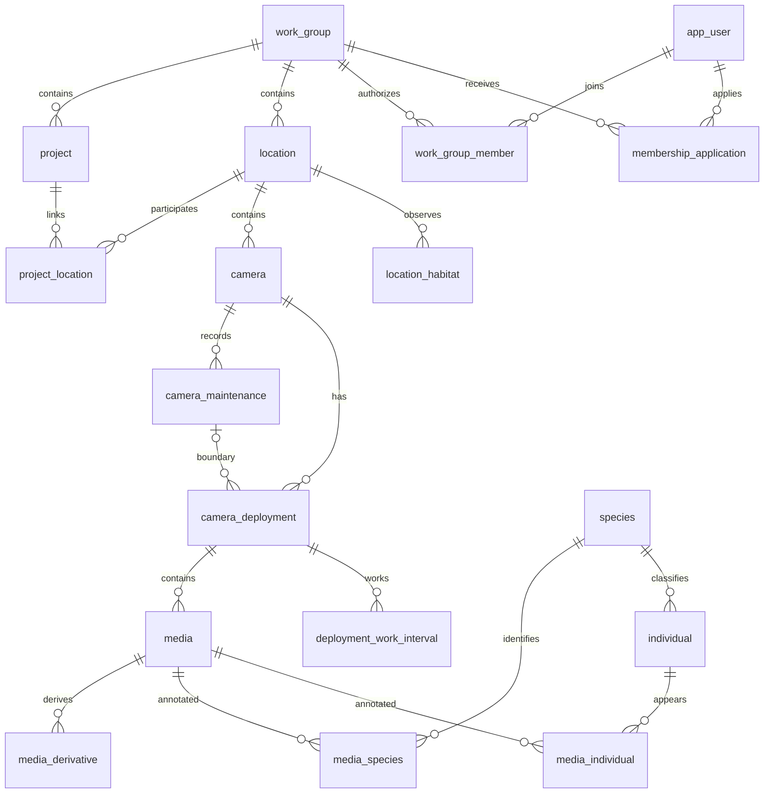

# 红外相机数据管理平台数据库设计文档

V1.5 · 2026-11-06（工作组、申请审批及指南同步修订） · PostgreSQL + PostGIS

依据《database_design_guide.md》修订的一期设计。本文完整描述本版模型，可独立用于评审及后续开发。设计文档更新不表示程序、数据库迁移或生产数据已经更新。

## 1. 版本依据与范围

### 1.1 依据及冲突处理

本版以[数据库设计指南](https://github.com/xuneree/WildlifeDATA/blob/docs/database-design-v1.5/docs/database/database_design_guide.md)、2026-11-06 用户确认的工作组与申请审批规则及[总体需求 V1.4](../requirements/platform-requirements-v1_4.md)为依据。最新指南读取自提交 `5c340b11ba41d2de739b8a1033bdbad4c01f883c`，指南 blob 为 `b9e635dc7c5b801a02c11b9799faebfca78fc163`；以前版数据库 V1.4 及本版先前稿为修订基线。

工作组是数据归属和人员授权单位，替代旧区域权限模型。项目直接继承工作组权限，一期不设项目级授权。管理申请由系统管理员审批；工作、只读申请由工作组管理员审批，系统管理员可代审。工作组管理员的任命、降级及撤销由系统管理员负责。

同步指南新增的位点生境历史、维护后相机参数、精确坐标与下载权限，以及周期内故障恢复的样例。指南中仍残留的“区域”“项目-权限”及“工作组管理员审批所有等级”按本轮已确认规则修正。旧版一期个体关系、事件实体及固定选项字典表不恢复。

文中“已确认”表示用户明确提出或接受的业务原则；“实现建议”表示落实该原则的字段、约束和事务方案；未知词表和真实数据样例仍须验证。本文为设计，不表示已迁移运行数据库。

### 1.2 一期与后续边界

一期包括：工作组和项目、成员与申请审批、共享位点及生境观察、机位、维护记录及参数、布设周期及多段有效工作、媒体及派生文件、XMP 物种标签导入、Excel 个体标签导入、个体档案与多角度代表图、历史编号、媒体标签底表、账号授权、审计和查询统计支撑。标签底表不等于完整素材库的选编、裁剪、发布功能已经纳入一期。

一期不增加实体相机库存管理，不增加个体关系表。已有个体关系数据须归档保留。人工个体标注工具、繁殖记录、家域可视化和模板报告沿用后续规划；物种 AI 的交付阶段仍另定。RAI 仍保留一期设计支撑，但正式计算口径须先确定。

### 1.3 相对 V1.4 的主要变化

| 主题 | V1.4 | V1.5 |
| --- | --- | --- |
| 数据组织 | 两级区域、位点 | 工作组承担数据归属和授权；工作组下项目与位点并列，通过 project_location 多对多关联 |
| 相机含义 | 周期内 device_code 字符串 | camera 独立表示位点内机位，非实体设备 |
| 现场记录 | 工作、现场维护及数据交接混在周期内 | camera_maintenance 保存维护及维护后型号、参数；周期保存起始配置快照 |
| 周期状态 | 主要为已结束周期 | 支持开放周期、已闭合周期及未补齐边界的历史周期 |
| 时间校准 | 媒体单独校准 | 周期统一秒偏移；历史媒体单独校准保留为优先覆盖值 |
| 当前标签 | species_annotation、individual_occurrence | media_species、media_individual，保留导入来源及覆盖历史 |
| 个体档案 | 主要为豹；代表图无结构化角度 | 支持豹、兔狲等物种；代表图有角度、部位，支持拼合图 |
| 个体关系 | 一期 | 一期不纳入，历史数据归档 |
| 账号权限 | admin/operator/viewer 与工作组范围 | system_admin/normal 账号类型；按工作组授权，项目直接继承 |
| 素材标签 | 主要支撑未知个体标签 | 保留系统标签并补齐素材标签、标记人和素材描述字段 |
| 独立拍摄 | 派生事件及成员表 | 不建事件实体，在 media 和 media_species 保存有明确口径的标记 |
| 固定选项 | 各自独立字典表 | location 字段 + CHECK；变化的生境另存 location_habitat 时间序列 |
| 人员审批 | 直接分范围授权 | 注册后申请工作组及等级，审批后生成有效成员；项目无独立授权 |
| 有效工作 | 单段日期及故障恢复待明确 | deployment_work_interval 保存实际有效区间，故障恢复不再按整段跨度计算 |

### 1.4 本轮术语约定

维护采用标准英文拼写 maintenance，统一使用 camera_maintenance。维护类型为安装 install、回收 collect、停用 deactivate；“回收”仅是维护类型，不再是与维护并列的业务实体。周期边界及媒体来源均引用维护记录。旧版术语仅允许出现在迁移对照中。

## 2. 业务对象与关系

### 2.1 名词与基数

| 对象 | 定义及归属 | 例子 |
| --- | --- | --- |
| work_group | 数据归属和人员权限管理单位，业务指南称 group | 山西、西北、河北&北京等工作组；名称可沿用地名，不代表地理权限边界 |
| project | 有明确目标的监测项目，只属于一个 work_group | 和顺常规监测、和顺 X337 |
| location | 地理监测位置，只属于一个 work_group；可关联零个或多个同工作组 project | 701 |
| camera | location 内稳定机位；更换实体相机不更换机位 ID | 701A、701B |
| maintenance | 对 camera 的一次现场维护，包含安装、回收、停用操作，有批次 | 2026-10-01回收记录 |
| deployment | 同一 camera 两次维护之间的布设周期，首次从安装起算 | 2026-08-01 至 2026-09-30 |
| media | 一个原始视频或图片，只属于一个 deployment | IMG00001.MP4 |
| annotation | 媒体与物种或个体的当前有效关联 | media_species、media_individual |
| species | 全系统物种字典 | leopard |
| individual | 稳定身份的个体档案，可改当前编号 | LEO_HS1905F |

一个位点关联多个项目时，共用该位点的机位、周期、媒体和标签；不为每个项目复制事实。不在 location 再放单个 project_id，也不以旧“二级工作组”直接代替新 project。

### 2.2 核心实体关系图

下图省略导入历史、素材标签、审计及代表图等支撑表；箭头代表外键关系，不代表数据必须按箭头顺序录入。



camera_maintenance 作为周期边界具有两种具体外键：start_maintenance_id 和 end_maintenance_id。同一次回收可同时是上一周期结束与下一周期开始；新周期并不复制该维护记录。work_group_member 每行只对应一个用户与工作组，项目不再有授权行。

### 2.3 数据归属与项目关联

project、location、individual 明确归属一个 work_group；机位、维护、布设、媒体、标签和生境记录通过稳定外键链继承归属，不逐行再授权。工作组内多个项目可共用一个位点及其媒体，不复制事实，跨项目汇总按主键去重。

成员权限覆盖所属工作组全部项目，也覆盖尚未关联项目的位点。project_location 仅用于业务组织和筛选，增加或停用关联不再改变成员权限。项目负责人不自动获得成员身份或管理权限。项目筛选仅决定查询范围，不是安全边界。

跨工作组项目—位点关联由复合外键禁止。业务数据跨组转移会改变可见人员，须由系统管理员走独立校验与审计流程，不允许普通更新归属 ID。工作组权限取消后，不能凭历史项目关联、导入记录或旧文件链接继续访问。

## 3. 命名、类型与通用约定

表名用单数 snake_case。主键采用 UUID，不随业务编号变化。代码字段保持文本，保留前导零。相机机位统一使用 camera_code，实体设备型号使用 camera_model；不把型号当机位编号。

`DATE` 保存现场维护、布设和有效工作日期，不伪造午夜；`TIMESTAMPTZ` 保存媒体拍摄与审计时间点。媒体来源时区通过来源记录明确，未知时区不按服务器默认值猜测。界面按明确选择的时区展示。

除复合关联表外，业务表默认有 `id UUID PRIMARY KEY`、`created_at TIMESTAMPTZ NOT NULL DEFAULT now()`、`updated_at TIMESTAMPTZ NOT NULL DEFAULT now()`；下方不重复列出。可变事实表另有 `row_version BIGINT NOT NULL DEFAULT 1`，用于导入预览后提交及人工更正的并发检查。导入历史、审计和已完成统计快照只追加，不原位修改内容。表中“必填”含数据库 NOT NULL；“可空”表示 NULL，不用空字符串、0 或虚构关联替代未知值。

指南以 * 标明非必填。本版字段表进一步区分正常必填、条件必填和历史/未知可空：开放周期不要求结束信息，未复核不要求复核人，未知出生信息、坐标和工作量允许 NULL。这些可空处理沿用真实资料不完整时不造值的原则，属于实现建议；新在线录入是否强制坐标、生境等资料齐全，应在表单验收时确认，不能以虚构值满足约束。

外键默认 RESTRICT/NO ACTION；业务实体不级联删除。每个外键须有适合访问路径的索引。坐标采用 WGS84；空间查询可使用 `ST_SetSRID(ST_MakePoint(longitude,latitude),4326)` 的 GiST 表达式索引。

## 4. 表清单

本版一期模型含 27 张基础及支撑表、1 张可选 statistics_run 统计快照表，共 28 张表。相对先前 25 表稿新增 membership_application、location_habitat、deployment_work_interval；原 user_permission 改为 work_group_member。位点别名表仍未纳入；本表数不表示运行库已实现表数。

| 分组 | 表 | 职责 |
| --- | --- | --- |
| 组织 | work_group | 数据归属与人员管理单位 |
| 组织 | project | 项目 |
| 组织 | project_location | 项目—位点关联 |
| 监测 | location | 地理位点及相对稳定信息 |
| 监测 | location_habitat | 植被、动物痕迹、人为干扰的历史观察 |
| 监测 | camera | 位点内机位 |
| 监测 | camera_maintenance | 安装、回收、停用维护 |
| 监测 | camera_deployment | 布设周期、起始配置快照及周期统一校准 |
| 监测 | deployment_work_interval | 周期内实际有效工作区间 |
| 媒体 | media | 原始文件索引 |
| 媒体 | media_derivative | 代理视频、缩略图、抽帧 |
| 物种 | species | 全局物种字典 |
| 物种 | annotation_import | XMP 导入批次 |
| 物种 | annotation_import_item | 逐媒体导入结果与快照 |
| 物种 | media_species | 当前物种标签 |
| 个体 | individual | 个体档案 |
| 个体 | individual_profile | 按角度、部位保存的代表图 |
| 个体 | individual_alias | 个体历史编号 |
| 个体 | individual_import | Excel 个体导入批次 |
| 个体 | individual_import_item | 逐媒体导入结果与快照 |
| 个体 | media_individual | 当前已确认个体关联 |
| 标签 | tag | 系统与素材标签字典 |
| 标签 | media_tag | 媒体标签、标记人和素材描述 |
| 账号 | app_user | 账号类型、身份及状态 |
| 账号 | work_group_member | 审批通过后的工作组成员及权限 |
| 账号 | membership_application | 加入工作组或调整等级的申请与审批 |
| 审计 | audit_log | 操作和前后快照 |
| 统计 | statistics_run | 规则、输入、结果快照 |

## 5. 组织与监测数据字典

### 5.1 work_group｜工作组

指南业务名为 group，物理表名采用 work_group，避免 SQL 关键字歧义。它表示组织和数据责任边界，不要求等同于行政或地理区域。

| 字段 | SQL 类型 | 要求 / 默认 | 说明 |
| --- | --- | --- | --- |
| work_group_code | VARCHAR(30) | 必填 | 稳定代码，全局唯一 |
| work_group_name | VARCHAR(100) | 必填 | 工作组名称，全局唯一 |
| is_active | BOOLEAN | 必填 / true | 停用后暂停普通成员访问及申请审批，历史保留 |
| notes | TEXT | 可空 | 工作组说明 |

指南“写死”落实为初始化固定工作组配置及稳定 ID；注册和数据导入不能创建工作组。系统管理员维护配置、启停和管理员任命。已引用的工作组不直接删除。系统管理员可查看停用组历史并恢复工作组。

### 5.2 project｜项目

| 字段 | SQL 类型 | 要求 / 默认 | 说明 |
| --- | --- | --- | --- |
| work_group_id | UUID | 必填 | FK → work_group.id |
| project_code | VARCHAR(50) | 必填 | 工作组内唯一项目编号 |
| project_name | VARCHAR(200) | 必填 | 项目名称 |
| project_type | VARCHAR(50) | 必填 | 项目类型，取值待提供 |
| responsible_person | TEXT | 必填 | 负责人姓名文本，兼容无平台账号人员 |
| responsible_user_id | UUID | 可空 | FK → app_user.id；有关联账号时填写 |
| project_status | VARCHAR(20) | 必填 / active | active / inactive |
| notes | TEXT | 可空 | 备注 |

约束：UNIQUE(work_group_id,project_code)，并设 UNIQUE(work_group_id,id) 支持同工作组复合外键。负责人和成员身份独立；停用项目仍可查询有权限的历史，停止普通新增。跨工作组迁移项目影响全部权限及关联，不开放直接改 work_group_id。

### 5.3 location｜位点

| 字段 | SQL 类型 | 要求 / 默认 | 说明 |
| --- | --- | --- | --- |
| work_group_id | UUID | 必填 | FK → work_group.id |
| location_code | VARCHAR(20) | 必填 | 工作组内唯一，包含停用位点 |
| grid_code | VARCHAR(50) | 可空 | 网格编号；文本保留前导零，非必填 |
| longitude | DOUBLE PRECISION | 可空 | -180 至 180 |
| latitude | DOUBLE PRECISION | 可空 | -90 至 90，与经度同时填写或同时为空 |
| elevation_m | NUMERIC(8,2) | 可空 | 海拔米，可为合法负值 |
| habitat_type | VARCHAR(20) | 可空 | 固定代码选项，用 CHECK 约束 |
| terrain_type | VARCHAR(20) | 可空 | 固定代码选项，用 CHECK 约束 |
| environment_type | VARCHAR(20) | 可空 | 固定代码选项，用 CHECK 约束；兼容旧字段 |
| first_deployed_date | DATE | 可空 | 首次布设日期；已有可靠历史保留 |
| track_storage_path | TEXT | 可空 | 轨迹文件受控存储键，不内嵌文件内容 |
| notes | TEXT | 可空 | 说明 |

约束：UNIQUE(work_group_id,location_code)、UNIQUE(work_group_id,id)，坐标成对及范围 CHECK。位点表不保存单值“项目”列，由 project_location 查询项目列表。两项状态不作为 location 的手填事实列保存。

布设类型和位点启用状态是随时间变化的只读计算结果，不手填，也不固定在布设周期内。按查询时刻每个机位最后一条已知操作后的在位标记汇总：0 台为无布设/停用，1 台为单侧/启用，2 台为对拍/启用。故障、关机、收卡换卡和更换实体设备不等于撤机；撤回或确认丢失且未补装时不在位，丢失后补装恢复在位。丢失日期未知时只在实际检查日期记录已知结果，不倒推未知历史。

维护记录 is_deployed_after 表示操作完成后是否有相机在位，与 working_status_after 和有效工作区间独立。历史按实际操作日期及同日顺序计算，不按录入时间、周期内累计相机数或 open 周期数计算。当前 DATE 模型查询所选日期最后一次操作后的状态；同日多次操作按 maintenance_sequence 排序，不伪造小时分钟。没有记录时按已记录事实计为 0 台，但缺失操作历史不构成已核实的现场停用结论；没有位点编号时不显示计算结论。超过两台保持启用，布设类型显示待核查。

只读视图/查询返回 deployment_type（none/single/paired/unclassified）、location_status（active/inactive）、camera_count 和 as_of。当前结果可缓存回底表以便展示，但缓存必须带计算日期及来源版本，只能由系统重算；不能接受人工写入，也不能用于替代历史操作。

指南反馈位点改号较少，但可能存在别名；别名是否需要维护仍待确认，本版不预建 location_alias。已有旧位点编号在迁移映射与审计中保留，不能丢弃或当作新编号覆盖。若确认需要，按“稳定 location_id + 可追溯历史编号表”扩展，避免逗号拼接字段。

### 5.4 project_location｜项目—位点关联

| 字段 | SQL 类型 | 要求 / 默认 | 说明 |
| --- | --- | --- | --- |
| work_group_id | UUID | 必填 | 用于强制两端同工作组 |
| project_id | UUID | 必填 | FK → project.id |
| location_id | UUID | 必填 | FK → location.id |
| is_active | BOOLEAN | 必填 / true | 是否作为当前业务关联参与项目筛选，不参与授权 |
| linked_by_id | UUID | 必填 | FK → app_user.id |
| linked_at | TIMESTAMPTZ | 必填 / now() | 建立关联时间，非项目参与起始日期 |
| notes | TEXT | 可空 | 关联说明 |

以 (project_id,location_id) 为复合主键，无单独 id；通用 created_at/updated_at 保留。复合外键 (work_group_id,project_id) → project(work_group_id,id)、(work_group_id,location_id) → location(work_group_id,id) 防止跨工作组关联。变更 is_active 记录审计；重新关联复用该行。关联时间不是媒体访问起点。

### 5.5 camera｜机位

| 字段 | SQL 类型 | 要求 / 默认 | 说明 |
| --- | --- | --- | --- |
| location_id | UUID | 必填 | FK → location.id |
| camera_code | VARCHAR(20) | 必填 | 位点内机位编号，如 701A |
| camera_status | VARCHAR(20) | 必填 / active | active / inactive，机位业务录入控制；不代表物理在位 |
| notes | TEXT | 可空 | 机位说明 |

约束：UNIQUE(location_id,camera_code)。机位非设备，无库存数量、采购、资产流转字段。型号记录在维护和周期；同机位换新实体相机沿用 camera.id。机位挪到新的地理位点须新建 ID，历史媒体不改挂。若未来加入实体资产模块，另建 camera_device 并关联周期，不改变 camera 的含义。

### 5.6 camera_maintenance｜相机维护记录

| 字段 | SQL 类型 | 要求 / 默认 | 说明 |
| --- | --- | --- | --- |
| camera_id | UUID | 必填 | FK → camera.id；位点经 camera 推导 |
| maintenance_date | DATE | 必填 | 现场维护日期 |
| maintenance_sequence | INTEGER | 必填 / 1 | 同机位同日维护顺序，正整数 |
| maintenance_type | VARCHAR(20) | 必填 | install / collect / deactivate |
| maintenance_batch | VARCHAR(20) | 必填 | 本次维护批次；安装、回收、停用均填写 |
| data_status | VARCHAR(20) | 条件可空 | collected / not_collected；无数据交接动作时为空 |
| camera_model_after | VARCHAR(20) | 可空 | 维护后留在机位的相机型号；撤机可空 |
| camera_parameters_after | JSONB | 可空 | 维护后相机参数；历史未记录为 NULL，不能猜默认参数 |
| working_status_after | VARCHAR(20) | 必填 / unknown | normal / faulty / stopped / unknown |
| is_deployed_after | BOOLEAN | 必填 | 维护后机位是否仍布有相机，不设猜测默认值 |
| maintained_by | TEXT | 可空 | 现场工作人员姓名 |
| recorded_by_id | UUID | 必填 | FK → app_user.id；录入账号，区别于现场人员 |
| issue_type | VARCHAR(50) | 可空 | 异常类型；正常为空 |
| issue_notes | TEXT | 可空 | 异常问题 |
| maintenance_notes | TEXT | 可空 | 维护内容 |
| notes | TEXT | 可空 | 其他说明 |

约束：UNIQUE(camera_id,maintenance_date,maintenance_sequence)，另设 UNIQUE(camera_id,id) 供周期复合外键。install 要求 is_deployed_after=true，deactivate 要求 false；collect 必须填写data_status 和维护批次，collected 必须有批次。deactivate 可同时记录回收；install 本版不同时表达回收，应先记录回收再安装。维护批次是分组代码，不是独立业务对象或唯一维护 ID，同机位同批次多次回收通过不同 maintenance.id 区分。

collected 表示确实取回数据介质/数据，空卡或损坏仍为 collected，异常写说明。not_collected 表示回收尝试失败或未取回；不能据此假造已完成回收。问题类型沿用既有候选 sd_card_lost / camera_lost / camera_damaged / battery_depleted / other，词表最终以业务配置为准。

指南列出的位点编号和相机编号在视图中通过 camera.location_id 输出，不在本表重复保存易冲突的编号。批次只保存于维护表，媒体通过所属回收维护获得批次。

相机参数使用带版本的字段契约校验；触发间隔、拍摄模式、视频时长、灵敏度等为待真实模板确认的候选字段，单位和枚举明确后统一校验，不接受任意 JSON 代替有效参数。参数写的是维护后的配置，原值由审计保留，撤机无留置设备可为空。

### 5.7 camera_deployment｜布设周期

| 字段 | SQL 类型 | 要求 / 默认 | 说明 |
| --- | --- | --- | --- |
| camera_id | UUID | 必填 | FK → camera.id |
| start_maintenance_id | UUID | 条件可空 | 起始维护；新建正常周期必填 |
| end_maintenance_id | UUID | 条件可空 | 结束维护；开放周期为空 |
| deployment_status | VARCHAR(20) | 必填 | open / closed / legacy_unknown |
| camera_model | VARCHAR(20) | 可空 | 周期起始型号快照，来自起始维护后的型号 |
| camera_parameters | JSONB | 可空 | 周期起始参数快照，来自起始维护的 camera_parameters_after |
| deployment_start_date | DATE | 条件可空 | 布设开始日期，新周期必填 |
| deployment_end_date | DATE | 条件可空 | 布设结束日期，closed 必填 |
| effective_work_start_date | DATE | 可空 | 已核实工作区间的最早起点，受控汇总值 |
| effective_work_end_date | DATE | 可空 | 已核实工作区间的最晚终点，受控汇总值 |
| work_interval_verified | BOOLEAN | 必填 / false | 是否已确认有效工作区间完整、可采信；不是“跨度连续” |
| work_verification_note | TEXT | 可空 | 工作量确认依据；确认从未有效工作时必填 |
| time_offset_seconds | INTEGER | 可空 | 校准秒偏移，NULL=未校准，0=已确认无需偏移 |
| time_offset_note | TEXT | 可空 | 校准依据与说明 |
| time_offset_updated_by_id | UUID | 可空 | FK → app_user.id |
| time_offset_updated_at | TIMESTAMPTZ | 可空 | 最后一次校准时间 |
| independence_status | VARCHAR(20) | 必填 / pending | pending / ready / stale，当前周期独立拍摄标记是否可用 |
| independence_rule_version | VARCHAR(100) | 可空 | 用于派生标记的默认规则版本，ready 时必填 |
| independence_input_signature | VARCHAR(64) | 可空 | 媒体、时间和物种输入签名，ready 时必填 |
| notes | TEXT | 可空 | 周期说明 |

外键：用 (camera_id,start_maintenance_id) 与 (camera_id,end_maintenance_id) → camera_maintenance(camera_id,id) 保证同机位。start_maintenance_id 非空唯一，end_maintenance_id 非空唯一，允许同一个 maintenance.id 出现在上一周期 end 与下一周期 start。创建部分唯一索引 UNIQUE(camera_id) WHERE deployment_status='open'。

状态约束：open 要求 start_maintenance_id 和开始日期非空，end_maintenance_id 和结束日期为空；closed 要求两端维护及日期非空；legacy_unknown 只用于不能可靠重建边界的历史记录，新在线录入禁止使用。日期均在已知时检查先后，有效工作区间不得超出已知布设边界；work_interval_verified=true 表示区间集合完整、可采信；有区间时起止汇总必须一致，确认从未有效工作时集合可为空但必须有依据说明。校准偏移非空时，校准人、时间必填。independence_status=ready 时规则版本和输入签名必填，状态约束由 CHECK 落实。

开始、结束日期是边界维护日期的受控冗余，用约束触发器或同一事务服务核对，不能允许独立随意编辑。边界先后按“维护日期、同日顺序”比较；同一天允许上一周期结束和下一周期开始，因此不能用日期相等直接判为重叠。

媒体归属布设周期使用 deployment_id。结束维护与回收维护通常相同，但停用后另行取卡时可能不同，故媒体另有 maintenance_id；二者不能混为一个概念。

### 5.8 生境、地形等固定选项直接约束字段

一期不建 terrain_option、habitat_option、environment_option 表。location 直接保存 habitat_type、terrain_type、environment_type 的稳定字符串代码；数据库按各字段允许值建立 CHECK 约束，前端下拉框和 Excel 校验从同一份版本化选项配置生成。数据库不保存“下拉框”，而是校验最终写入值。

采用 VARCHAR + CHECK 而非 PostgreSQL 原生 ENUM，便于后续经迁移修改选项。具体允许值尚未提供，本文件不编造词表或把示例当正式取值；实施时必须将已确认代码列表落实到 CHECK，不能只在前端限制。未知值报错；空值仍按字段的可空规则处理。

固定且少量、随版本发布的选项不需要字典表。只有后续需要管理员在线增删、停用旧选项、排序或多语言等能力时，再考虑字典表；即使届时引入，也可使用一张带类别的统一字典，不必每个字段一张表。

选项展示名修改不改变稳定代码。删除或改义旧代码前先检查历史值，不能在收紧 CHECK 前静默丢数据。原 vegetation_type 与新“生境类型”的语义须人工映射，原 environment_type 兼容保留；未核对的值归档待处理。

### 5.9 location_habitat｜位点生境观察历史

location 保存坐标、地形及相对稳定的生境类型；本表按观察日期记录变化信息，不能用最新一次观察覆盖历史。

| 字段 | SQL 类型 | 要求 / 默认 | 说明 |
| --- | --- | --- | --- |
| location_id | UUID | 必填 | FK → location.id，归属经位点继承 |
| observed_date | DATE | 必填 | 实际观察日期，不用录入时间代替 |
| vegetation_info | TEXT | 可空 | 植被状况 |
| animal_signs | TEXT | 可空 | 动物痕迹 |
| human_disturbance | TEXT | 可空 | 人为干扰 |
| maintenance_id | UUID | 可空 | FK → camera_maintenance.id；随维护调查时关联，必须同位点 |
| observed_by | TEXT | 可空 | 实地观察人 |
| recorded_by_id | UUID | 必填 | FK → app_user.id，实际录入账号 |
| notes | TEXT | 可空 | 方法、样例及其他说明 |

至少一项观察内容非空；NULL 表示未记录，明确未发现可填写“未见”，不能把两者混为一谈。同日可多次观察，不设 (location_id,observed_date) 唯一约束。按 (location_id,observed_date) 索引；历史更正保留前后审计。位置变化须建新位点，不以生境记录改变地理身份。

### 5.10 deployment_work_interval｜有效工作区间

指南确认周期内故障后修复虽少但存在，因此一期保存多段实际有效工作区间。单段正常工作也使用本表，统一计算方式。

| 字段 | SQL 类型 | 要求 / 默认 | 说明 |
| --- | --- | --- | --- |
| deployment_id | UUID | 必填 | FK → camera_deployment.id |
| work_start_date | DATE | 必填 | 有依据的有效工作开始日期 |
| work_end_date | DATE | 必填 | 有依据的有效工作结束日期 |
| evidence_notes | TEXT | 必填 | 有效工作与故障恢复的判断依据 |
| verified_by_id | UUID | 必填 | FK → app_user.id，确认账号 |
| verified_at | TIMESTAMPTZ | 必填 / now() | 确认时间 |
| notes | TEXT | 可空 | 区间说明 |

CHECK(end>=start)，已知时不得超出布设日期；同一 deployment 内日期区间不重叠，可用按 deployment_id 与闭区间 daterange 的排斥约束或等效事务校验。日期型记录无法表达同日部分时间；不能伪造时刻，需依据已确认的日界规则或标记资料不足。

有效工作量来自已确认区间的并集及筛选裁剪，不从首末日期跨度推算。deployment 的 effective_work_start/end 是区间最早与最晚日期的受控汇总；区间修改使汇总、确认状态及统计快照在同一事务更新或失效。只有 work_interval_verified=true 才认可整个周期工作量。区间为空且未确认表示未知；为空且已确认、附有依据时表示明确未有效工作，分母为 0，RAI 仍不可计算。

故障恢复证据记录在工作区间及说明中；维护类型仍为安装、回收、停用，不为了补工作量伪造回收维护。独立维修日志及更细时间精度留待真实样例确定。

## 6. 媒体、物种与标签数据字典

### 6.1 media｜原始媒体文件

| 字段 | SQL 类型 | 要求 / 默认 | 说明 |
| --- | --- | --- | --- |
| deployment_id | UUID | 必填 | FK → camera_deployment.id |
| maintenance_id | UUID | 可空 | FK → camera_maintenance.id；实际取得本文件的回收维护，历史不明可空 |
| filename | TEXT | 必填 | 原始文件名 |
| media_type | VARCHAR(10) | 必填 | video / image |
| storage_path | TEXT | 必填 | 受控 NAS 路径或存储键，唯一 |
| file_size_bytes | BIGINT | 可空 | 非负文件字节数 |
| file_hash | VARCHAR(64) | 可空 | SHA-256，不作为跨目录自动删除依据 |
| captured_at | TIMESTAMPTZ | 可空 | 首次导入的原始拍摄时间，保留原值 |
| captured_time_source | VARCHAR(30) | 必填 | file_mtime / metadata / legacy / unknown |
| source_timezone | VARCHAR(100) | 可空 | 解释原始本地时间的 IANA 时区或来源说明 |
| time_corrected_at | TIMESTAMPTZ | 可空 | 历史或特例媒体单独校准值；优先于周期偏移 |
| time_correction_note | TEXT | 可空 | 单文件校准依据，写入审计记录操作者 |
| duration_seconds | NUMERIC(12,3) | 可空 | 视频时长，非负；图片为空 |
| width | INTEGER | 可空 | 像素宽，非空须大于 0 |
| height | INTEGER | 可空 | 像素高，非空须大于 0 |
| codec | VARCHAR(50) | 可空 | 编码 |
| individual_annotation_status | VARCHAR(20) | 必填 / unannotated | unannotated / annotated |
| is_independent_capture | BOOLEAN | 可空 / NULL | 文件级独立拍摄标记；TRUE=代表文件，FALSE=同组后续文件，NULL=未判定 |
| notes | TEXT | 可空 | 文件说明 |

maintenance_id 非空时必须为同机位且 data_status=collected 的维护；回收维护日期不早于文件所属已知周期的结束边界。停用关闭后才取卡，允许引用后来的成功回收维护。同一次回收类型维护可取得多个历史周期的文件，但每个媒体仍须明确一个拍摄周期。不能只按文件名或批次猜归属。

维护批次由 maintenance_id → camera_maintenance.maintenance_batch 推导，视图输出该字段，不在 media 再独立存一份。原文件拍摄时间沿用首次读取文件 mtime 的已有约定，新导入优先规则变化须单独确认；captured_time_source 的 metadata 值仅为明确采用元数据时的扩展，不静默改变默认来源。未知时间不排除媒体入库，但独立拍摄标记保留 NULL，不能把缺少时间视为“非独立”。

有效拍摄时间为视图计算列 `effective_captured_at`，公式见第 11 节。不把跨表计算写成 PostgreSQL generated column，也不批量覆盖原始 captured_at。

### 6.2 media_derivative｜代理与预览

| 字段 | SQL 类型 | 要求 / 默认 | 说明 |
| --- | --- | --- | --- |
| media_id | UUID | 必填 | FK → media.id |
| derivative_type | VARCHAR(30) | 必填 | proxy_video / thumbnail / frame_capture |
| filename | TEXT | 必填 | 派生文件名 |
| storage_path | TEXT | 必填 | 唯一存储键 |
| generation_status | VARCHAR(20) | 必填 / pending | pending / ready / failed |
| notes | TEXT | 可空 | 生成说明或错误 |

索引 (media_id,derivative_type)。允许同一原始文件多张抽帧，不用 UNIQUE(media_id,derivative_type) 误限制。派生文件可重建；查看和播放继承原始 media 的权限，路径不能作为公开访问凭证。

### 6.3 species｜全局物种字典

| 字段 | SQL 类型 | 要求 / 默认 | 说明 |
| --- | --- | --- | --- |
| species_code | VARCHAR(50) | 必填 | 全局唯一代码 |
| common_name | VARCHAR(100) | 必填 | 物种名称 |
| scientific_name | VARCHAR(200) | 可空 | 拉丁学名 |
| is_active | BOOLEAN | 必填 / true | 停用不删除已有关联 |
| notes | TEXT | 可空 | 分类说明 |

物种由系统管理员维护，所有账号的引用使用稳定 species.id；普通标签导入不能自动创建未知物种。

### 6.4 annotation_import｜XMP 导入批次

| 字段 | SQL 类型 | 要求 / 默认 | 说明 |
| --- | --- | --- | --- |
| imported_by_id | UUID | 必填 | FK → app_user.id，实际上传账号 |
| imported_at | TIMESTAMPTZ | 必填 / now() | 执行时间 |
| source_filename | TEXT | 可空 | 单文件或压缩包名 |
| source_hash | VARCHAR(64) | 可空 | SHA-256 |
| import_status | VARCHAR(20) | 必填 | validated / completed / failed |
| replacement_policy | VARCHAR(30) | 必填 | skip_identical / replace_confirmed |
| annotated_by | VARCHAR(100) | 可空 | 批次默认原标注人，非上传账号 |
| review_status | VARCHAR(20) | 必填 / unreviewed | unreviewed / reviewed |
| reviewed_by | VARCHAR(100) | 可空 | 批次默认复核人 |
| total_file_count | INTEGER | 必填 / 0 | 处理项总数 |
| success_file_count | INTEGER | 必填 / 0 | 成功数 |
| failed_file_count | INTEGER | 必填 / 0 | 失败数 |
| skipped_file_count | INTEGER | 必填 / 0 | 跳过数 |
| notes | TEXT | 可空 | 说明 |

计数非负，success+failed+skipped ≤ total；completed 时相等且 failed=0。本版采用整批业务提交，失败不能留下部分标签更新。可在失败业务事务之外单独记录 failed 批次及错误项。

### 6.5 annotation_import_item｜逐媒体 XMP 结果

| 字段 | SQL 类型 | 要求 / 默认 | 说明 |
| --- | --- | --- | --- |
| annotation_import_id | UUID | 必填 | FK → annotation_import.id |
| source_filename | TEXT | 必填 | 来源 XMP 文件名 |
| source_media_key | JSONB | 必填 | 周期、目录、相对路径等匹配上下文 |
| media_id | UUID | 可空 | FK → media.id；未匹配时为空 |
| import_status | VARCHAR(20) | 必填 | success / failed / skipped |
| before_data | JSONB | 可空 | 替换前完整物种关联及人员、复核、来源快照 |
| after_data | JSONB | 可空 | 完整目标标签及元信息，使用稳定 species.id |
| error_message | TEXT | 可空 | 失败、跳过说明 |

success/skipped 必须有 media_id；每批非空 media_id 唯一。success 的 after_data 保存实际提交值；失败项的候选内容须明确为未生效，不作为当前标签。快照结构按接口契约校验，不能只有代码列表而丢失复核及来源信息。

### 6.6 media_species｜当前物种标注

| 字段 | SQL 类型 | 要求 / 默认 | 说明 |
| --- | --- | --- | --- |
| media_id | UUID | 必填 | FK → media.id |
| species_id | UUID | 必填 | FK → species.id |
| annotated_by | VARCHAR(100) | 可空 | 原标注人 |
| review_status | VARCHAR(20) | 必填 / unreviewed | unreviewed / reviewed |
| reviewed_by | VARCHAR(100) | 可空 | reviewed 时须有复核人 |
| reviewed_at | TIMESTAMPTZ | 可空 | 有可靠时间时保存，不以导入时间冒充复核时间 |
| annotation_import_item_id | UUID | 条件可空 | FK → annotation_import_item.id |
| source_type | VARCHAR(20) | 必填 | xmp_import / legacy；manual 留待后续工具启用 |
| imported_at | TIMESTAMPTZ | 可空 | 可靠导入时间 |
| is_independent_capture | BOOLEAN | 可空 / NULL | 此物种在该媒体上的独立拍摄标记，用于物种次数和 RAI 分子 |

UNIQUE(media_id,species_id)。导入批次 ID 通过 item 推导，不重复保存两个可能冲突的来源外键。source_type=xmp_import 必须引用同媒体的成功导入项；legacy 不伪造来源。一个媒体可多物种，本版不增加数量、框或帧时段。

### 6.7 tag｜标签字典

| 字段 | SQL 类型 | 要求 / 默认 | 说明 |
| --- | --- | --- | --- |
| tag_code | VARCHAR(50) | 必填 | 全局唯一 |
| tag_name | VARCHAR(100) | 必填 | 标签名称 |
| tag_type | VARCHAR(20) | 必填 | system / material |
| description | TEXT | 可空 | 定义 |
| is_active | BOOLEAN | 必填 / true | 是否供新标记使用 |

预置 system 标签 unknown_individual。全局字典由系统管理员维护；一期保存素材标签关联，不预设完整素材库分类和发布流程。

### 6.8 media_tag｜媒体标签与素材描述

| 字段 | SQL 类型 | 要求 / 默认 | 说明 |
| --- | --- | --- | --- |
| media_id | UUID | 必填 | FK → media.id |
| tag_id | UUID | 必填 | FK → tag.id |
| tagged_by | VARCHAR(100) | 可空 | 标记人姓名 |
| tagged_by_id | UUID | 可空 | FK → app_user.id，平台执行账号 |
| tagged_at | TIMESTAMPTZ | 必填 / now() | 标记时间 |
| material_description | TEXT | 可空 | 该素材标签下的素材描述 |
| individual_import_item_id | UUID | 条件可空 | FK → individual_import_item.id，仅未知个体导入来源使用 |
| notes | TEXT | 可空 | 其他说明 |

UNIQUE(media_id,tag_id)。已知个体与 unknown_individual 可同一媒体并存。未知标签不代表一个固定个体，不代表未知个体数量。个体导入只更新 unknown_individual 标签，不覆盖 material 类型标签或其描述。来源项非空时须同媒体、已成功且标签为 unknown_individual。

## 7. 个体档案与个体导入数据字典

### 7.1 individual｜个体档案

| 字段 | SQL 类型 | 要求 / 默认 | 说明 |
| --- | --- | --- | --- |
| individual_code | VARCHAR(50) | 必填 | 当前编号，全局唯一 |
| species_id | UUID | 必填 | FK → species.id，支持豹、兔狲等 |
| work_group_id | UUID | 条件可空 | FK → work_group.id；档案归属工作组，新建必填，历史不明可空且仅系统管理员可见 |
| profile_id | UUID | 可空 | FK → individual_profile.id，当前主代表图 |
| sex | VARCHAR(20) | 必填 / unknown | male / female / unknown |
| birth_year | INTEGER | 可空 | 1–9999，未知不猜测 |
| birth_date_from | DATE | 可空 | 推测出生日期下界 |
| birth_date_to | DATE | 可空 | 推测出生日期上界 |
| life_status | VARCHAR(30) | 必填 / unknown | alive / confirmed_dead / unknown |
| notes | TEXT | 可空 | 档案说明，按档案维护范围控制 |

建档时间使用通用 created_at。指南重复出现的两个“出生日期上界”按“下界、上界”修正。两端已知时 from ≤ to；出生年份与日期区间有一致性检查，只知年份不补 1 月 1 日。未再观测到不表示确认死亡。

work_group_id 表示档案数据归属，不是动物活动地理范围；普通成员只能查看和维护本组档案。跨组身份共享未确认前不自动开放其他组代表图、备注或出现记录；本组媒体关联个体须校验档案同组。跨组历史关联先列为迁移核对项，不静默复制、删除或合并个体。

当前编号与所有历史编号共用一个全局编号空间，禁止 unknown_individual 作为正式编号。首末拍时间、出现位点由权限范围内 media_individual → media 汇总，不保存在此表。跨工作组全局汇总只供有全部相应范围权限的账号。

### 7.2 individual_profile｜个体代表图

| 字段 | SQL 类型 | 要求 / 默认 | 说明 |
| --- | --- | --- | --- |
| individual_id | UUID | 必填 | FK → individual.id |
| view_angle | VARCHAR(20) | 必填 / multi | multi / left / right / front / back |
| body_part | VARCHAR(30) | 必填 / whole_body | whole_body / face / tail / left_forelimb / right_forelimb / left_hindlimb / right_hindlimb |
| filename | TEXT | 必填 | 图片名称 |
| storage_path | TEXT | 必填 | 唯一受控存储键 |
| uploaded_by_id | UUID | 可空 | FK → app_user.id；历史不明可空 |
| notes | TEXT | 可空 | 制作说明 |

默认“多角度 + 全身”用于人工拼合图，非从文件名猜测角度。一个个体同角度同部位可以多张图，不加该组合唯一约束。代表图不是原始 media；若有原始依据，可在说明中记录受控引用，不强制关联一个原始文件。

设置 UNIQUE(individual_id,id)，用复合 FK individual(id,profile_id) → individual_profile(individual_id,id) 保证主图属于同一个体。先建 individual，建 profile 后再加该循环外键，或在事务中延期检查。主图切换与档案更新同事务。

### 7.3 individual_alias｜历史编号

| 字段 | SQL 类型 | 要求 / 默认 | 说明 |
| --- | --- | --- | --- |
| individual_id | UUID | 必填 | FK → individual.id |
| alias_code | VARCHAR(50) | 必填 | 历史编号，全局唯一 |
| retired_at | TIMESTAMPTZ | 可空 | 该编号停用时间；历史未知可空 |
| notes | TEXT | 可空 | 改号说明 |

改号事务：校验新编号未被任何当前号或历史号占用 → 旧号写 alias → 更新 individual_code → 写审计。跨两表的编号冲突须用并发锁和约束触发器保证，不能仅靠各表单独 UNIQUE；不能把另一只个体旧号重新分配。回用本个体曾用号若有业务需要，须专门迁移流程，本版常规改号不允许。

### 7.4 individual_import｜Excel 个体标签导入批次

| 字段 | SQL 类型 | 要求 / 默认 | 说明 |
| --- | --- | --- | --- |
| source_filename | TEXT | 必填 | Excel 文件名 |
| source_hash | VARCHAR(64) | 可空 | SHA-256 |
| imported_by_id | UUID | 必填 | FK → app_user.id |
| imported_at | TIMESTAMPTZ | 必填 / now() | 导入执行时间 |
| import_status | VARCHAR(20) | 必填 | validated / completed / failed |
| replacement_policy | VARCHAR(30) | 必填 | skip_identical / replace_confirmed |
| total_media_count | INTEGER | 必填 / 0 | 归并后的媒体项数 |
| success_media_count | INTEGER | 必填 / 0 | 成功数 |
| failed_media_count | INTEGER | 必填 / 0 | 失败数 |
| skipped_media_count | INTEGER | 必填 / 0 | 跳过数 |
| notes | TEXT | 可空 | 批次说明 |

计数、状态与整批提交约束同 annotation_import。同一个媒体的多行先归并为完整个体集合，不能逐行覆盖。

### 7.5 individual_import_item｜逐媒体个体导入项

| 字段 | SQL 类型 | 要求 / 默认 | 说明 |
| --- | --- | --- | --- |
| individual_import_id | UUID | 必填 | FK → individual_import.id |
| source_row_numbers | JSONB | 必填 | 原始行号数组 |
| source_media_key | JSONB | 必填 | 周期、目录、文件名及可选哈希 |
| media_id | UUID | 可空 | FK → media.id |
| import_status | VARCHAR(20) | 必填 | success / failed / skipped |
| before_data | JSONB | 可空 | 完整个体集合、未知标签、完成状态、人员复核和来源 |
| after_data | JSONB | 可空 | 完整目标集合、稳定 ID 及编号快照等 |
| error_message | TEXT | 可空 | 错误或跳过原因 |

success/skipped 必须匹配一个媒体；每批非空 media_id 唯一。快照包含即使没有任何已知个体时的“已标注、未知个体、原标注人和复核人”信息，避免空关联集合丢失来源。成功项与所有被更新记录同事务落库。

### 7.6 media_individual｜已确认个体关联

| 字段 | SQL 类型 | 要求 / 默认 | 说明 |
| --- | --- | --- | --- |
| media_id | UUID | 必填 | FK → media.id |
| individual_id | UUID | 必填 | FK → individual.id |
| annotated_by | VARCHAR(100) | 可空 | 原标注人 |
| annotated_at | TIMESTAMPTZ | 可空 | 有可靠原时间时保存，不伪造 |
| review_status | VARCHAR(20) | 必填 / unreviewed | unreviewed / reviewed |
| reviewed_by | VARCHAR(100) | 可空 | reviewed 时须有复核人 |
| reviewed_at | TIMESTAMPTZ | 可空 | 可靠复核时间 |
| individual_import_item_id | UUID | 条件可空 | FK → individual_import_item.id |
| source_type | VARCHAR(20) | 必填 | excel_import / legacy；manual 为后续工具保留 |
| notes | TEXT | 可空 | 说明 |

UNIQUE(media_id,individual_id)。excel_import 必须指向同媒体的成功 item；legacy 不伪造来源。个体所属物种须与该媒体物种集合一致；更正物种若导致冲突，阻断并要求先核对标签与个体，不静默删除关联。个体标签不能以缺失物种标签为由自动创造新物种标注；可提供明确预览后的联合补录流程，物种来源另行记录。

unknown_individual 仅在 media_tag 中，不建虚拟 individual。`individual_annotation_status=annotated` 表示流程已完成，不表示全部个体身份已知；允许“已知 A + 未知”及“完成审核但无需个体记录”。不得只凭存在关联自动推断完成状态。

## 8. 账号、成员、申请与审计数据字典

### 8.1 app_user｜平台账号

| 字段 | SQL 类型 | 要求 / 默认 | 说明 |
| --- | --- | --- | --- |
| username | VARCHAR(100) | 必填 | 规范化后唯一登录名 |
| password_hash | TEXT | 必填 | 安全密码哈希，不保存明文 |
| display_name | VARCHAR(100) | 可空 | 姓名 |
| account_type | VARCHAR(20) | 必填 / normal | system_admin / normal |
| is_active | BOOLEAN | 必填 / true | 禁用后全部会话及业务权限失效 |

自助注册固定创建 normal，服务端不接受注册者指定 system_admin。注册完成可登录查看本人申请，但未获批准时不能读取工作组业务数据。系统管理员由系统既有初始化或受控管理流程产生。工作组管理身份不写在账号类型中。

### 8.2 work_group_member｜有效成员与工作组权限

替代原 user_permission；每个用户在每个工作组最多一条成员记录，不再保存 project_id 或 none 权限。

| 字段 | SQL 类型 | 要求 / 默认 | 说明 |
| --- | --- | --- | --- |
| user_id | UUID | 必填 | FK → app_user.id |
| work_group_id | UUID | 必填 | FK → work_group.id |
| permission_level | VARCHAR(10) | 必填 | manage / work / read |
| is_active | BOOLEAN | 必填 / true | 停用成员即撤销本组访问，不删除历史 |
| can_view_coordinates | BOOLEAN | 必填 / false | 只读成员的精确坐标开关 |
| can_download_data | BOOLEAN | 必填 / false | 工作、只读成员的数据下载开关 |
| granted_by_id | UUID | 必填 | FK → app_user.id，最近授权人 |
| granted_at | TIMESTAMPTZ | 必填 / now() | 最近授权时间 |
| source_application_id | UUID | 可空 | FK → membership_application.id；审批授权时关联，系统直接任命或历史迁移可空 |
| notes | TEXT | 可空 | 说明 |

UNIQUE(user_id,work_group_id)。成员只有在账号启用、工作组启用、成员启用时生效；无记录或 inactive 均为无访问权。成员沿用 row_version 用于审批并发检查。来源申请非空时必须与成员同用户、同组且已批准，不能引用失败或待审申请。

manage 由系统管理员授予、调整和撤销；工作组管理员仅管理本组 work/read 成员及两个附加开关，不能改动 manage 成员或自己的管理身份。manage 在本组具备坐标和下载能力；work 具备坐标能力但下载仍需开关；read 的坐标与下载分别检查开关。附加开关永不扩大工作组范围。

### 8.3 membership_application｜加入及权限调整申请

| 字段 | SQL 类型 | 要求 / 默认 | 说明 |
| --- | --- | --- | --- |
| user_id | UUID | 必填 | FK → app_user.id，申请者 |
| work_group_id | UUID | 必填 | FK → work_group.id，申请加入的组 |
| requested_permission_level | VARCHAR(10) | 必填 | manage / work / read |
| application_status | VARCHAR(20) | 必填 / pending | pending / approved / rejected / withdrawn |
| request_reason | TEXT | 可空 | 加入或调整权限理由 |
| base_member_version | BIGINT | 可空 | 提交时成员 row_version；尚无成员为 NULL |
| submitted_at | TIMESTAMPTZ | 必填 / now() | 提交时间 |
| reviewed_by_id | UUID | 条件可空 | FK → app_user.id；批准或拒绝时必填 |
| reviewed_at | TIMESTAMPTZ | 条件可空 | 批准或拒绝时间 |
| review_note | TEXT | 可空 | 审批说明，拒绝须填写原因 |
| approved_can_view_coordinates | BOOLEAN | 必填 / false | 批准时设定的坐标开关快照，不是待审访问权 |
| approved_can_download_data | BOOLEAN | 必填 / false | 批准时设定的下载开关快照 |
| withdrawn_at | TIMESTAMPTZ | 条件可空 | 申请人撤回时间 |

同用户同组仅允许一个 pending，采用部分唯一索引；已办结申请只读保留，可重新申请但不复用旧申请。CHECK 审批人不能是申请人；approved/rejected 必须有审批人、时间，withdrawn 必须有撤回时间，pending 不得伪造审批结果。申请等级合法不代表申请人已具备该等级。

申请表先保留待审与办结记录，成员表单向引用来源申请；同事务服务核对来源的用户、工作组和批准状态，申请表不再反向引用成员主键。申请前后成员状态保存在审计中。首次系统直接任命管理员可不经过申请，但同样记录授权与审计。

### 8.4 audit_log｜审计

| 字段 | SQL 类型 | 要求 / 默认 | 说明 |
| --- | --- | --- | --- |
| actor_id | UUID | 可空 | FK → app_user.id；历史操作者未知可空 |
| action | VARCHAR(100) | 必填 | 注册、申请、撤回、审批、授权、撤权、资料变更、导入及下载等 |
| entity_type | VARCHAR(100) | 必填 | 业务对象类型 |
| entity_id | UUID | 可空 | 对象 ID，复合键另存快照 |
| scope_snapshot | JSONB | 必填 | 当时的工作组及必要业务主键，支持删除后鉴权 |
| before_data | JSONB | 可空 | 前值 |
| after_data | JSONB | 可空 | 后值 |
| created_at | TIMESTAMPTZ | 必填 / now() | 真实操作时间 |

日志只追加，无通用 updated_at/row_version，不保存密码哈希、令牌或下载凭据。成功审批、成员变化及业务审计同事务；日志、导入历史和下载清单本身仍受工作组和坐标权限限制。

## 9. 工作组权限与申请审批规则

### 9.1 一条范围规则

system_admin 管理全系统，normal 的有效权限仅由当前 work_group_member 决定。项目、位点、媒体等按所属工作组检查同一条成员记录；不再取区域/项目权限最大值，也不保存项目覆盖、拒绝优先或逐媒体授权。

一个用户可加入多个工作组，在各组权限独立；A 组管理不会赋予 B 组访问权。项目、位点或个体归属不明的历史数据仅由系统管理员处理，不能用“未归属”绕过隔离。

### 9.2 操作矩阵

| 能力 | 系统管理员 | 本组管理 | 本组工作 | 本组只读 |
| --- | --- | --- | --- | --- |
| 查询、播放、查看统计 | 全部 | 本组 | 本组 | 本组 |
| 新增及修改位点、生境、机位、维护、布设、参数与校准 | 全部 | 本组 | 本组 | 不允许 |
| 导入媒体、物种/个体标签，维护本组档案及代表图 | 全部 | 本组 | 本组 | 不允许 |
| 创建/停用本组项目，调整项目—位点关联 | 全部 | 本组 | 不允许 | 不允许 |
| 审批本组工作/只读申请，管理普通成员 | 全部 | 本组 | 不允许 | 不允许 |
| 任命、调整、撤销工作组管理员，审批管理申请 | 允许 | 不允许 | 不允许 | 不允许 |
| 删除未引用的误建业务记录 | 全部 | 本组 | 不允许 | 不允许 |
| 查看精确坐标 | 全部 | 本组 | 本组 | 本组且坐标开关开启 |
| 下载原始文件、打包、业务数据导出 | 全部 | 本组 | 本组且下载开关开启 | 本组且下载开关开启 |
| 维护系统账号类型、固定工作组配置、全局物种及系统标签 | 允许 | 不允许 | 不允许 | 不允许 |

所有删除仍受外键引用保护。项目负责人仅为业务字段；普通成员的只读下载不赋予业务写入权。人员管理中的“管理申请”不等于工作组管理员可以任命其他管理员。

### 9.3 注册和申请

注册普通账号 → 选择一个或多个已配置、启用的工作组并分别申请等级 → 每组独立进入 pending → 相应审批人处理。选择工作组时仅公开必要名称/代码，不公开组内人员、项目或监测资料。

工作、只读申请由本组 manage 成员或系统管理员审批；管理申请只能由系统管理员审批。已有成员申请调整等级时，其当前已批准权限在审批前保持不变；待审等级不预先生效。当前已有 manage 身份的任何调整也须由系统管理员处理，避免通过“申请只读”绕过管理身份保护。申请者可撤回 pending；已批准、拒绝或撤回记录不可重新执行。

### 9.4 审批事务与撤权

审批时验证申请仍 pending、账号和工作组有效、审批者此刻仍有资格，并禁止自审。锁定申请及目标成员，重验 base_member_version；提交后成员版本已变化则返回冲突，重新核对，不覆盖后续授权。

批准在同一事务内写申请结果 → 创建、启用或调整成员到申请等级及获批附加开关 → 更新版本 → 写审计。任何步骤失败全部回滚；重复处理同一已办结申请只返回结果，不能再次授权。拒绝或撤回不生成成员，也不清除已有有效身份。两个并发加入请求由唯一键和锁防止重复成员。

工作组管理员可停用本组 work/read 成员或调整其授权；manage 成员由系统管理员处理。停用账号影响全部工作组，停用成员仅影响本组。授权变更立即使范围缓存失效，文件、下载任务、旧统计及再次审批均检查当前权限，不能用过期会话恢复已撤销权限。

### 9.5 坐标、下载和共享项目

坐标与下载是同一工作组成员上的两个附加能力，不再按项目分别配置。下载不绕过坐标限制：只读成员即使可导出数据，若不可查看坐标，导出字段须脱敏；包含完整坐标的轨迹原文件要求同时具有坐标与下载权限。

查询、播放和预览按只读能力提供；原始媒体下载、打包及业务数据导出额外检查下载能力。后台导出在创建任务、执行和领取结果时复验权限，链接不作为永久授权。NAS 不直接公开。成员、项目筛选或统计不能获取另一工作组数据。

同组多个项目共用媒体和标签，修改后同组有权人员看到同一结果。项目关联只影响筛选和去重，权限不会随项目关联增减。统计筛选不得把前端提供的 work_group_id 当成已获授权。

### 9.6 个体和其他归属

物种为全系统字典；个体档案及代表图按 individual.work_group_id 隔离，媒体关联个体须同组。现有全局稳定 UUID 及当前/历史编号唯一空间保留，不能因改工作组随意重建身份。跨组个体身份对照、代表图共享及档案转移尚未定义，一期不通过编号检索或关联自动共享；涉及历史跨组关联时由系统管理员核对迁移，不静默删除。

生境记录随 location、有效工作区间随 deployment、原始及派生文件随 media 继承工作组归属。普通成员的首末拍、分布、下载及快照仅基于可见工作组数据计算。

## 10. 维护记录与布设周期的事务规则

### 10.1 周期边界

正常周期从安装开始，到成功回收或停用结束。中途成功回收后继续布设时，该回收维护结束上一周期并开启下一周期。仅回收尝试但未取回数据且继续布设，不切断周期；若随后停用，则以停用结束。该规则是对指南“两次回收期间”的实现细化，避免把未成功回收当成数据已交接。

| 维护类型及结果 | 上一开放周期 | 新周期 | 说明 |
| --- | --- | --- | --- |
| install，维护后已布设 | 必须不存在，否则报冲突 | 开启 | 起点是安装维护 |
| collect，collected，继续布设 | 结束 | 开启 | 同 maintenance 同时作为前后边界 |
| collect，collected，撤机 | 结束 | 不开启 | 维护后 is_deployed_after=false |
| collect，not_collected，继续布设 | 保持 | 不开启 | 失败尝试仍有现场记录 |
| collect，not_collected，结束布设 | 结束 | 不开启 | 记录为何结束且未取回 |
| deactivate | 若存在则结束 | 不开启 | 可同时记录成功或失败回收 |
| 已停用后补做成功取卡 | 无需伪造开放周期 | 不开启 | 可供历史媒体引用实际 maintenance_id |

同一机位最多一个 open 周期。维护后的相机型号用于新周期；上一周期保留其起始型号快照。正常周期中更换实体相机或改变校准基准，应以真实维护形成可追溯边界，不能用事后型号覆盖历史。若不是回收动作而是单纯维修，不能伪造 collect，有效工作证据按第 5.10 节记录。

### 10.2 日期示例

机位 701A：2026-08-01 安装 M1 → 2026-09-30 成功回收 M2 并继续布设 → 2026-10-31 停用 M3。

形成 D1(start=M1,end=M2)、D2(start=M2,end=M3)。M2 的 camera_model_after 若变更为另一型号，只影响 D2。D1 的有效工作结束日期可以是 2026-09-27，不自动等于 9 月 30 日。2026-09-30 的媒体需要目录和回收上下文确认属于 D1 或 D2，不能凭 DATE 自动假定操作发生在零点。

同日多次维护通过 maintenance_sequence 明确先后；不能用虚构时间点解决未知时刻。安装、结束日期只是边界日期，统计工作量仍需单独确认日界和纳入方式。

### 10.3 写入与更正

创建维护时锁定 camera 及当前开放周期，在同一事务内写 camera_maintenance、闭合旧周期、开启新周期和 audit_log。通过机位锁与开放周期唯一索引防止并发产生两个 open。周期不得跨不同机位引用维护，不能重叠复用同一个起点或终点。

事后补录早期维护时，重新校验该机位时间线并预览受影响周期；已有媒体时不自动改挂或按日期自动拆分。确认后在同一更正事务更新引用和审计，标记受影响统计过期。结束维护被周期引用时禁止直接删除。

位点启用/停用由相机在位记录计算，不提供人工启停位点的入口；不因故障或数据回收直接改成停用。机位若有独立的业务录入控制状态，不参与物理在位数量判断，也不删除历史或伪造撤回事实。允许历史补录，查询结果按实际操作日期及同日顺序重算。

## 11. 时间校准与有效工作区间

### 11.1 周期校准公式

指南要求对整个周期加减秒数，统一存为有符号 time_offset_seconds。正数表示相机时钟慢，需要加；负数表示相机时钟快，需要减。例如原时间 10:00:00、偏移 +120，则有效时间 10:02:00。

```sql
CASE
  WHEN m.time_corrected_at IS NOT NULL THEN m.time_corrected_at
  WHEN m.captured_at IS NULL THEN NULL
  ELSE m.captured_at
       + COALESCE(d.time_offset_seconds, 0) * INTERVAL '1 second'
END AS effective_captured_at
```

这是 media m JOIN camera_deployment d 的查询视图表达式。time_offset_seconds=NULL 时继续使用原始时间，但显示“未校准”；0 表示已经确认无需调整。单文件覆盖值是绝对时间，不再叠加周期偏移。新流程主要使用周期偏移；历史单文件覆盖值保留，并单独提示不受周期偏移变化影响。

更改偏移只更改周期字段并写审计，所有未单独覆盖的媒体立即生效。预览须显示媒体数、单独覆盖数、日期越界候选和受影响统计，不改原始文件及 captured_at。校准后时间超出已知周期的媒体须核查，不自动截断到边界。

独立拍摄判定及 RAI 使用有效时间；校准变更使对应周期 independence_status=stale，须重算标记。校准后旧统计保留原快照并标为过期，新查询重算，不能让旧结果静默代表新时间。

### 11.2 多段有效工作与故障恢复

指南反馈山西周期内故障后恢复“极少，但是存在”，因此使用第 5.10 节 deployment_work_interval 保存实际有效区间。布设和结束维护日期不直接等于有效工作日期，也不能把最早与最晚工作日期之间的停机时间计入分母。

例如同一周期 8 月 1 日至 31 日，确认 1–10 日工作、11–19 日停机、20–31 日恢复，则保存两段工作区间；若统计规则按首尾日均计入，则工作量为 10+12=22 相机日。该例只演示多段求并集；首尾日、同日维护及对拍规则仍须业务确认。

只有区间集合已完整核实，work_interval_verified 才为 true。只知部分日期、停机边界不明或跨周期重叠未处理时，保留媒体查询，但 RAI 返回资料不足。区间修改使统计快照过期；原始媒体及拍摄时间不改变。

## 12. 导入、更正与历史保留

### 12.1 位点、机位与现场维护导入

使用工作组、项目、位点、机位的稳定代码与明确上下文匹配；项目关联另列处理，不在每次录入位点时覆盖项目列表。未知工作组、项目和固定选项报错；可按明确流程先建项目或机位，不按模糊文本偷偷创建。

维护导入按机位和维护顺序排序，在预校验中模拟周期衔接。同键同内容跳过，同键不同内容报冲突；普通批量导入不作为历史覆盖接口。一次成功提交的位点/维护、周期联动与审计须同事务。确认提交时重新核对当前权限、row_version、唯一性和开放周期，失败整批回滚。

新版不再以 (位点,机位,维护批次) 唯一约束代替维护 ID：同批次多次回收允许保存，但旧系统中存在的唯一约束需在数据迁移完成后明确移除。UI 若需防止误重复，可提示同机位同日同批次已有维护，不能阻止真实多次维护。

### 12.2 原始媒体入库

先明确 deployment_id，再核对实际回收维护、目录、文件路径和可选哈希。文件名和维护批次均不足以唯一定位媒体。未知周期的文件先留在导入暂存区，不创建假周期后当作完整事实。历史周期边界不明可按 legacy_unknown 显式保留可靠归属。

同路径重复上传须幂等；不同路径相同哈希提示核查，不自动删除。首次拍摄时间及其来源冻结，后续 mtime 变化不静默覆盖。读取 NAS、媒体分析或代理生成失败要有可重试结果，数据库事务不能声称文件已可靠生成但存储文件不存在。

### 12.3 XMP 与 Excel 标签

统一流程为预校验 → 展示匹配和差异 → 明确替换意图 → 提交时重验。所有目标媒体逐个鉴权；跨工作组批次不能因上传者对其中一个工作组有权而整批放行。导入结果只展示调用者有权看到的内容。

同媒体多标签或多行先归并完整目标集合。相同集合及元信息跳过；如复核状态或标注人更正，仍是有效差异。空标签、空个体集合默认不清空旧记录；明确清空需显示差异并记录确认策略。未知物种、缺失个体、歧义匹配、权限不足不覆盖原结果。

成功提交时保存前快照 → 更新当前关联集合 → 更新未知个体标签与完成状态（个体导入）→ 保存后快照和来源项 → 写审计，全部同一事务。统计快照随后标记过期或按输入签名识别过期。批次外媒体和素材标签不变。

导入项 success 与当前标签间的同媒体来源约束，采用可延期约束触发器或统一提交服务验证；不能先永久提交 success 再异步更新一半关联。失败事务可单独保存 failed 批次与错误，但不能保存成已成功的业务更新。

## 13. 查询、独立拍摄标记与统计

### 13.1 查询事实链与维护统计

物种记录：media_species → media → camera_deployment → camera → location → work_group。项目范围通过有效 project_location 用 EXISTS 筛选，避免多项目关联展开后重复计数。

个体记录：media_individual → individual，以及 media → 周期 → 机位 → 位点。个体出现只包含已确认身份；豹分布位点从豹物种标注查，不局限于有个体档案的媒体。未知个体不计入独立个体数。

维护按 camera_maintenance.id 计数，维护类型分别统计安装、回收、停用。需要展示数据取回比例时，以有数据交接结果的维护记录为分母：collected / (collected + not_collected)，并列出维护类型范围；没有数据交接的安装不入分母。该比例不等于计划完成率，后者需要明确计划清单。跨项目共享维护按主键去重，无分母返回不可计算。

### 13.2 取消独立事件实体

一期只需统计次数，不需要保存可编辑的事件身份、成员集合、事件详情及证据链，因此不建 event、event_media，也不在 media 保存 event_id。判定独立拍摄的规则仍然需要，但结果可直接记录在已有媒体层表中：每组连续拍摄选一个代表文件标 TRUE，后续文件标 FALSE，未判定为 NULL。

文件级统计使用 media.is_independent_capture，不区分物种；物种统计使用 media_species.is_independent_capture，分别对每个物种判定。二者不能互相替代或先按文件级 FALSE 过滤媒体，否则会漏掉后来首次出现的物种。

示例假设：规则按同一周期、同一物种，间隔小于 30 分钟为连续，首个文件为代表。30 分钟仅供说明，不是本项目已确认阈值。

| 媒体 | 时间与物种 | media 文件标记 | 豹关联标记 | 兔狲关联标记 |
| --- | --- | --- | --- | --- |
| M1 | 10:00，豹 | TRUE | TRUE | 无该物种关联 |
| M2 | 10:05，豹、兔狲 | FALSE | FALSE | TRUE |

在这个例子中，全文件连续拍摄计 1 次，豹计 1 次，兔狲计 1 次。一个 media 总标记不足以表达两个物种的计数；在已有 media_species 加一个字段即可，无需再建表。

### 13.3 判定、空值和失效

默认规则以布设周期/机位为界，文件级按该周期完整媒体序列排序，物种级按该周期该物种完整序列排序；使用 effective_captured_at，时间相同以 media.id 稳定排序。阈值、比较符号、按前一文件还是组首判断、跨日边界需先确认并记入应用中的版本化统计规则配置；未确认前标记保持 NULL，independence_status=pending，不输出正式独立拍摄次数。

当前物种标注层未解决复核过滤规则前，默认按当前全部有效关联判定。如需只统计已复核物种，须以该候选集合重新计算，不能仅在预存标记上再筛 review_status。删除、新增、改挂媒体、物种标签变更或时间校准均将受影响周期设为 stale，不能只更新一行，因为它可能改变下一段连续拍摄的代表文件。

重算锁定受影响周期或比较输入版本，基于完整序列更新文件及物种标记，最后同事务写入规则版本、输入签名及 ready。若部分媒体时间未知，可保留其 NULL，但 ready 仍要求“所有可判定行已完成、未知行显式列出”；正式统计检查所选范围是否存在 NULL，不能将 NULL 当 FALSE。ready 表示已执行判定，不表示资料完整。读取统计时校验 status、规则版本和输入签名，失败返回待重算或资料不足。无法定位拍摄时间的媒体，即使不能通过时间筛选，也必须在相关周期资料完整性检查中报告，不能先过滤掉。

常用规则下，对每个物种独立次数就是符合范围且标 TRUE 的关联行数，项目联结采用 EXISTS 避免重复。正式结果须同时返回未知标记数量。RAI 分子使用物种标记，不能使用文件总标记。

### 13.4 固定默认标记与临时统计范围

预存标记只适用于它所对应的完整候选集合、分组和规则。筛选导致代表文件被排除时，直接累加 TRUE 标记 可能错误。例如一组文件为 09:59、10:01，代表是 09:59；若只统计 10:00 以后拍摄，则“范围内重新去重”应计 10:01 为 1 次，不能直接得到 0。

默认统计定义为“先确定完整候选范围，再在该范围内重新判定”。完整周期、全部物种关联且规则与缓存一致时复用标记；时间截取、复核筛选、其他媒体候选条件或分组变化时，在查询服务中临时重算，不覆盖默认标记。没有事件表也能完成该计算。物种、机位、周期等不改变组内候选的筛选可以直接复用。

对拍按位点合并、跨周期合并或临时改变阈值时也临时重算；默认字段不保存多套口径。只有后续需要多套结果长期并存、事件详情或人工合并拆分时，才重新评估事件或独立判定结果表。

### 13.5 statistics_run｜可选统计快照

该表只用于保存需下载、复现或审计的正式统计，不参与日常独立拍摄判定；简单查询无需每次创建运行记录。

| 字段 | SQL 类型 | 要求 / 默认 | 说明 |
| --- | --- | --- | --- |
| created_by_id | UUID | 必填 | FK → app_user.id |
| run_status | VARCHAR(30) | 必填 | completed / insufficient_data / failed |
| filter_snapshot | JSONB | 必填 | 工作组、项目、位点、物种、时间等稳定 ID 条件 |
| rule_snapshot | JSONB | 必填 | 间隔、比较方式、范围边界、分组、对拍、时区、工作日等规则 |
| input_snapshot | JSONB | 必填 | 不可变输入值，包括媒体时间、物种、完整工作区间及确认状态、判定标记或临时计算结果 |
| input_signature | VARCHAR(64) | 可空 | 输入签名，用于识别过期 |
| algorithm_version | VARCHAR(100) | 必填 | 算法版本 |
| result_snapshot | JSONB | 必填 | 各分组独立拍摄次数、有效工作量、RAI 和不可计算原因 |
| is_stale | BOOLEAN | 必填 / false | 输入更正后置 true |

使用通用 created_at；完成后的输入、规则、结果不可改写，不使用通用 updated_at/row_version，只维护 is_stale 并审计。仅保存可能继续被修改的 ID 列表不足以复现；可按需将完整不可变输入存为受控文件。

计算、读取和导出重新验证当前权限。跨工作组混合快照不能整体提供给只有部分范围权限的账号，应重新计算其可见子集。快照不是长期授权凭证。

### 13.6 RAI 与工作量口径

RAI = 某物种独立拍摄次数 / 有效相机工作日 × 100。分子来自该物种标记或相同规则的临时重算，不来自 media 总标记。工作量可靠且 >0 才可计算；未知或不可信返回 NULL 并附原因，不能填 0。可靠工作量且没有探测时可为 0。

正式计算前明确阈值、比较方式、候选范围、按机位还是位点、对拍处理、首尾日纳入方式及时间裁剪。相机日与位点日不可混用；去重分子与工作量分母须一致。不能用“最早至最晚媒体”推断工作日；存在不明停机时返回资料不足。

## 14. 索引、删除及关键约束

### 14.1 推荐索引

| 表 | 索引 |
| --- | --- |
| project、location | 各自工作组内业务代码唯一；(work_group_id,id) 唯一 |
| project_location | PK(project_id,location_id)；(location_id,project_id) WHERE is_active=true |
| camera | UNIQUE(location_id,camera_code) |
| camera_maintenance | UNIQUE(camera_id,maintenance_date,maintenance_sequence)；(maintenance_batch,maintenance_date) |
| camera_deployment | 起始/结束维护非空唯一；每机位最多一条 open；(camera_id,deployment_start_date) |
| media | UNIQUE(storage_path)；(deployment_id,captured_at)；(maintenance_id)；(individual_annotation_status)；file_hash 非空检索索引 |
| media_derivative | (media_id,derivative_type) |
| media_species | UNIQUE(media_id,species_id)；(species_id,media_id)；来源 item 外键索引 |
| media_individual | UNIQUE(media_id,individual_id)；(individual_id,media_id)；来源 item 外键索引 |
| individual | UNIQUE(individual_code)；(work_group_id) |
| location_habitat | (location_id,observed_date)；(maintenance_id) |
| deployment_work_interval | (deployment_id,work_start_date)；同周期不重叠约束 |
| individual_profile、individual_alias | (individual_id)；代表图自身复合唯一；UNIQUE(alias_code) |
| media_tag | UNIQUE(media_id,tag_id)；(tag_id,media_id) |
| 两类导入 item | (批次_id,media_id) 非空唯一；(media_id) |
| work_group_member | UNIQUE(user_id,work_group_id)；(work_group_id,is_active,permission_level) |
| membership_application | 同用户同组 pending 部分唯一索引；(work_group_id,application_status,submitted_at) |
| audit_log | (entity_type,entity_id,created_at)；(actor_id,created_at) |
| statistics_run | (created_by_id,created_at) |
| location 空间 | 合法坐标的 PostGIS GiST 表达式索引 |

跨周期校准后的有效时间先由 JOIN 视图计算，普通 captured_at 索引不能直接当作已覆盖所有校准筛选。数据量增长后可维护有版本的投影或物化视图，但须在周期偏移变更时同步失效；不在第一版引入无必要缓存。

### 14.2 不能只靠普通外键的检查

以下由约束触发器或统一业务事务服务实现，并在后续迁移测试中覆盖：维护顺序与周期不重叠；周期日期与边界维护一致；媒体回收维护属于同机位且成功；来源 item 与当前标签同媒体且 success；代表图属于自身；个体物种与媒体物种一致；当前号与历史号跨表不冲突；独立标记与周期判定状态、规则版本及输入签名一致；审批者当下确有对应资格、不能自审且不能覆盖已改变的成员版本；生境关联维护同位点、有效工作区间同周期且不重叠。

复合外键、唯一索引和 CHECK 能覆盖的规则优先交给数据库，权限检查与可解释反馈由后端负责；不让前端成为唯一校验位置。

### 14.3 删除与历史

位点、生境、机位、维护、周期、工作区间、媒体、个体、成员和来源批次被引用时禁止直接删除。误建且未引用的事实按第 9.3 节权限删除并审计。停用不释放业务编号，不改变历史归属；真实地理迁移须新建 location/camera，不把历史影像移到新地点。

派生文件与独立拍摄标记可按明确策略重建，但不能借清理统计级联删除原始事实。当前标签替换不等于删除其历史；导入快照、编号变更与校准审计应保留。原始媒体删除涉及 NAS 文件和数据库引用，需单独有可恢复的业务流程，本设计不把 SQL 行删除等同于物理文件已清理。

## 15. 当前实现到工作组模型的迁移设计

### 15.1 实际运行库优先

V1.4 和 V1.5 都是设计，不能据此假定运行库已具有相应表。实施前检查实际 Alembic 版本、初始模型的 role/regions、已有区域/项目授权、数据文件与全部引用关系；新增版本化迁移，不修改已执行初始迁移。

### 15.2 主要映射

| 旧对象 / 字段 | 新目标 | 处理原则 |
| --- | --- | --- |
| region、region_level1/2、自由文本区域 | work_group | 按组织责任人工确认，不按地名自动认定成员或数据归属 |
| project.region_id、location.region_id、project_location.region_id | work_group_id | 保留业务 UUID，核对同组复合外键及组内编号冲突 |
| individual.management_region_id | individual.work_group_id | 确认档案归属及历史跨组媒体引用，不把维护责任假定为已获共享授权 |
| app_user.role 或 account_type=admin | account_type=system_admin/normal | 已确认全局管理员转 system_admin；工作组管理身份只在成员表 |
| 旧 user_permission、区域授权表 | work_group_member | 完整工作组授权经确认后映射；附加开关按原范围保留 |
| 旧项目级授权 | 待重新审批的工作组申请 | 不直接扩大为整个工作组权限；未获批准不生成有效成员 |
| camera_site、media_asset、species_annotation、individual_occurrence | location、media、media_species、media_individual | 保留稳定 ID 和关联，不只改表名而忽略 API |
| 初稿 camera_visit 及旧 retrieval 外键 | camera_maintenance 及维护外键 | 仅对实际存在结构迁移；旧字段和真实操作证据完整归档 |
| 旧单段有效工作日期 | deployment_work_interval | 有证据才转成区间；未知保留未知，不默认认证整段工作 |
| 旧相机参数与生境信息 | 参数快照及 location_habitat | 保留原内容及来源；未知观察日期不伪造，先归档待补录 |
| 旧关系、繁殖或事件数据 | 历史只读归档 | 不因一期未采用相应表直接丢弃数据 |

旧审批历史不存在时不制造“已批准申请”；经确认映射的成员来源可为空，记录迁移审计。旧单文件时间校准、当前物种及个体标签原样保留；不把周期偏移重复叠加。

### 15.3 升级步骤

1. 备份实际数据库、文件清单和授权快照；盘点未知归属、重复编号、孤立引用、旧词表、时区、停机与跨组个体关联。
2. 建 work_group、work_group_member、membership_application 及新的可空兼容列。固定组配置由系统管理员确认，注册和导入不自动创建组。
3. 保留 ID 映射业务归属，检查同组关联及组内唯一性；未确认数据暂由系统管理员处理，不把缺少工作组当作公开数据。
4. 成员迁移逐账号比较访问范围；旧项目授权不升级为整组，管理身份须系统管理员确认，下载与坐标按已获范围迁移。停用、拒绝、撤回及历史申请不产生权限。
5. 新增生境观察、维护后参数与多段有效工作区间。新增字段缺失不填虚构默认值；区间未经完整核实，工作量保持未知。
6. 同步 API、注册/审批页面、查询过滤、媒体及下载鉴权、导入模板、字段 CHECK、复合外键和并发审批约束，再切换服务。独立拍摄标记依原规则保留或失效重算。
7. 按第 16 节使用真实账号、批次和故障恢复样例验收。备份及映射保留，观察完成后另定旧字段清理，不在文档修订时执行清理。

切换后若已有新写入，回滚须停止写入并保存增量，再按已演练的恢复或前向修复方案处理；不能仅改回表名而丢失成员审批、工作区间或文件记录。本轮不执行数据库迁移。

## 16. 评审、验收与待明确事项

### 16.1 关键验收场景

| 场景 | 预期结果 |
| --- | --- |
| 同工作组两个项目共用位点 701 | 只有一个 location、同一套 camera/media；跨项目汇总不重复 |
| 把不同工作组的项目和位点关联 | 复合外键和业务校验拒绝 |
| 组内 work 成员打开本组所有项目及未关联位点 | 均按 work 生效，无项目级授权 |
| 用户 A 组 manage、B 组 read | 两组分别生效，管理身份不扩散到 B |
| 组内 work 修改维护及周期、调用成员审批接口 | 本组业务修改允许；审批拒绝 |
| 工作组管理员审批 manage 申请或修改已有 manage 成员 | 拒绝，转系统管理员处理 |
| 8 月安装、9 月回收继续、10 月停用 | 两周期共享中间 maintenance；旧周期型号不被新型号覆盖 |
| 两个请求并发开启同机位周期 | 最多一个 open，另一个收到可解释冲突 |
| 同机位同批次真实两次回收 | 允许不同 maintenance，依维护日期和同日序号区分 |
| 回收空卡或文件损坏 | collected，有异常说明；不伪造零工作量 |
| 失败回收仍继续布设 | 保留原开放周期，不虚构成功回收 |
| 周期偏移 +120 秒 | 原始时间保留；未单独覆盖媒体统一 +120 秒；旧统计过期 |
| 已有绝对单文件校准 | 优先用该值，不再叠加周期偏移 |
| 同一媒体多个物种或多个已知个体加未知 | 当前集合完整、无重复，unknown 不建立虚拟个体 |
| 导入解析失败、空标签或权限变化 | 原结果不被清空，整批业务变更回滚并保留失败反馈 |
| 同一只个体改号 | id 不变，旧号进入 alias，新旧号不与其他个体冲突 |
| 导入无角度/部位的拼合图 | 默认 multi / whole_body；主图不能指向其他个体 |
| 只知出生年份或跨年估计区间 | 不伪造月日，边界与年份保持一致 |
| 同周期确认工作 1–10 日、20–31 日 | 保存两段区间；按首尾日计入的示例为 22 日，不计停机跨度 |
| 故障恢复日期不明 | 可查媒体，工作量资料不足，不默认连续工作 |
| 一期不使用个体关系 | 不出现一期新增关系流程，旧关系数据仍可追溯 |
| 已撤权账号读取旧导入、代理 URL 或统计快照 | 重新鉴权，不能复用旧范围绕过权限 |
| M1 仅豹、随后 M2 豹加兔狲 | M2 文件级 FALSE、豹 FALSE、兔狲 TRUE；物种统计不被文件总标记过滤 |
| 标记尚未判定或输入更正 | NULL 不当 FALSE；stale 不能冒充当前有效统计 |
| 时间筛选剔除原代表文件 | 在筛选后的候选集合重新判定，不直接 COUNT 默认标记 |
| location 导入配置中未定义的生境或地形 | 前后端和数据库 CHECK 一致拒绝，无需字典表 |
| 注册者提交 system_admin、申请 pending/rejected/withdrawn | 服务端仅创建 normal；没有获批成员时无组内数据访问权 |
| 普通加入申请获批，或已有 read 成员申请 work | 申请与成员、审计整体提交；待审期间只保留既有获批权限 |
| 并发审批、重复审批、审批者已撤权或申请者自己审批 | 不重复授权、不覆盖新成员版本；无当前资格和自审被拒绝 |
| read 开下载但未开坐标 | 可导出授权数据的脱敏版本；坐标和轨迹原文件不可泄露 |
| work 未开下载 | 可以工作及播放预览，原始下载和业务导出被拒绝 |
| 同位点先后两次植被/动物痕迹/干扰调查 | 新增两条带日期的生境记录，旧观察可追溯 |
| 维护后调整相机参数并开启新周期 | 维护参数与新周期起始快照一致，旧周期快照不覆盖 |

以上是后续实施的验收要求，文档输出不代表已经运行这些业务测试。对本文件仅进行表清单、引用、示例和版本一致性校核。

### 16.2 指南反馈与当前边界

| 事项 | 最新反馈 | 本版处理 |
| --- | --- | --- |
| 实体相机库存 | 山西维护繁琐，一期暂不考虑 | 一期不建设库存；camera 仍是机位 |
| 位点改号或别名 | 改号较少，可能存在别名 | 保留迁移映射和审计；别名维护需求仍待确认，不新增 location_alias |
| 周期内故障恢复 | 极少但存在 | 纳入 deployment_work_interval，不再只保留单段起止 |

### 16.3 待验证事项

工作组完整固定配置及旧数据、成员映射；项目类型、地形和生境词表；相机参数真实模板与单位；生境调查样例及观察日期；故障恢复的区间证据、日界和对拍工作日规则；XMP/Excel 匹配、来源时区及 mtime 可靠性；跨组个体身份及代表图共享流程。项目继承工作组权限、管理申请的系统审批边界、坐标与下载开关不再列为未决规则。

## 17. 交付与版本说明

本版完整替换旧版冲突的区域/项目授权模型，并同步工作组注册审批、生境记录、相机参数和多段工作量，保留未冲突的原始文件管理、稳定身份、导入快照、审计及可复现统计原则。Markdown 与 Word 由同一正文生成，旧版 V1.3/V1.4 保留。

交付为数据库设计文档 V1.5，不包含已执行的迁移、API 改造或生产部署。后续代码实施须以真实运行库为基线，不能把设计文件中已描述的 28 张表当成已建库状态。

参考：[camtrapR](https://cran.r-project.org/web/packages/camtrapR/index.html) 用于后续独立拍摄与工作量口径讨论；本版没有把其默认参数视为本项目已确认规则。
