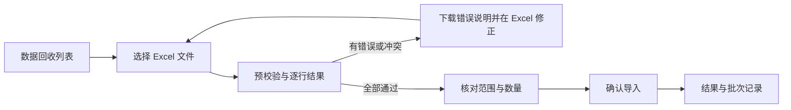

# 模块 01：批次录入页面流程与交互草案

版本：0.1 · 2026-10-15；状态：方案讨论，尚未确认；已生成独立低保真原型，正式业务功能尚未实现。

可点击原型、PDF 和页面截图见[原型说明](../prototypes/module01/README.md)。

依据：[模块需求](../requirements/01-camera-sites-and-retrieval.md)。已确认日常主工作方式为“先在 Excel 整理一个回收批次的多个位点，再批量导入”。以下页面组织为待审阅设计，不扩大已确认功能范围。

## 1. 页面组织

建议模块内保留两个主要入口：

| 入口 | 主要任务 | 辅助任务 |
|---|---|---|
| 数据回收 | 按一级区域、二级区域、回收批次查询周期记录；Excel 批量导入 | 少量手工补录、周期详情和已有记录纠错 |
| 相机位点 | 建档、位置与生境维护、停用/启用、位点 Excel 导入 | 查看单个位点的回收历史 |

数据回收页面将“Excel 导入”设为主要操作，“手工补录”为次要操作。不将复杂网页多行编辑器作为当前设计重点。

“批次”是组织现有相机周期记录的视角，不据此增加独立批次业务表、审核流程或进行中工作周期。YYYYMM 不是全平台唯一标识；跨区域可能有相同批次值，一批次内仍按相机保存独立记录。

## 2. Excel 导入主流程

建议使用四步流程：上传文件 → 预校验 → 确认导入 → 导入结果。错误留在预校验步骤处理，不以弹窗中的一句“失败”替代逐行反馈。

### 2.1 上传文件

- 提供“工作与回收周期”模板下载及文件选择。位点导入在位点页面使用独立模板，不混为一套字段。
- 模板保留一级区域、二级区域、位点编号、相机编号、回收批次及其他已确认字段。区域/批次来自文件，不用页面选项静默覆盖；同文件不同区域/批次仍按每行检查，避免缩小既定模板范围。
- 提醒先导入不存在的位点；周期导入不自动新建区域或位点。
- 一台相机一行；对拍按实际编号分别填，如 701A 和 701B，不自动假定两侧工作日期或回收状态相同。
- 不出现期末维护日期；所有现场日期仅到日；空卡或损坏文件仍填已回收并在备注说明。
- 编号与批次按文本保留前导零，固定选项和 20 字符限制与手工录入一致。

### 2.2 预校验

上方展示文件名、总行数及各处理类别数量；主体表格展示源 Excel 行号、完整区域路径、位点、相机、批次和结果。支持只看错误/冲突/重复行。

| 逐行结果 | 展示与处理 |
|---|---|
| 待新增 | 匹配正确且满足约束，可以纳入新增 |
| 重复跳过 | 同业务键、同内容，不重复建档 |
| 冲突/错误 | 字段错误、未知字典、归属不匹配、越权或同键不同内容；说明字段和原因，不自动覆盖 |

已确认整批有错不部分写入。有错时提供可下载的逐行错误说明，工作人员在 Excel 修正后重新上传；首版不在网页中复制完整表格编辑能力。

已有记录同键但不同内容时，引导有权人员查看原记录、按纠错流程处理，不通过重传文件覆盖原记录。错误结果不泄露无权访问的区域或坐标。

### 2.3 确认导入

明确显示本次涉及的一级/二级区域、批次、待新增数量和重复跳过数量。文件可涉及多个范围，不以单个顶部批次标签掩盖真实内容。

仅在全部通过后允许确认；若全部为重复，明确“无需新增”，不显示虚假的新增成功。确认后重新校验权限和并发冲突，新增与审计同事务，失败整批回滚。

提交期间防重复点击，显示处理中；通信中断时说明本次结果尚未确认，须查询结果或重新校验，不直接断言服务端未写入。业务唯一键防止重复提交产生重复事实。

### 2.4 导入结果

展示实际新增/跳过数量及处理范围，可下载处理结果并进入筛选后的回收记录列表。多个区域/批次要明确展示，保持用户授权边界。

导入成功不表示媒体已入库，也不证明影像可用。文件中没有出现的相机不变更，不能自动认定为未回收或丢失。

## 3. 查询、补录与纠错

数据回收列表按一级区域、二级区域、批次、位点/相机、回收状态和主异常筛选；返回列表保留原筛选和分页。

“手工补录”仍是一台相机一条周期，允许预填用户明确选择的区域、批次及共同信息，不默认复制另一台相机的实际工作日期。补录重复时查看已有记录，不覆盖。

从列表进入周期详情，更正已经保存的资料；已关联媒体的归属变更按专门纠错规则处理。导入页面与编辑页面分工明确，不另加审核流程。

停用位点默认不在常规补录候选中显示；从历史补录入口明确选择时提示已停用，保留历史补录能力。

## 4. 交互状态与后续设计

加载、无记录、筛选无结果、无权限、文件不合法、校验不通过、提交中、结果待确认及成功分别表达。错误定位到源行和字段，不仅用颜色区分。

未确认的文件或输入离开时提醒；不将预校验页面称为已入库。不默认承诺刷新恢复、跨天保存服务器草稿或将敏感内容写入浏览器长期存储。

后续低保真原型优先验证“数据回收列表 + Excel 四步导入”，再补位点列表/详情及单条周期纠错。交互规则参见[规范草案](interaction-guidelines-v0_1.md)。原型使用标记清楚的示例数据，不调用正式导入 API，不计为业务功能已实现。
